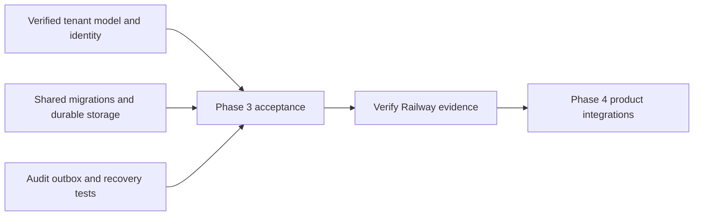

This review applies the Phase 3 scope in [[implementation-phases]] to the locked
[[design/decisions]] and the acceptance criteria in #33, #34, #52 and the
persistence portion of #46.

## Foundation gates

| Gate | Verified behavior | Evidence |
| --- | --- | --- |
| Tenant model and delegation | Both compilers produce the same mappings and hashes. Ledger and Support use separate stores and permission sets. A stale role tuple grants no access after membership removal. The ordinary delegation model denies owner grants, including the custom owner role. | [[phase-3-tenant-model]], [[phase-3-delegation]], [[phase-3-model-binding]] |
| Trusted configuration and verified identity | Startup pins the issuer, audience and OpenFGA model. Maintained JWT libraries validate token signatures and expiry. Authoritative token and user checks enforce freshness, handle key rotation and outages, and propagate cancellation. Both SDKs verified live active, disabled and deleted identity cases. | [[phase-3-runtime-configuration]], [[phase-3-token-verification]], [[phase-3-identity-freshness]], [[phase-3-postgres-runtime]] |
| Shared migrations and compatibility | Session-only install excludes managed tables. Deployment commands serialize installation, refuse drift and incompatible versions, and recover from confirmed commit-response loss. The Railway CLI verified ordered upgrades through audit v5 with managed v1, restricted status and denied activation. | [[phase-3-managed-migrations]], [[phase-3-migration-runner]], [[phase-3-retirement-marker-scale]] |
| Encrypted storage and identity invalidation | TS and Go read each other's records. Scope, expiry, revision non-reuse, CAS races and identity-bound invalidation are tested. Both SDKs meter encryption against a shared ledger, refuse retired keys and recover using fresh keys in an isolated restore. | [[phase-3-postgres-records]], [[phase-3-identity-sessions]], [[phase-3-session-version-invalidation]], [[phase-3-metered-records]], [[phase-3-key-rotation-restore]] |
| Managed transactional persistence | Both SDKs verify workspace and candidate reads, concurrent create, generation and membership revision races, rollback of local audit and state changes, and preservation of blocked state after an uncertain dispatch. Candidate repair publishes explicit observations against the original revision. | [[phase-3-retained-operations]], [[phase-3-retained-managed-reads]], [[phase-3-candidate-repair]], [[phase-3-operation-scans]] |
| Audit append and crash recovery | Both SDKs preserve identical receipts and routing, commit requests before evaluation and results before release, and fail closed on local audit failure. Pending recovery reserves capacity, survives process death and preserves unknown outcomes. | [[phase-3-audit-persistence]], [[phase-3-audited-decisions]], [[phase-3-audited-authentication]], [[phase-3-recovery-process-restart]], [[phase-3-retained-recovery]] |
| Retention and outbox | Hard caps preserve recovery capacity. Holds protect full decision groups. Both SDKs gate outbox mutations on migration readiness and preserve event IDs when requeueing. The operator can persist a bounded retirement page with its configuration-bound continuation. | [[phase-3-public-capacity]], [[phase-3-atomic-holds]], [[phase-3-retirement-races]], [[phase-3-retained-outbox]], [[phase-3-retirement-scheduling]] |
| Cleanup, export and restore | Bounded expiry cleanup preserves live sessions and identity denials. Restricted readers export allowlisted metadata, and audited inventory uses one snapshot. The PostgreSQL restore drill keeps runtime access closed and preserves pending decisions, retry holds, receipts and uncertain operations. | [[phase-3-record-cleanup]], [[phase-3-managed-inventory]], [[phase-3-retained-storage-restore]] |
| Connection bounds | The Go connector caps connection establishment, including stalled startup. Runtime adapters preserve caller cancellation and bounded service calls. Caller-owned pools must satisfy the same connection bounds. | [[phase-3-go-connection-deadlines]], [[phase-3-public-runtime]] |

## Cross-phase acceptance

- **Phase 4** must exercise fabricated-principal refusal on the public
  authorization boundary (#34), browser session lifecycles and the full audited
  check, role and discovery paths in both reference products.
- **Phase 5** must enforce delegation and owner assignment through actual
  provisioning and administration (#33). It must verify OpenFGA outcome
  reconciliation, complete candidate rebuild with durable checkpoints, and
  product-scheduled managed maintenance. Uncertain dispatch remains quarantined
  until verified quiescence.
- **Phase 6** must implement strict tenant SAML/OIDC, SCIM reconciliation,
  configurable audit and SIEM transport (#46). The delivery worker must prove
  outage, retry and duplicate acknowledgement behavior. Operator replay must
  compose the gated requeue storage action with authorization.
- **Phase 7** must qualify coordinated provider and application restore before
  reopening runtime access (#52), mixed-version deployments, production-size
  performance and clean installs. The local restore drill and the synthetic
  index measurements establish specific storage behaviors.

## Verification record

The foundation code was tested at `dedb0fdff6cb92fc69d4946ffaf28240c96a462c`.
GitHub push and PR checks 43437999956 and 43438013063 passed for that source.
The managed-storage harness was rerun with the isolation fix included in this
acceptance record. Its first run found that readiness tests changed shared
metadata concurrently with unrelated operation tests. Running the readiness
matrix separately resolved the interference.

| Command | Passing run |
| --- | --- |
| `python3 tests/integration/managed-schema.py` | `28e308ad025f41aa830c6bdcee069594` |
| `python3 tests/integration/key-rotation.py` | `heimdall-key-rotation-ed29606f404c409c9f2d5d85e2a97756` |
| `python3 tests/integration/audit-capacity-backfill.py` | `heimdall-capacity-backfill-f5c168876847457cbffb6ffff0d444bd` |
| `HEIMDALL_PROBE_DURABLE_RUNTIME=1 HEIMDALL_PROBE_SDK_STATUS=1 python3 tests/integration/postgres-records.py` | `heimdall-records-a04f7195205d4df2ba6291cdd6b6e22c` and provider run `2a53ea90-cc7c-446d-9dbf-10404064f3f7` |
| `python3 tests/integration/migration-runner-railway.py --execute-verification-migration` | `bad849815ccc46d8be8c1fec03d929fc`, Railway PostgreSQL deployment `574c0fb1-1252-41cb-a02b-7f3fdd74c18b` |
| `HEIMDALL_PROBE_MODEL_BINDING=1 node tests/integration/tenant-model.mjs` | `2a0f46f5-320d-49dd-ab64-5d9e5ce139bd`, 1,094 OpenFGA checks and six SDK binding cases |

The provider probes used the dedicated Railway ZITADEL and OpenFGA deployments
`7ef5c76d-4911-4326-97dc-50d5614f2a55` and
`cfd87a9f-da43-493c-b659-72ce4a5ba98e`. The combined live run used local
PostgreSQL 17.11 with a restricted role, verified 12 audit v5 records and
matching outbox rows, and exercised six active/disabled/deleted identity cases
in both languages. The sanitized result is
`tests/integration/evidence/phase-3-acceptance-2026-11-13.json`.

The foundation gates passed. Railway publication of this acceptance record is
the final gate before Phase 4. The linked issues retain their cross-phase criteria.
