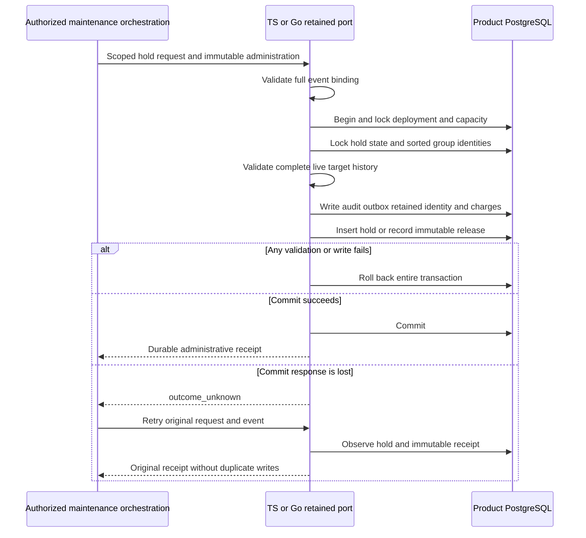

The internal retained runtime ports now apply administrative and retry-purpose holds
in both languages: TS `applyHold` and Go `ApplyHold`. They use the exact binding in
[[phase-3-hold-administration]]. Authenticated scope authorization and trusted
policy/time selection still belong to the orchestration layer.

New transitions read at most three bounded group members and refuse malformed or
inconsistent history. A terminal-member hold protects the complete decision. Missing
or retired targets cannot acquire a new hold. The port validates primary v4
readiness before returning even an exact retry. No migration runs implicitly.

The hold row, administrative event, outbox, retained identity and both capacity
ledgers commit together. A retry after release cannot reactivate a hold. Changing
scope, target, purpose, actor or timestamp conflicts rather than altering history.
Independent hold IDs remain independent. An unknown COMMIT is resolved through the
same immutable request from a healthy connection, including the other SDK.

## Verification

Live run `heimdall-capacity-backfill-6bf58dbe08ed48ca84bd0766652239e2` passed the
complete capacity/retention regression suite and the new base hold profile. While
that run continued, the added fault, group and readiness blocks were executed
separately against isolated clones inside the same owned PostgreSQL container;
all passed. These blocks are now included in the reproducible harness
`tests/integration/audit-capacity-backfill.py`.

The live checks cover acquire/release, stable exact retries, acquire-after-release,
changed actor/purpose/tenant/target/time, missing holds/targets, late SQL rollback,
independent retry holds, cancellation and reciprocal receipts. Lost COMMIT was
injected for both operations in both languages; the other SDK retried without
changing a full storage/accounting snapshot. Concurrent TS/Go calls produced one
hold and the expected seven total event/identity records per seeded product.
A terminal hold protected its completed decision; corrupt sibling history refused
without writes. Legacy and read-only admission also refused without writes.

The final workspace gate passed: 1,706 TypeScript tests, 124 environment-dependent
skips, Go race tests, lint/type/package checks and 195 parsed Mermaid diagrams.
The live database runs provide the separate evidence for the skipped persistence
test. Shared vectors are in `contracts/fixtures/audit-hold-storage.json`.
The harness used private disk-backed host storage because Docker's data disk was
nearly full; its owned container and temporary data directory were removed.

## Remaining gates

The port is internal. Actor authentication/authorization, configured policy lookup,
release-obligation evidence, bounded maintenance scheduling and retirement remain
open. This does not enable a public purge or hold API.

A release does not allocate another hold row, but its mandatory new audit event
still consumes payload/outbox and retained-identity capacity. The port fails closed
when that capacity is exhausted. Safe release at a completely full store needs a
reserved audit budget or another tested solution before Phase 3 acceptance. The
older SQL proof with a pre-existing administration reference does not prove this
runtime property. See [[phase-3-readiness-audit]].

## Prepared release reservations

The next storage extension adds one durable release reservation per active hold.
It uses the same logical quotas as existing audit writes and keeps decision recovery
reservations separate. The hold row and its reservation record fit within the
existing hold metadata slot. The release event reserves its own identity slot.

The SQL in `contracts/persistence/session/0005-hold-release-reservations.sql`
adopts existing holds transactionally. The quota triggers protect the reservation
during ordinary writes and limit changes. A deferred constraint binds consumption
to the same hold's recorded release and preserves the reserve if the transaction
rolls back. Ordinary writer credentials cannot update the aggregate reserve count.

The pinned PostgreSQL profile in run
`heimdall-capacity-backfill-1c3e7c681bbf47a0a5b84c9348f43ad6`
adopted two active holds and two released holds.
It rejected preparation without headroom and verified that failed preparation
left no reservation table. Reducing any of the five exact-fit limits by one failed.
Rollback preserved the active count, and the deferred constraint rejected
reservation consumption without a corresponding release. Separate probes on
the same clone showed that a legacy audit charge and a hold release without
consumption both roll back.

This checkpoint prepares the physical schema. Explicit migration publication and
TS/Go consumption of the reservation during an authorized release remain open.

## Explicit reservation preparation

Run `heimdall-migrate --prepare-hold-release-upgrade --writers-drained
--sql-directory contracts/persistence/session` with the migration database
connection configured. The command pins the SQL and both PostgreSQL catalogs,
takes the deployment writer lock, and installs the reserve and marks v4
`migrating` in one transaction. Keep writers drained through activation.
Ordinary and managed v4 readiness reject the prepared database.

The focused CLI profile ran on an isolated clone inside the pinned PostgreSQL
run `heimdall-capacity-backfill-704a47fa7efb4d83ba387f3be999d91a`. It checked
argument validation, read-only refusal, rollback when quota is insufficient,
and retry after an injected lost commit response. A retry preserved existing
reservations and refused aggregate count or schema drift. Activation and runtime
reservation consumption remain pending.

## v5 activation and release at quota

The deployment command `heimdall-migrate --activate-hold-release-upgrade
--writers-drained` validates the prepared catalog, reserve ledger and indexed
hold bindings before atomically publishing the v5 checksum and compatibility
ranges. Exact status checks are available as `audit-v5` and `managed-v5`.
Current SDKs accept v4 and v5. On v5, the release transaction consumes the
matching scoped reservation before it charges the audit event.

Pinned PostgreSQL run `heimdall-capacity-backfill-3669566233894202a116e46068073cfb`
verified activation and its lost commit retry, exact-fit hold acquisition in
both SDKs, and one-unit overflow refusal in each of the five quota dimensions.
Ordinary new writes were refused at quota while either SDK could release a hold.
A late constraint failure rolled back reservation consumption and the audit.
After each injected lost release commit response, the other SDK obtained the
original receipt without another write. The existing decision recovery reserves
were preserved throughout. The public storage factories also passed their
decision reservation tests on v5.

A separate concurrency probe on the exact-fit clone ran the same release in
both languages simultaneously and observed a single audit charge. That probe is
included in the reproducible harness. Authorization and scheduling of maintenance
operations and audited payload retirement remain open.
