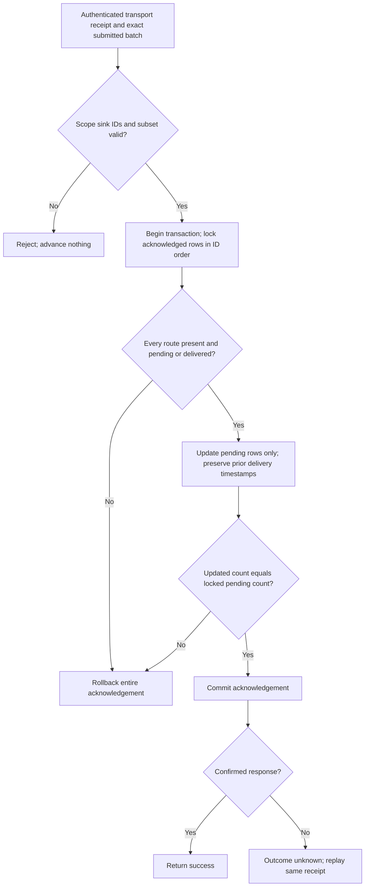

Both internal PostgreSQL audit stores now persist validated delivery acknowledgements atomically. This extends [[phase-3-audit-persistence]] and advances #46/#52. It does not yet send events to a SIEM or authenticate a remote receiver.

The transport layer must validate the full wire schema and receiver identity before calling this internal operation. Storage repeats the normalized scope, sink, size, uniqueness and subset checks. A malformed trusted batch is invalid_argument; an invalid receipt is unavailable. Neither changes rows. Delivery time is recorded from the local clock rather than accepting an arbitrary sink timestamp.

Every acknowledged row must exist for the exact product/environment/sink. Quarantined rows reject the whole acknowledgement; this path cannot silently clear quarantine. Unacknowledged IDs and other sinks remain pending. Replays preserve the original delivery timestamp. The update count is checked before commit, and no receipt operation changes immutable event payloads or creates a missing route.

## Live proof

Pinned PostgreSQL 17.11 run `heimdall-records-5d8671a05e1e486bbcfe111cacdf3a85` exercised both SDKs against the shared delivery fixtures:

| Scenario | Observed result |
| --- | --- |
| Full, reordered and partial receipts | Exactly acknowledged IDs advance |
| Wrong product/environment/sink, unknown ID, empty or duplicate receipt | No rows advance |
| Duplicate submitted batch | Rejected before transaction |
| Different sink for the same events | Remains pending |
| Acknowledgement includes quarantined or missing row | Entire operation rejects; existing pending row unchanged |
| Eight concurrent retries | All complete; no duplicate transition or deadlock |
| Later replay with newer local time | First delivery timestamp retained |
| Delivery-only role | SELECT/UPDATE on delivery table suffices; no event write privileges needed |

A PostgreSQL wire proxy then observed a successful server COMMIT and dropped all response frames for a partial acknowledgement in each language. Both returned outcome_unknown. Direct reads **before retry** found one delivered row and one pending row. Retrying the same receipt succeeded, preserving both the timestamp and the unacknowledged row.

The complete harness reran migration, readiness, record, append, Unicode and cross-language tests and removed its disposable database container. Its readiness probe now checks TCP, avoiding PostgreSQL's temporary Unix-socket-only initialization server. No production service configuration changed.

## Remaining work

Pending-event selection, authenticated HTTPS delivery, retry/backoff/quarantine scheduling, storage limits, retention, exporter authorization and receiver integration remain open. The primitive assumes a trusted internal caller supplies the actual submitted batch and authenticated receipt; it is not a public endpoint for marking arbitrary events delivered. Phase 3 remains in progress.
