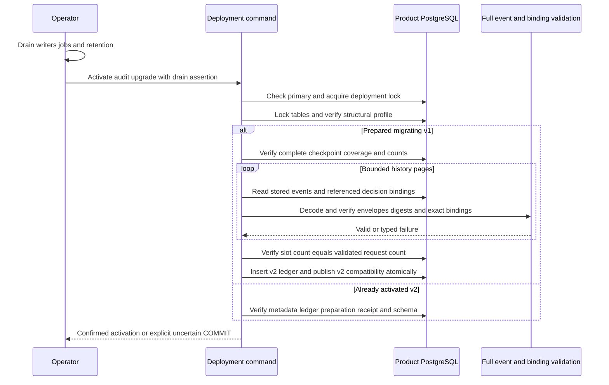

The deployment command can now validate backfilled history and atomically publish
v2 compatibility. Both SDKs have an explicit internal v2 readiness checker, while
legacy v1 checks refuse activated storage. Public factory wiring remains a separate
unfinished gate: this is not yet a serving-product upgrade recommendation.

## Activation data flow

Run `heimdall-migrate --activate-audit-upgrade --writers-drained`, with the existing
HEIMDALL_MIGRATION_DATABASE_URL. `--status audit-v2` checks the new protocol;
`--status session` continues to check v1 and refuses activated v2. The current CLI
validator refuses custom history until a matching product registry can be supplied.
Preparation and backfill remain explicit preceding commands.

Activation holds table locks across final history validation and metadata COMMIT.
It verifies full event schemas, ha1 wrappers, digests, indexed bindings, original
request/terminal context, timestamps and resolution. A request must have its exact
slot, a completion must be its selected terminal, and no extra slot is allowed.
This catches unchanged-count corruption that checkpoint counts alone cannot catch.
It neither reruns authorization nor fabricates administration for imported unknown
outcomes. Events and outbox entries remain unchanged.

The ledger gains the pinned session/0002.sql checksum; database version and exact
reader/writer ranges become 2. Readiness and ledger are committed together.
An uncertain COMMIT can be retried by inspecting committed state; repeated
activation retains the original migration timestamp. A ready-v2 retry does not
rerun old backfill counts after legitimate new v2 events arrive.

## Executed proof

`tests/integration/audit-activation.py` passed on PostgreSQL 17.11, pinned image
`sha256:3540c0362c809df084ffac0ae69fe794515f9de92692f02178bcdce0ef0302ac`.
Run: `heimdall-activation-2c1011f05d92431794f5386e05ff6c0a`.

- Two products across production and staging: 136 historical events, eight slots;
  120 large events force count and byte-limited pagination. Every event was seen.
- Five corruption cases fail: missing slots, unchanged-count digest corruption,
  extra slots, wrong request timestamps and wrong terminal bindings.
- Incomplete backfill or a persisted missing slot leaves migrating v1 metadata
  and the one-entry ledger unchanged.
- Cancellation during history validation and lock waiting preserves failure and
  permits connection reuse. Read-only activation/readiness is refused.
- Four concurrent activators succeed through serialization and inspected retries.
- TS and Go agree on ready-v2, migrating, old-protocol, missing/altered/extra-ledger
  and future-version cases. Legacy checks reject activated v2.
- A proxy commits activation then drops the response. Retry observes ready v2 and
  retains the original migration timestamp.
- The actual CLI requires the drain assertion, supports stable retry and explicit
  v2 status. One additional post-activation event does not invalidate inspected retry.

The full workspace gate passed: 1,533 TypeScript tests, Go race tests,
format/lint/type/dependency checks, SDK/package-consumer verification, Quartz
build and 141 Mermaid parses. The preparation/backfill CLI regression also passed
as `heimdall-coordinate-763562a00d0040718bcc218e5aa86d1e`, retaining count-drift,
corrupt-history, custom-history and committed-response-loss refusal/recovery.

## Limits and next gate

Pages contain at most 100 events and 4 MiB of encoded event JSON, plus routing
framing and bounded referenced request/terminal loads. The whole activation has a
30-second deadline, five-second lock wait and 20-second statement limit. The final
scan is not checkpoint-resumable. Larger histories that exceed the deadline cannot
activate through this command yet; scale qualification and any necessary resumable
verification design remain release work. This test is not a throughput claim.

Public PostgreSQL storage factories and managed combined readiness still use v1;
wire and verify decision-aware v2 storage before serving an activated database.
Neither this publication nor metadata activation completes capacity/retention,
custom registry integration, operational qualification or Phase 3 acceptance.
See [[phase-3-readiness-audit]].
