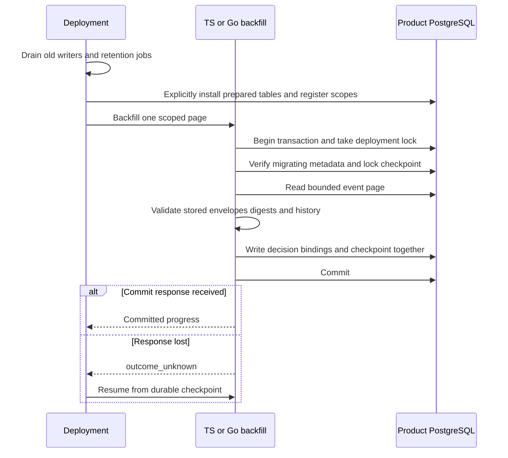
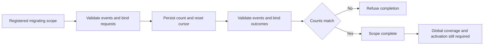

Both SDKs now implement internal, deployment-only backfill pages for the
[[phase-3-audit-recovery-schema|prepared decision-resolution schema]], using
[[phase-3-audit-decision-binding|the shared history validator]]. This is a storage
upgrade foundation, not activation of recovery or completion of Phase 3.

## Data flow and restart boundary

The first pass creates pending request slots; the second binds outcomes. Event IDs
need not be chronological: the shared fixture deliberately sorts a terminal before
its request. Both passes validate all events in the selected scope. Invalid,
ambiguous or orphan history rolls back the entire page and checkpoint.

Pages use C-collated event-ID cursors, a 1–100 count limit, a 4 MiB stored-JSON
budget and a five-second deadline. A byte-limited short page advances only through
its processed prefix. An oversized first row fails explicitly. Empty scopes pass
through both phases. Read-only connections, ready metadata and unregistered scopes
are refused. Checkpoint and decision writes commit together; source events and
outbox deliveries remain intact.

## Executed proof

`tests/integration/audit-backfill.py` passed on disposable PostgreSQL 17.11 pinned
to `sha256:3540c0362c809df084ffac0ae69fe794515f9de92692f02178bcdce0ef0302ac`.
Recorded run: `heimdall-backfill-55ca183660c3491a91a916e4e2f8e4f8`.

The harness runs the TypeScript tests and Go tests with the race detector, including:

- Identical shared progress vectors; each language resumes the other's checkpoint.
- Reversed request/terminal sort order, Unicode/NUL identity and pending history.
- Duplicate requests, orphan outcomes, changed permissions and multiple terminals;
  neither partial slots nor cursor movement escape a failed page.
- Corrupt digests, read-only/ready state and missing registration refusal.
- Empty scopes, source-count drift refusal and actual byte-limited short pages.
- Cancellation during a held advisory lock, followed by successful pool reuse.
- Eight concurrent callers serialized through durable progress.
- Confirmed COMMIT followed by a dropped response in both languages; the next call
  resumes the committed checkpoint without duplicating the first pass.

The database remains migrating with only the v1 migration ledger entry after the
proof. The fixtures pin both prepared SQL files, and the offline suite checks
those hashes. This is a local PostgreSQL storage proof; Railway publishes the
reviewable evidence, not an activated production database upgrade.

## Remaining gates

The deployment coordinator must still register and verify all scopes, inspect
prepared-schema integrity, enforce old-writer quiescence and publish compatible v2
readiness. Count agreement is not a writer fence or snapshot proof. The method
requires a full event validator; custom product registry integration is not proven
by these built-in-event fixtures. Runtime request/terminal atomicity, recovery
scanning, late-allow suppression and capacity enforcement remain open.

The migration CLI and serving runtime continue to support v1 only.
[[phase-3-readiness-audit]] remains the acceptance checklist.
