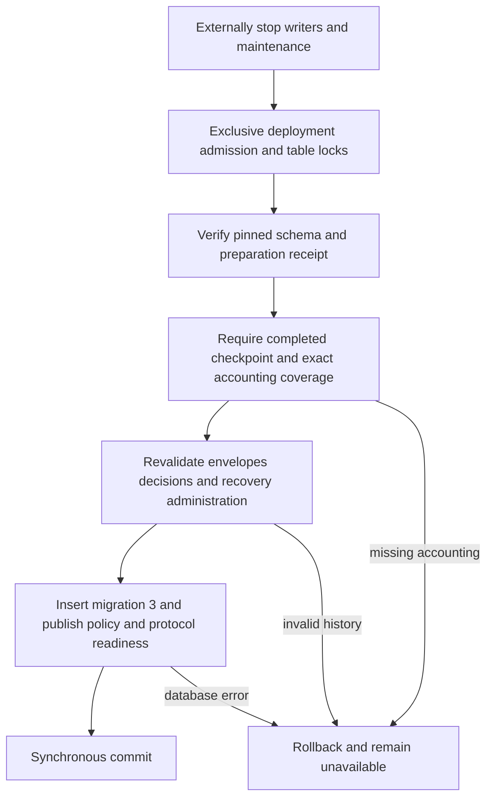
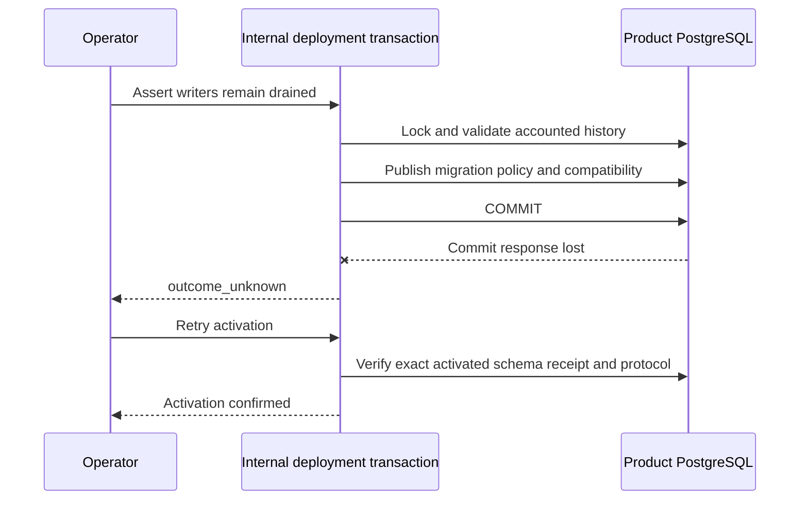

This checkpoint adds the deployment transaction that activates an accounted audit
capacity ledger. It is internal, not yet exposed as a supported CLI upgrade or
composed into public TS/Go storage factories. Phase 3 remains incomplete. The subsequent
[[phase-3-capacity-v3-deployment]] checkpoint adds CLI and readiness support; public
serving composition remains outstanding.

## Transaction and data flow

`ActivateAuditCapacityUpgrade` verifies accounting before calling the shared
bounded history readers. It cannot silently repair missing charges or reservations.
The scan uses local progress and preserves the original durable backfill
checkpoint. Only complete validation permits one transaction to insert migration
3, set capacity policy `ready`, and publish database/reader/writer version 3.

A retry after successful activation does not compare historical checkpoint counts
with later legitimate audit writes. It still verifies the exact schema, receipts,
policy limits, completed checkpoint shape and v3 protocol. Public v2 factories
reject the resulting version; this is not a supported live upgrade until the
remaining runtime and deployment composition is complete.

## Verification and limits

The extended `tests/integration/audit-capacity-backfill.py` exercises real mixed
TS/Go history on pinned PostgreSQL 17.11. It verifies successful activation,
rejection of incomplete accounting, corrupt stored digests, missing charges and
schema drift, a rejecting semantic validator, confirmed COMMIT-response loss,
and retries after a new capacity-accounted event. A restricted deployment role
cannot update compatibility metadata; this publication failure must leave no
migration 3 and keep the policy preparing.

Live run `heimdall-capacity-backfill-71718318c0ac4c56889039dfcf68dc07`
passed on November 12, 2026; its disposable container was removed.

The complete workspace check passes, including Go race tests, TypeScript tests,
package consumer validation, Quartz build and Mermaid syntax validation.

This is a 30-second, non-resumable full validation transaction with bounded page
payloads; it is not large-history performance qualification. External quiescence
is mandatory. CLI exposure, shared v3 readiness/catalog declarations, public
TS/Go capacity composition, authorized retention and operational qualification
remain open in [[phase-3-readiness-audit]].
