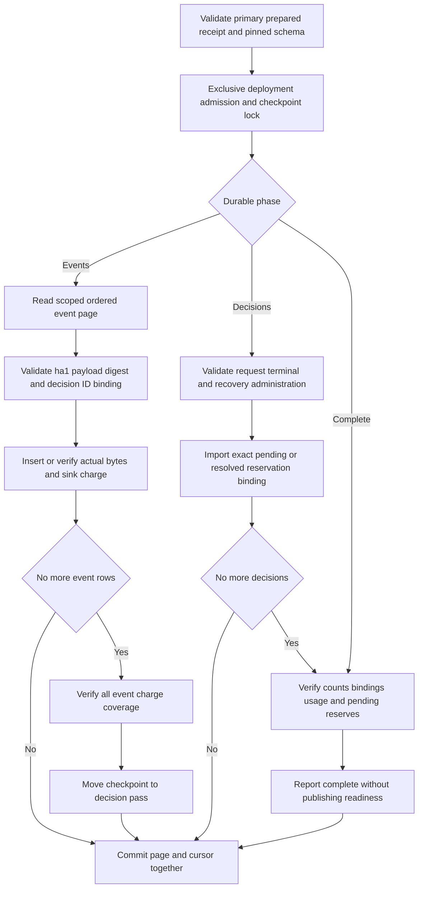
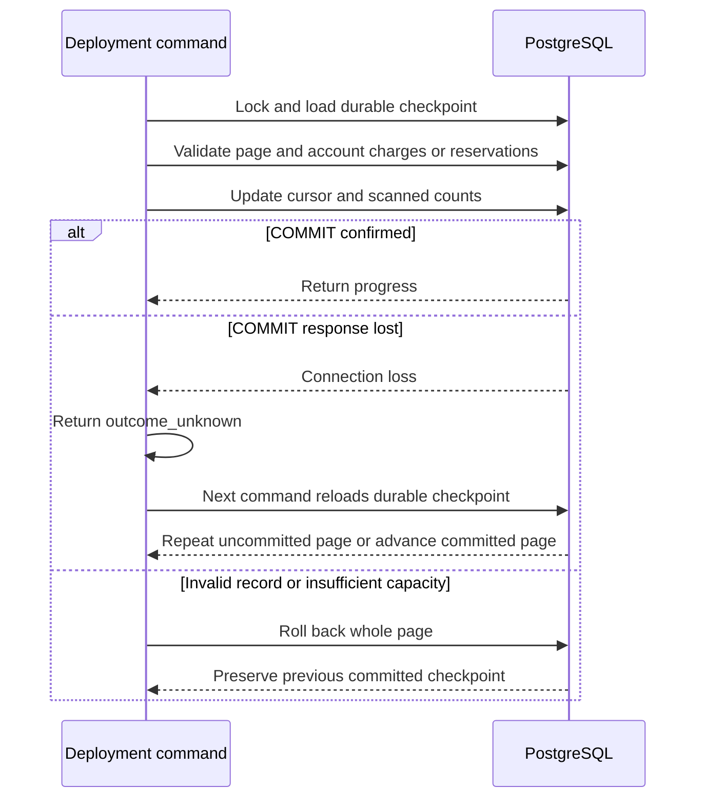

The deployment tool now accounts existing TS and Go audit history in bounded,
restartable pages. It validates events and decision/recovery bindings, preserves
original records and routing, and reserves future capacity only for pending
decisions. Completion is accounting coverage, not runtime activation. Phase 3
remains incomplete.

## Data flow and limits

Run `heimdall-migrate --backfill-capacity-upgrade --writers-drained --batch-size N`
against an explicitly prepared database. Each call advances one page; the batch
size is 1 through 100, with a default of 100. The deployment runner accepts the
product's full validator; the current CLI validates built-ins only, so custom
history is refused until registry selection exists. There is no wrapper service.

Events use a 4 MiB returned-envelope budget. Decision pages use 6 MiB, including a
conservative 1500000-byte allowance for each separately loaded recovery
administration event. A maximum three-event history fits in one decision page.
Both passes select at most 100 candidates; transport metadata is additional
memory. Pages use C collation on product, environment and record ID. A 10-second
operation deadline and 5-second lock/statement timeouts bound database work.

Every event is shape/semantics validated and digest checked. Authorization records
must refer to the slot's actual request/terminal. Decision pages validate the full
pair, timestamps and resolution; recovered decisions require the original,
deterministically identified administration record with matching tenant/decision
binding. A missing administration record is an error, not an invitation to create
history. No audit event or outbox routing is rewritten.

## Retry and failure behavior

Matching pre-existing charges/reservations do not consume capacity again.
Concurrent deployment commands serialize. Failure on a later record rolls back
all earlier changes within that page; previously committed pages remain intact.
An ambiguous command retry may return the next page's progress rather than the
lost response, because the checkpoint is authoritative.

At pass completion, actual rows, charges, sizes, sink counts, decision bindings and
aggregate counters must agree. A late legacy write or skipped cursor prevents
coverage completion. Final coverage scans also have a deadline; large-history
qualification remains open. All serving writers and mutation jobs must stay
stopped throughout the workflow.

Fresh preparation now checks configured limits against historical usage plus
pending recovery reservations before installing capacity tables or committing
migrating state. Undersized limits fail while original v2 readiness remains intact.
This preflight checks logical capacity, not event validity or physical free space.

## Live evidence

`tests/integration/audit-capacity-backfill.py` passed on disposable pinned
PostgreSQL 17.11 as
`heimdall-capacity-backfill-891d0f4400254cf98c0a492c6f32533a` on November 12, 2026.
The preparation regression and new sizing preflight passed as
`heimdall-capacity-upgrade-e18d8f7328ad491fa27b97a0e23c5392`.
Both containers were removed.

The shared fixtures and live suites prove:

- Mixed TS/Go history across Ledger/Support and production/staging, with pending,
  completed and recovered decisions and Unicode identities.
- Count and envelope-budget paging, including a 121-event dataset with enlarged targets and seven recovery
  histories spanning multiple decision pages.
- Eight concurrent CLI processes advance distinct durable pages without duplicates.
- Lost event-page and decision-page COMMIT responses resume without double charges
  or reservations.
- Corrupt digests, missing recovery administration, wrong timestamps, orphan
  requests, skipped cursors and incorrectly imported administration bindings fail
  without committing the failing page.
- Matching pre-accounted history is verified; insufficient capacity refuses pending
  imports without partial reservations.
- Late legacy writes prevent complete coverage; held-lock cancellation permits
  later reuse.
- Both SDKs remain unavailable while accounting is complete but not activated.
- In an isolated port-level continuation test, Go recovers an accounted TS request
  and TS recovers an accounted Go request. The harness enables only that test
  policy; it does not publish a public compatibility protocol.

Activation, public runtime composition, authorized retention and scale/restore
qualification remain open in [[phase-3-readiness-audit]]. See
[[phase-3-audit-capacity-upgrade]] for offline preparation and
[[phase-3-audit-capacity-writes]] for the internal runtime transaction path.
