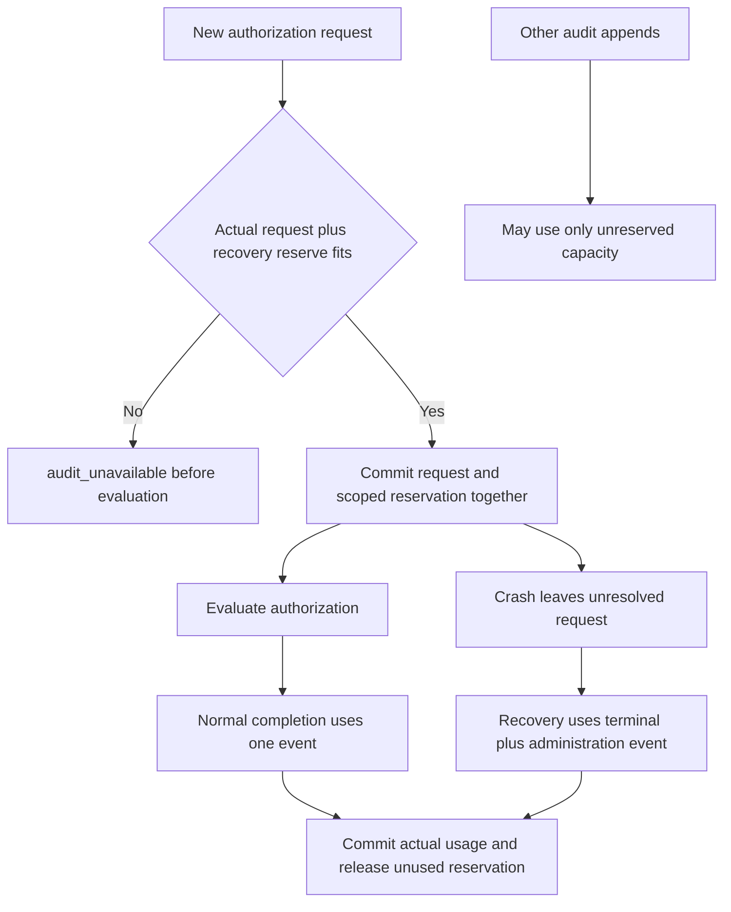

The TypeScript and Go SDKs now share executable arithmetic for audit admission and
reserved authorization outcomes. This checkpoint is a prerequisite for database
capacity enforcement, **not an implemented runtime limit**. PostgreSQL persistence,
upgrade/backfill, startup policy and public factory composition remain open.

## What a request must reserve

The existing audit store permits an encoded envelope of at most 1500000 bytes and
32 configured sink rows per event. Recovery needs two events: an unknown-outcome
terminal and its administration record. A new authorization request therefore
needs space for its actual event/outbox plus a reservation of two events, 3000000
envelope bytes and 64 delivery rows.

The pure functions enforce all three dimensions independently and fail closed for
corrupt counters, malformed reservations or insufficient capacity. They use exact
shared integer bounds and avoid addition overflow. Normal completion releases the
extra recovery allowance. Recovery can fit at full admission because new ordinary
work cannot borrow its reserved capacity.

This reserves the worst supported recovery pair even for small requests or empty
sink lists. That costs concurrency/storage headroom but avoids claiming a smaller
reservation will cover a later larger terminal. Changing the bound requires a
versioned policy for outstanding requests.

## What the tests establish

`contracts/fixtures/audit-capacity.json` supplies 24 shared scenarios. Both SDKs
exercise exact limits, insufficient capacity in each dimension, terminal/recovery
charges, missing/partial reservations, corrupt state and the interoperable maximum
integer. TS also rejects nonfinite/fractional inputs and verifies that transitions
do not mutate their inputs. `contracts/audit-capacity.md` specifies the transition
semantics and the required atomic persistence composition.

Logical envelope bytes mean PostgreSQL's encoded JSONB text byte count. They do not
bound physical table/index space, WAL or replication. Operators still need physical
headroom and storage alerts; a reservation is not a promise that a failing disk can
persist a terminal event.

## Remaining enforcement work

The database must bind reservations to individual scoped decisions, deduplicate
before charging, serialize admission, and commit counters with events/outbox/slot
changes. A complete upgrade must account for historical usage and unresolved
requests before enabling the new runtime protocol. Retention must release usage
only after delivery, hold, recovery and retry obligations permit deletion.

The existing public audit factory does not call this calculator yet. Pure arithmetic
cannot prevent cross-replica oversubscription or make a counter update durable.
Managed mutation reservations, live concurrency/rollback/COMMIT-loss proof, retention
and full restore remain open in [[phase-3-readiness-audit]].
