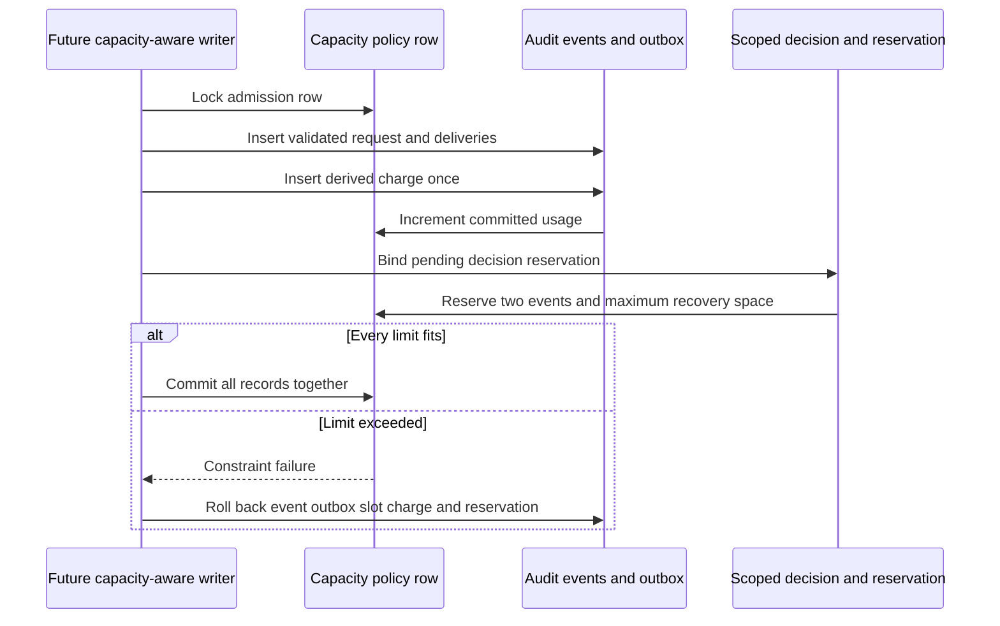

The prepared PostgreSQL schema now implements physical charges and scoped decision
reservations for [[phase-3-audit-capacity-contract]]. It is not installed by runtime
constructors, is not activated in the migration catalog, and is not used by the
public audit factory yet. Phase 3 remains incomplete.

## Physical transaction boundary

One policy row bounds event count, JSONB envelope bytes and delivery rows across
all products/environments in an audit database. This creates shared contention and
availability; it is not tenant quota isolation or a physical disk guarantee.

Charges derive bytes and sink count from stored rows. Accounting runs after a new
charge is inserted, so a duplicate `ON CONFLICT DO NOTHING` does not double-count.
Delivery insertion and charging serialize on the same policy row. A new sink is
refused after charging; delivery state changes remain supported. Runtime roles need
no permission to rewrite audit history.

A reservation must match the scoped decision request and refer to its event charge.
Completion/recovery changes must match the decision slot. Deferred foreign keys
require charged terminal records and, for recovery, the administration record at
commit. This permits the transaction to release its reserved allowance before
charging the outcomes, while refusing an incomplete committed release. Resolved
bindings are immutable, no-op resolution retries do not release twice, and pending
reservations cannot be deleted.

## PostgreSQL proof

`tests/integration/audit-capacity-schema.py` uses disposable pinned PostgreSQL 17.11
and SQL bytes pinned by `contracts/fixtures/audit-capacity-schema.json`. Run
`heimdall-capacity-8d344efc23c9420e99709674fe9968da` passed on November 12,
2026. Both SDK
unit suites verify that checksum. The live checks cover:

- Rollback removes the entire prepared schema and its delivery trigger.
- Actual JSONB bytes and original sink rows determine charges.
- Duplicate charges preserve counters; resets, policy deletion, rebindings and
  late sink additions fail.
- Runtime credentials cannot delete charges/reservations, change limits or truncate.
- Full admission rejects ordinary append and rolls back its event/outbox.
- Missing terminal or recovery-administration charges fail at commit and restore
  the prior pending reservation and counters.
- Normal completion releases unused recovery allowance.
- Recovery with two 1500000-byte envelopes and 64 sink rows fits exactly inside its
  reserved capacity, even with no unreserved space left.
- Eight concurrent requests across two products admit exactly one under a
  three-event limit; losing transactions leave no events, decisions or charges.
- Normal completion racing recovery produces one winner without losing charges.
- Sink insertion racing charging is correct in either observed lock order: an
  earlier sink is included, or a later sink is refused.

These are routing/constraint fixtures, not fully validated SDK security events.
The test does not claim ha1 semantic validation, SDK admission or a supported
production upgrade from the prepared SQL alone.

## Remaining work

The SDK must validate and deduplicate complete events, bind reservation ownership,
and use one transaction for all mutations. Explicit drained upgrade/backfill must
account for existing history and pending decisions before a compatible runtime
protocol is enabled. Public startup and append need that protocol gate.

Charge deletion has a physical decrement trigger, but runtime roles cannot use it.
Authorized retention still needs delivery, hold, age, unresolved-decision and retry
validation before any purge. Legacy unaccounted writers can bypass this prepared
ledger until migration and runtime composition are complete. Capacity COMMIT-loss
recovery, managed mutation reservations and full-system restore remain open in
[[phase-3-readiness-audit]].
