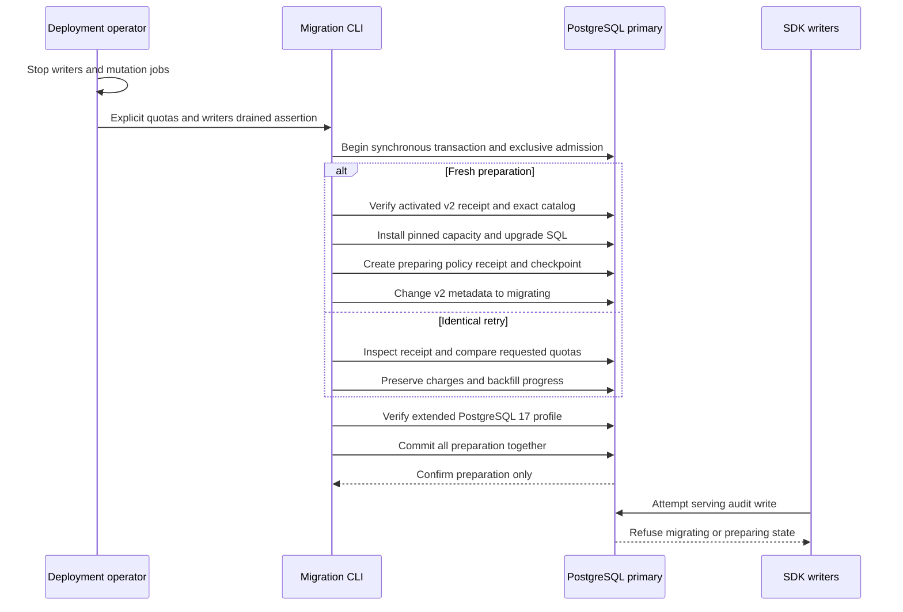
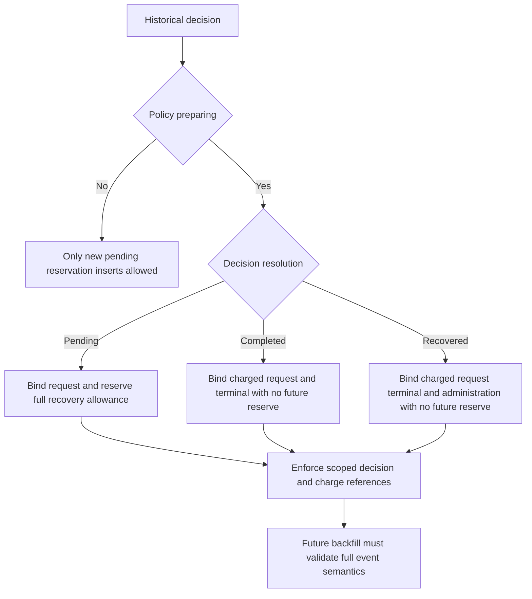

The deployment CLI now prepares the capacity ledger from a supported activated
v2 database. It preserves existing audit history and refuses serving writes until
historical accounting and activation are implemented. This is the preparation
stage, not a completed migration or Phase 3 acceptance.

## Deployment flow

`heimdall-migrate --prepare-capacity-upgrade` requires `--writers-drained`, the
shared `--sql-directory`, and explicit `--capacity-events`, `--capacity-bytes` and
`--capacity-deliveries` limits. It uses `HEIMDALL_MIGRATION_DATABASE_URL` and works
for deployments integrating either SDK. There is no wrapper service or runtime DDL.

All serving writers, retention and export mutation jobs must remain stopped. The
operator's drain assertion is not automatically proven by an advisory lock. This
command deliberately leaves the database unavailable for serving; the subsequent
backfill/activation stages are not implemented yet.

Both SQL files are checksum pinned. The old schema is verified before adding
foreign keys and triggers that change its signature. The new catalog profile
includes schema identity, relations, columns, constraints, indexes, trigger
functions and trigger enablement. Unexpected rules, row policies or inheritance
also fail comparison. The prepared receipt binds the original requested quotas;
a retry cannot resize or reset the ledger. Partially installed manual objects are
not adopted.

A failure before commit rolls back the entire addition and leaves original v2
readiness intact. If the confirmed COMMIT response is lost, the CLI returns
`outcome_unknown`; repeating the exact command inspects the durable receipt.
Preparation is bounded by a 30-second deadline, 5-second lock timeout and
20-second statement timeout. These are operation limits, not production scale
qualification.

## Importing historical decisions

The first prepared schema allowed only pending reservation inserts. Historical
completed/recovered decisions need their immutable bindings imported too, so later
retries can verify accounting without rewriting a decision through pending.
`0003-upgrade.sql` adds this capability without changing the old pinned SQL.

This is a physical import mechanism, not a semantic backfill runner. Every
historical payload, digest and request/terminal/administration relationship still
needs validation. Missing recovery administration must not be invented. The
prepared checkpoint has event and decision passes, a global scoped cursor and
scanned counts; creation of that row does not account history or certify coverage.

## Recorded proof

`tests/integration/audit-capacity-upgrade.py` passed against disposable pinned
PostgreSQL 17.11 as
`heimdall-capacity-upgrade-5cdb3ae4ecd541909a487fe650231e3c` on November 12, 2026.
The container was removed. The proof includes:

- Supported v2 initialization/preparation/backfill/activation as the starting state.
- Pending, completed and recovered audit history remains byte-for-byte unchanged.
- Pinned SQL and explicit quota validation before database I/O.
- Concurrent identical retries and preservation of a simulated partial backfill
  charge/checkpoint; changed requested quotas conflict.
- Eighteen catalog/metadata drift cases refused, including disabled accounting,
  removed charge references, row filtering, rewritten functions and early readiness.
- Resolved bindings import only while preparing and add no future reserve; pending
  bindings reserve two events and maximum recovery bytes/deliveries.
- Both TS and Go refuse their existing v2 and prepared capacity writer paths after
  preparation.
- Waiting on a held deployment lock respects cancellation and permits later retry.
- Actual CLI argument/read-only rejection, mid-DDL rollback, old-schema drift,
  partial manual schema rejection, and confirmed COMMIT-response loss/retry.

Historical accounting, complete coverage verification, activation, public runtime
composition and authorized retention remain open in [[phase-3-readiness-audit]].
See [[phase-3-audit-capacity-writes]] for the separate internal writer proof.
