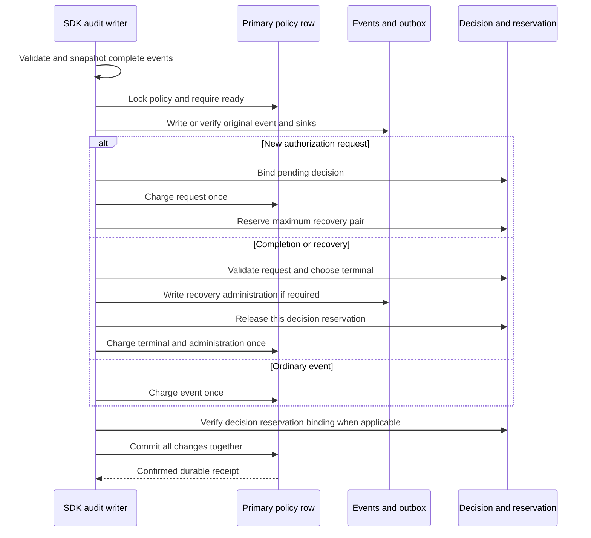
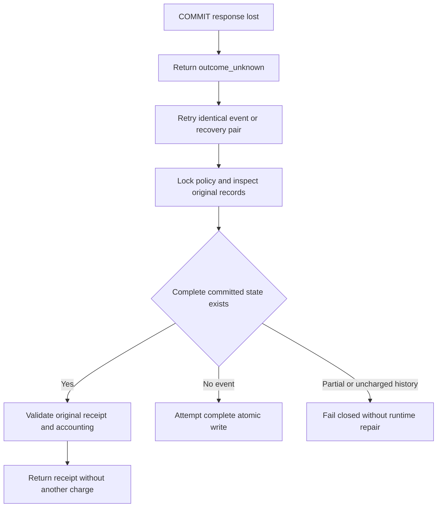

The internal TS and Go audit writers now compose the
[[phase-3-audit-capacity-schema|prepared physical ledger]] with full ha1 event
validation, decision binding and durable receipts. This is a tested persistence
foundation, not public activation. Phase 3 remains incomplete.

## Transaction and data flow

Both SDKs take shared deployment admission and then the capacity policy row lock
before any event, outbox or decision mutation. Every attempt requires a ready
policy on a writable primary. The database derives actual encoded bytes and sink
rows. A new authorization request reserves two events, 3000000 envelope bytes and
64 delivery rows for a possible recovery pair.

An exact retry checks the stored payload/digest, charge size, original sink count
and reservation binding. It never adds a destination or borrows another decision's
reservation. A changed payload or losing terminal remains a conflict. An existing
uncharged event or missing reservation fails closed; only deployment backfill may
repair historical accounting. A policy constraint failure returns
`audit_unavailable` and leaves no event, outbox, decision or charge from that attempt.

## Live proof

`tests/integration/audit-capacity-writes.py` runs both SDKs against disposable,
pinned PostgreSQL 17.11 with restricted runtime credentials. Both suites consume
`contracts/fixtures/audit-capacity-writes.json` and validate full security events,
including Unicode identity data. The isolated database fixture deliberately sets
an empty prepared policy ready; it does not exercise a supported upgrade.

Run `heimdall-capacity-writes-2e19a9bd28504af3a46d833a305e3e72` passed on
November 12, 2026. The existing record/audit/public-runtime regression also passed
as `heimdall-records-b657fcd75c0647758251753fa558f530`, covering the shared transaction
finalizer used by the new path. Both disposable containers were removed.

The suite checks:

- Request admission reserves recovery space; ordinary append cannot consume it.
- Independent byte and delivery limits refuse requests and roll back all rows.
- Normal completion releases unused reserve; recovery fits when admission is full.
- Duplicate requests, completions and recoveries preserve charges and receipts,
  including when configured sink names change.
- Changed payloads and late competing terminals remain conflicts.
- Eight simultaneous requests across two products admit exactly one under the
  three-event budget. Normal completion racing recovery produces one winner.
- Recovery administration sink failure rolls back the pair and preserves the
  pending decision/reservation.
- Preparing policy, uncharged legacy records and missing reservations fail closed.
- Confirmed COMMIT responses are dropped for ordinary, request, normal completion
  and recovery writes in each language. Identical retries do not double-charge.
- TS requests can be recovered by Go and Go requests by TS using original receipts.

## Release boundary

The public factory still uses its existing v2 audit path. These capacity methods
are internal preparation for a new compatible protocol. Drained historical
backfill, structural validation and activation must precede public composition;
setting a policy ready manually is not a deployment recipe. Legacy writers are
not fenced by the prepared ledger alone.

Authorized retention, managed mutation reservations, full-system restore and
operational/scale qualification remain open in [[phase-3-readiness-audit]]. The
logical budget does not guarantee physical disk space or PostgreSQL availability.
