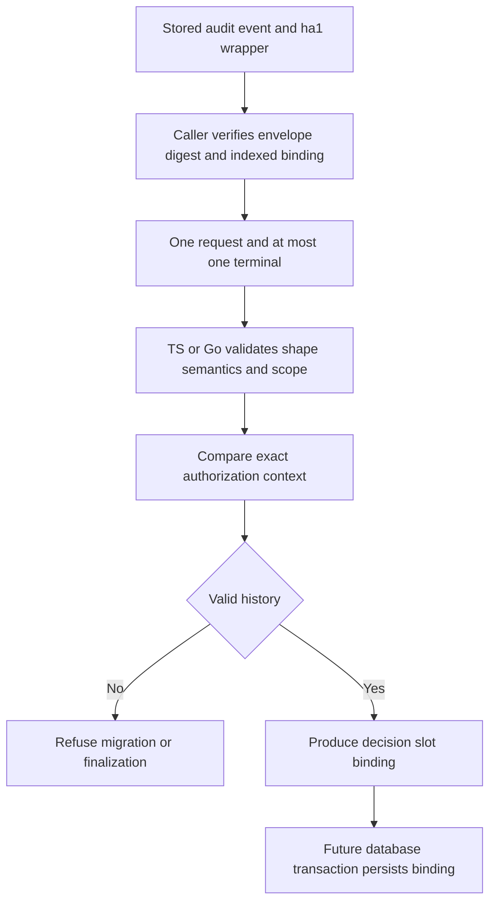

TypeScript and Go now share a validated request/outcome correlation boundary for
[[phase-3-audit-recovery-schema|the prepared decision-resolution schema]]. It is a
prerequisite for upgrade backfill and runtime finalization, not activation of
recovery or a completed database migration.

## Binding behavior

Each call accepts one requested authorization event and, optionally, one terminal
event. It checks event shape/semantics, fixed scope, identity and authorization
context, timestamps and distinct event IDs. Duplicate requests, ambiguous terminal
history, orphan outcomes and changed context fail closed with audit_unavailable.

The validator preserves tenant, actor, target/action/permission, correlation and
model/manifest/policy bindings. It permits a newer SDK version because that field
identifies the emitter. Event IDs, outcomes, timestamps and sanitized reason codes
have their own checks. Nested object ordering is canonical; Unicode and NUL in
identity fields retain exact bytes. Inputs remain unchanged.

The result is only IDs, times and a pending/completed/recovered classification.
It is not a durable receipt, proof of recovery administration, or authorization to
run protected work. Both languages emit the same JSON field names and value types.
The detailed contract is `contracts/audit-recovery.md`.

## Test evidence

`contracts/fixtures/audit-decision-binding.json` supplies 40 shared cases with
explicit expected bindings for valid histories. TypeScript runs 41 tests including
configured-scope validation; Go runs the same vectors with the race detector.
They cover all terminal outcomes, reversed event order, changed SDK version,
Unicode/NUL identity, equal recorded timestamps, reordered nested context,
wrong scope/actor/tenant/policy/model/correlation, missing fields, malformed events,
and ambiguous or orphan history. Both suites passed.

These are executable shared contract tests, not live migration or crash-recovery
proof. The stored ha1/digest check shown upstream in the diagram is a caller
requirement; this function accepts already-decoded events and cannot authenticate
a fabricated history on its own.

## Remaining implementation

The migration still needs a bounded, restartable scan/backfill with full coverage
verification, corruption refusal and an explicit old-writer drain. Both SDKs need
the atomic append/resolve paths and recovery scanner, including commit-loss and
late-allow suppression tests. The v1 migration catalog and runtime readiness remain
unchanged. [[phase-3-readiness-audit]] still records Phase 3 as incomplete.
