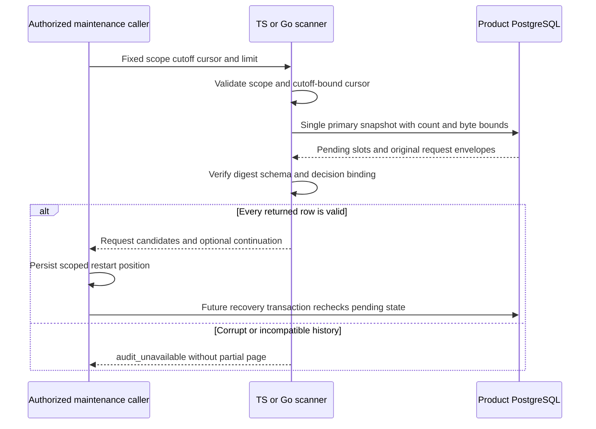

Both SDKs now expose internal maintenance pages of validated pending authorization
requests. This supplies candidates for the recovery writer still to be implemented;
it does not claim ownership, decide an outcome or activate the prepared v2 schema.
See [[phase-3-audit-decision-writes]] for transactional result selection.

## Data flow

The scanner orders by requested timestamp, then C-collated decision ID. Its cutoff
is inclusive; terminal slots and newer requests are excluded. Cursors carry
product, environment, cutoff and position. A changed scope/cutoff is rejected.
These are trusted maintenance objects, not signed tokens for an end-user API.
Request payloads require authorized maintenance access.

Each call has a five-second budget, a 1–100 result limit, one-record lookahead and
a 4 MiB encoded-row budget. Short byte-limited pages retain a continuation. Stored
ha1 wrappers, payload digests, full event validation and exact slot/request binding
must all pass, including any returned lookahead row. Read-only connections are
refused even when the queue is empty.

## Executed proof

`tests/integration/audit-decision-scan.py` passed on disposable PostgreSQL 17.11,
pinned to `sha256:3540c0362c809df084ffac0ae69fe794515f9de92692f02178bcdce0ef0302ac`.
Run: `heimdall-audit-scan-30c8eb719c404b44a33f509c7d1882b9`.

The TS suite and Go race-detector suite verify:

- Shared time/ID ordering, equal-time ties, count pagination and exact request data.
- Invalid scope/cutoff cursors, input bounds and cancellation before database use.
- Each SDK reads pending requests created by the other SDK.
- Terminal/future exclusion and an empty continuation after concurrent completion.
- Digest corruption and mismatched slot timestamps fail without a partial page.
- One hundred large valid requests produce real byte-limited pages and are all
  returned exactly once across that static scan.
- PostgreSQL rejects an attempted oversized stored event and the original row
  remains readable. Its 1.5 MB per-event cap prevents exercising the scanner's
  defensive oversized-first-row branch under the supported schema.
- Read-only empty scans fail; cancellation while a table lock blocks the query
  releases the connection and subsequent scans succeed.

This is local PostgreSQL storage proof. Railway publishes the evidence and data
flow, not a newly activated runtime or recovery scheduler.

## Snapshot and recovery limits

A page is not a lease. A candidate may be completed before a caller acts on it, so
finalization must lock and recheck the pending slot. A cutoff does not prove that
an evaluator died; aggressive recovery can make an active caller fail closed.
Separate pages use separate snapshots. Backdated requests inserted behind a cursor
are discovered by a later sweep from the beginning. Maintenance must retain its
scope/cutoff with the cursor and periodically restart sweeps.

The scanner neither evaluates permission again nor invents a historical result.
Recovery administration, upgrade activation, scheduling, capacity and retention
remain required. [[phase-3-readiness-audit]] still marks Phase 3 incomplete.
