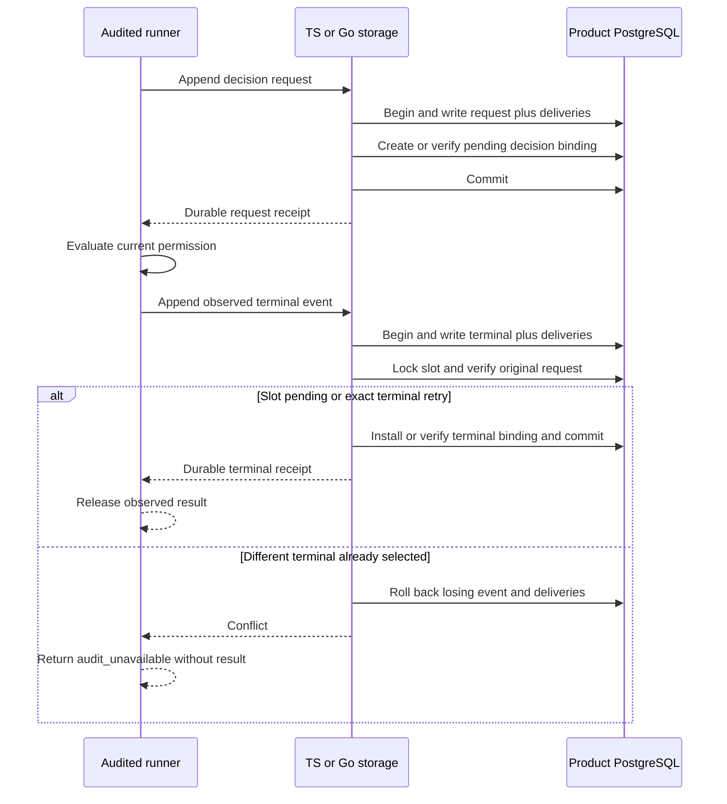

Both SDKs now have internal decision-aware request/completion writers for the
[[phase-3-audit-recovery-schema|prepared decision schema]]. They reuse the existing
audit transaction and [[phase-3-audit-decision-binding|shared history validation]].
The public factory still uses v1: these ports do not activate a database upgrade or
complete recovery administration.

## Transaction and data flow

An exact request or terminal retry returns the original receipt. A changed payload
or competing binding cannot obtain that receipt. Orphan completions, corrupt
stored requests and incompatible scope/context fail closed. Read-only connections
are refused. The Go shared append path checks connection mode before BeginTx to
avoid the driver overriding a default read-only setting.

The existing managed mutation callback still executes before event writes; the
new decision finalizer executes afterward. This preserves workspace-first managed
lock order. Normal decision completion rejects outcome_unknown: the future recovery
writer must include its administration audit atomically.

## Executed proof

Disposable PostgreSQL 17.11 run
`heimdall-decision-e00f075a0d4e4ea9b21a54278bfb8f3d` passed via
`tests/integration/audit-decision-writes.py`. Its image is pinned to
`sha256:3540c0362c809df084ffac0ae69fe794515f9de92692f02178bcdce0ef0302ac`.

- Shared fixtures cover all five normal terminal outcomes and context/timestamp
  mismatches in both languages.
- Eight concurrent identical requests converge on one request/slot/delivery.
  Eight competing terminals yield one winner; losing events and deliveries vanish.
- Exact retry after completion preserves the original request and terminal receipts.
- Orphan, conflicting request and corrupt-request cases leave no partial writes.
- Injected request outbox failure leaves no event or slot. Terminal outbox failure
  retains the pending slot and request only.
- TS creates a request that Go completes, and Go creates one that TS completes.
- Both audited runners face a rival committed terminal before their evaluator
  returns true. They return audit_unavailable; no late allow escapes.
- Fault proxies confirm COMMIT then drop the response separately for request and
  terminal writes in both SDKs. Each returns outcome_unknown, and exact retry reads
  the committed binding without duplicate events or deliveries.

The full workspace gate passed with 1,529 TypeScript tests, Go race tests, package
consumer verification and 135 Mermaid syntax checks. The existing managed-storage
integration harness also passed after the shared append refactor:
`tests/integration/managed-schema.py`, run `ec9dae3e507e42d8a3fd76054cbc1856`.
That regression includes managed mutations, candidate repair, atomic audit,
commit-loss retries and cross-language reads.

The live proof uses the prepared schema in a disposable database. Railway publishes
this evidence; it does not activate the new schema in a serving product.

## Remaining work

Global upgrade coverage/activation, the recovery writer with its administration
event, bounded unresolved scanning, capacity/retention and public integration
remain required. The late-result test proves contention against another normal
terminal; recovery-specific races must also pass once that writer exists.
[[phase-3-readiness-audit]] remains incomplete.
