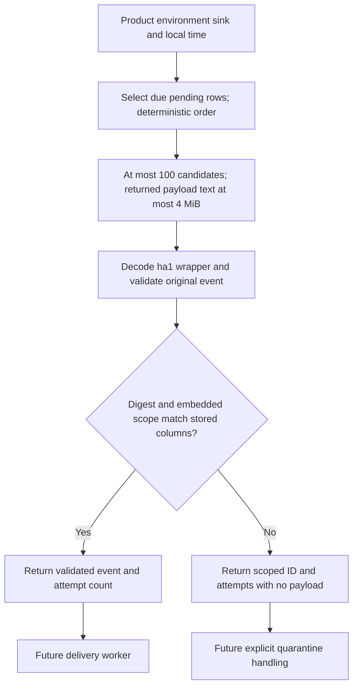

Both internal PostgreSQL audit stores now select due pending events for delivery. This extends [[phase-3-audit-persistence]] and [[phase-3-audit-acknowledgements]], advancing #46/#52 while Phase 3 remains open.

The single SQL statement filters product, environment, sink, pending state and due time. It orders by next-attempt time and binary event ID. A window sum bounds returned stored JSONB event text to 4 MiB, alongside a caller limit of 1–100 candidates. Driver/metadata overhead is additional; this is not a universal memory ceiling. The schema's per-row size bound ensures at least the first candidate fits that payload budget.

Reads do not acquire a delivery lease, increment attempts or change state. Repeated or concurrent workers can see the same events. The exporter must persist acknowledgements or explicitly reschedule/quarantine failures. Delivery is at least once, with no chronology guarantee implied by this ordering.

## Validation before export

The decoder is shared with append replay validation. It checks the wrapper format, canonical base64url, event schema/semantics, typed digest, and agreement between the stored columns and the decoded event's product, environment, ID and timestamp. Checking a digest alone is insufficient: a well-formed payload with a recomputed digest but the wrong embedded product must still be rejected.

Invalid rows return their scoped event ID and attempt count with a null/nil event. Their payloads are never returned to a transport. Other healthy candidates in the batch remain available. The caller must handle invalid entries explicitly; dropping them silently or retrying the same blocked batch forever would not meet the selected exporter design.

## Live evidence

Pinned PostgreSQL 17.11 run `heimdall-records-f3c69909707c46529183cc508001fbc8` passed both language suites with shared `contracts/fixtures/audit-pending.json`:

- Due-time boundary inclusion and future retry exclusion.
- Product, environment and sink isolation; delivered and quarantined rows excluded.
- Stable ordering, attempt counts, count limits and repeat reads without state changes.
- Bad digest and wrong embedded product withheld, including a recomputed digest for the wrong-product payload.
- A healthy event from another tenant following invalid rows remains available in the same batch.
- Six approximately 1 MB corrupted storage envelopes yield four bounded invalid candidates; no payload is exported.
- Go reads a TS-written pending event; TS then reads both language writers through the same decoder.
- Invalid limits and cancellation remain distinct from an empty backlog.

The full harness also reran migration, readiness, record, append and acknowledgement tests, including their COMMIT response-loss scenarios, then removed its disposable container. This checkpoint is local live PostgreSQL proof; the earlier migration evidence separately covers Railway execution.

## Remaining work

Retry scheduling, explicit quarantine transitions/replay, capacity limits, authenticated delivery, tenant-export authorization, fairness, retention and complete SDK factory integration remain open. This internal product-scoped selector is not a tenant-facing export endpoint. It cannot alone guarantee progress past invalid rows across successive batches.
