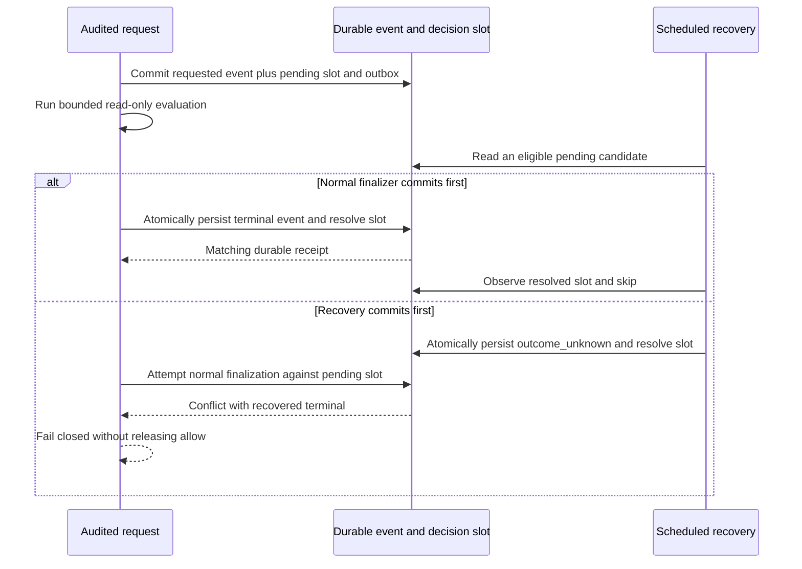

The prepared session/audit v2 SQL adds a durable decision slot for normal
finalization and crash recovery to share. It is a physical foundation, not an
enabled runtime feature. The supported migration catalog and SDK readiness still
require v1. [[phase-3-readiness-audit]] remains incomplete.

## Why the slot is needed

A scanner that merely finds an old requested event can race a late evaluator.
Writing outcome_unknown without coordinating finalization would allow a second,
contradictory terminal event. The proposed runtime protocol resolves that race
inside PostgreSQL before releasing a decision result.

`contracts/audit-recovery.md` specifies the required append/receipt, cutoff,
retention and upgrade behavior. SQL prevents rebinding the request, reopening a
terminal slot or changing its terminal event. Scoped foreign keys protect event
references. Runtime roles receive SELECT/INSERT/UPDATE, not deletion or DDL.

## Physical proof

Run `heimdall-audit-recovery-9291b882af6549afae49e6bfa07c2d2e` passed against pinned
PostgreSQL 17.11 using `tests/integration/audit-recovery-schema.py`:

- The current migration CLI refused the prepared v2 file with invalid_argument.
- All 13 shared invalid SQL cases were refused with their expected SQLSTATE.
- Rolling back installation left no decision table; installation then succeeded.
- Concurrent normal completion and recovery committed one terminal event and one
  outbox entry. The loser's event/outbox writes rolled back with the failed CAS.
- Both deterministic orders, normal-first and recovery-first, preserved the first
  terminal result and rejected the late contender.
- Invalid outbox persistence rolled back the terminal event and slot transition,
  leaving the request pending.
- Scope, runtime privilege and event-retention guards held; a primary pending
  query selected only its requested product/environment.

The fixture pins SQL SHA-256
`f7e859c78a6d099ad4a4d35c96e553ba10a53e3ae7e23440237c769efcd50722`.
The deployed v1 SQL checksum is unchanged. The proof uses physical routing
fixtures, not SDK authorization envelopes or actual permission evaluation.

## Activation gates still open

An explicit, restartable upgrade/backfill must validate existing ha1 events,
correlate requests/outcomes and reject ambiguous or corrupt history. Old writers
must be drained before cutover, and v2 readiness cannot become available until
coverage is verified. A startup version check alone does not fence existing
processes. The current CLI refuses this unregistered migration.

TS and Go append/finalization paths, bounded recovery scans, recovery-administration
audit, receipt reconciliation, lost-COMMIT tests and proof that a late allow never
reaches product code are not yet implemented. Audit capacity and retention remain
separate obligations. The Mermaid diagram describes the required protocol, not a
claim that those runtime paths already execute.
