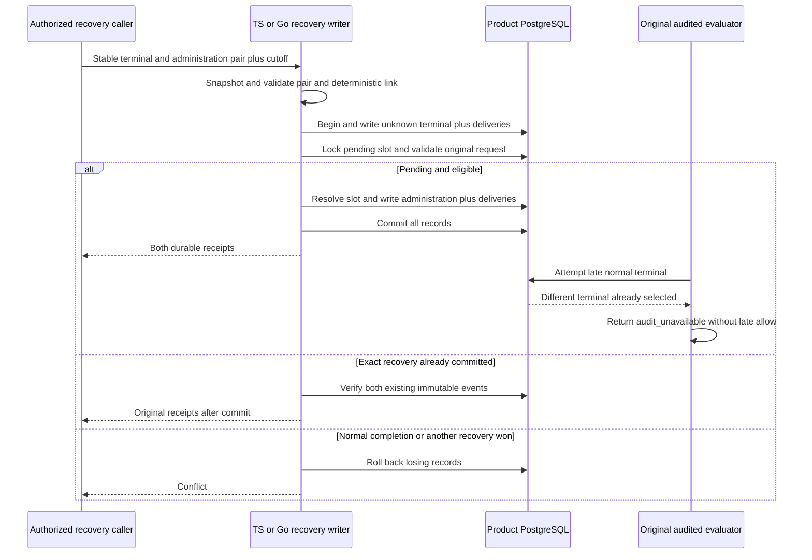

Both SDKs now recover an eligible pending decision by atomically recording an
unknown historical outcome, its recovery administration event and the terminal
slot. This composes [[phase-3-audit-decision-writes]] and
[[phase-3-audit-decision-scan]]; public runtime activation remains gated by the
explicit v2 upgrade/readiness work.

## Who did what

The authorization terminal preserves the original actor, tenant and decision
context. It says outcome_unknown, never inventing an allow or deny. A separate
heimdall.recovery.completed event identifies the authorized recovery initiator.
Its succeeded outcome means this recovery transaction completed, not that the
historical operation succeeded. The caller authenticates/authorizes that initiator;
shape validation alone cannot establish authority.

Administration IDs are deterministic hashes of product, environment and terminal
ID under a versioned domain. An exact retry must verify the original initiator and
payload; a changed payload conflicts. Already-recovered history lacking its linked
administration event is refused, not retroactively attributed to a new initiator.
The encoding and field bindings are specified in `contracts/audit-recovery.md` and
pinned by `contracts/fixtures/audit-recovery-write.json`.

The requested timestamp must be at or before the caller cutoff, and recovery time
must be at or after it. Eligibility is operator policy, not evidence that an old
process stopped. Recovery performs no remote mutation or historical reevaluation.
Retention must preserve the linked administration event with the decision's retry
obligations; this checkpoint adds no deletion path.

## Executed proof

`tests/integration/audit-recovery-write.py` passed on disposable PostgreSQL 17.11,
pinned to `sha256:3540c0362c809df084ffac0ae69fe794515f9de92692f02178bcdce0ef0302ac`.
Run: `heimdall-recovery-write-41379cb61fea46a5903e88fcf0f2b6c1`.

- Shared pair/ID fixtures reject mismatched tenant, decision, target, initiator,
  action, outcome, timestamps and invalid cutoff before database work.
- Both deterministic race orders and concurrent normal/recovery competition pass.
  Eight distinct recoveries leave exactly one terminal/administration pair.
- Eight exact retries return identical receipts without duplicated deliveries.
- Administration outbox failure rolls back the terminal, administration event and
  slot transition, preserving the original pending request only.
- Changed administration payload conflicts. Missing historical administration is
  not fabricated by retry.
- Each SDK recovers a request created by the other language.
- Both audited runners are forced to finish an allow after recovery has committed;
  both return audit_unavailable and release no allow result.
- Fault proxies confirm COMMIT and drop its response in both SDKs. The call returns
  outcome_unknown; exact retry verifies both committed receipts.

After the shared event-write refactor, the full workspace gate passed with 1,531
TypeScript tests, Go race tests, package-consumer checks and 137 Mermaid parses.
Normal-decision regression run `heimdall-decision-d13758792d1c4179b5f9878cbdb26e02`
and managed-storage run `2920c65c8d494f52943dfcd8e275ec4c` also passed, including
transaction rollback, cross-language reads and committed-response-loss retries.

The proof exercises real local PostgreSQL transactions and Go's race detector.
Railway publishes the evidence and diagram, not a serving v2 schema upgrade.

## Remaining gates

Explicit upgrade coverage/activation, factory/readiness selection, authorized
maintenance orchestration, storage capacity/reservations and retention remain
required. Local result gating does not fence old remote writes; managed uncertainty
quarantine is unchanged. [[phase-3-readiness-audit]] remains incomplete.
