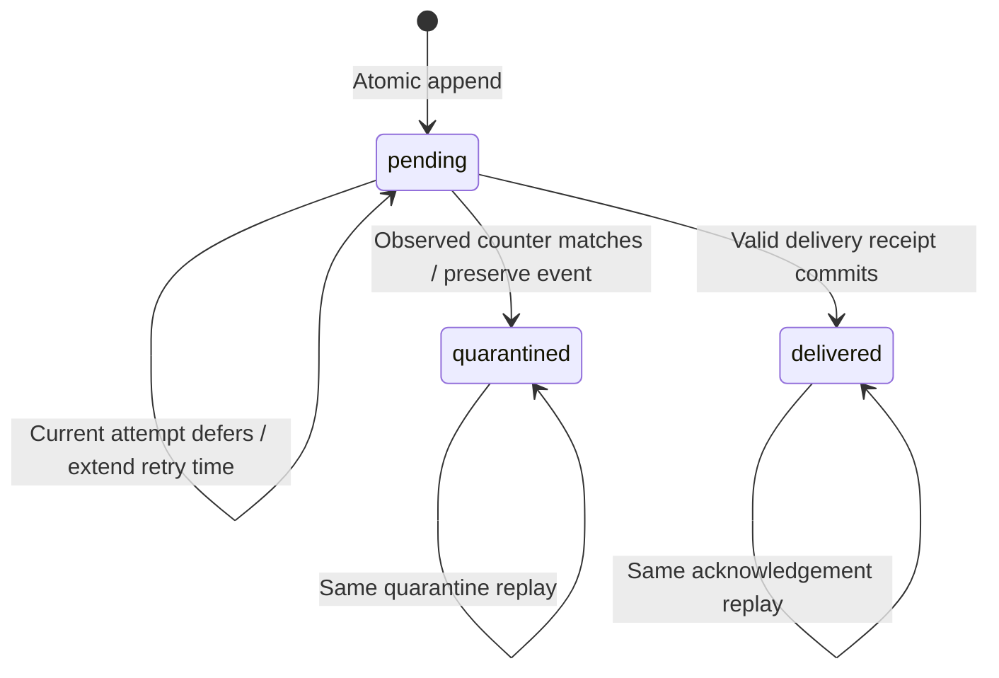

Both internal PostgreSQL audit stores now persist attempt claims, retry deferrals and quarantine. This extends [[phase-3-audit-pending]] and [[phase-3-audit-acknowledgements]]. Phase 3 remains open; no transport loop or background service is added.

A claim checks product, environment, sink, event ID, pending state, due time and the observed attempt counter. Only a committed new counter authorizes the future worker to dispatch. No match returns null/nil. An ambiguous COMMIT returns outcome_unknown and does not authorize dispatch, even if a later read happens to show the expected counter.

The attempt count records durable claims, including workers that stop before sending HTTP. A future due time makes those records eligible again after a stopped worker. It does **not** fence an external request that is still running. At-least-once delivery and sink deduplication remain necessary. These rules do not replace the managed authorization mutation recovery gate.

Deferral requires the current positive counter and can only extend the scheduled time. Quarantine requires the observed counter and preserves the event; replaying the same quarantine succeeds without creating another attempt. Delivered rows cannot be deferred, reclaimed or quarantined by these paths. Counter exhaustion is rejected rather than wrapped; a future worker must quarantine/alert, and operator replay must never reset the counter.

## Live proof

Pinned PostgreSQL 17.11 run `heimdall-records-23c6c8e2064446ea80b498f25f2e9ac0` passed both SDKs with shared `contracts/fixtures/audit-transitions.json`:

| Scenario | Observed result |
| --- | --- |
| Eight workers claim the same due counter | Exactly one receives attempt 1 |
| Claim before retry time | No claim |
| Deferral replay with an earlier time | Existing later schedule preserved |
| Old attempt defers/quarantines after a new claim | No state change |
| Current attempt quarantines, then repeats | Event retained; repeat succeeds |
| Delivered event receives stale failure callbacks | No state change |
| Other product or sink | No claim |
| Counter increment would overflow | Rejected before SQL |
| Invalid head event is quarantined | Next bounded read returns the healthy event; invalid event remains stored |
| Cancelled call | No claim returned |

The transition tests use the delivery-only role with SELECT/UPDATE on the delivery table. They do not need event-write privileges.

A wire-protocol proxy separately dropped confirmed PostgreSQL COMMIT responses for claim, deferral and quarantine in **each language**. All six calls returned outcome_unknown. Direct reads before retry confirmed committed state. An old-counter claim retry returned no new claim; deferral and quarantine retries preserved state. The complete prior regression harness also passed and removed its disposable container.

## Remaining work

Backoff/jitter policy, actual delivery dispatch, transient-versus-poison classification, health signals, privileged replay, fairness and tenant-export authorization remain open. These primitives accept trusted internal scheduling decisions; they do not implement those policies or authenticate an operator. Capacity/retention, identity invalidation and complete SDK factory integration are also outstanding.
