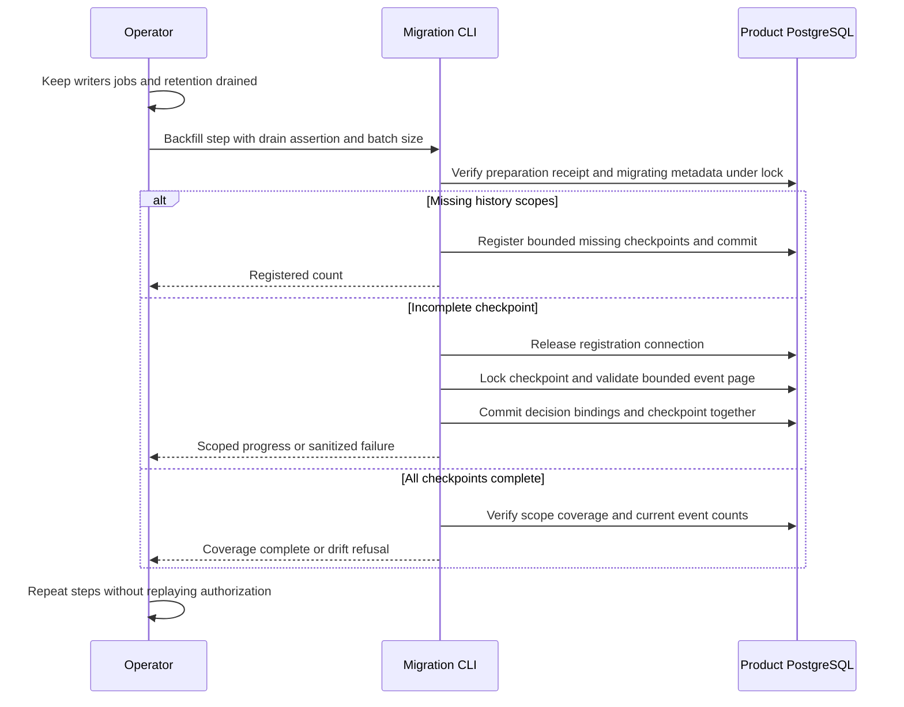

The migration CLI now discovers historical product/environment scopes and drives
bounded backfill steps. Developers no longer enumerate or insert checkpoints by
hand. This is an offline deployment operation shared by both SDK deployments;
Phase 3 and the production upgrade workflow remain incomplete.

## Data flow

Run `heimdall-migrate --backfill-audit-upgrade --writers-drained --batch-size 100`
with HEIMDALL_MIGRATION_DATABASE_URL. One invocation registers scopes or advances
one event page. JSON reports registered, backfilled or coverage_complete. On
failure, exit status is nonzero; a selected failed scope is reported without event
payloads. A lost COMMIT response is outcome_unknown: rerun the command to inspect
and resume committed state. This does not replay an authorization evaluation.

The batch range is 1–100. Scope registration and coverage queries may scan many
rows, with statement deadlines; the limit is not a claim of constant database
work. The overall operation is limited to ten seconds, and the event page retains
its five-second and 4 MiB bounds. Registration releases its connection before
backfill, so a single-connection pool works. Concurrent callers serialize durable
changes through the deployment/checkpoint locks.

## Executed evidence

`tests/integration/audit-upgrade-backfill.py` passed against pinned PostgreSQL
17.11, image digest
`sha256:3540c0362c809df084ffac0ae69fe794515f9de92692f02178bcdce0ef0302ac`.
Run: `heimdall-coordinate-6b8eb056fda54b8da91e22d0bfb52bfb`.

- Ledger and Support each have production and staging history: four scopes,
  sixteen events and eight decision slots, with original events/deliveries intact.
- Empty coverage is reevaluated on later calls; newly present scopes are discovered.
- Two-scope registration bounds and bounded event pages hold with eight concurrent
  callers and a one-connection pool.
- Read-only connections, missing drain assertion, cancelled lock waits and altered
  preparation receipts are refused; cancellation permits subsequent pool reuse.
- Completed-scope count drift fails without rewinding its checkpoint.
- Corrupt history reports the failed scope without partial decision bindings.
- A proxy confirms registration COMMIT then drops its response. The first call
  reports outcome_unknown; restart observes committed checkpoints and completes.
  Event-page COMMIT loss is covered separately by [[phase-3-audit-backfill]].
- The actual CLI prepares and progresses all four scopes without manual enumeration.
- Custom product history is refused by the current built-in-only CLI validator;
  its checkpoint does not skip the unrecognized event.
- Runtime status remains unavailable and base metadata remains migrating v1.

The full workspace gate passed: 1,532 TypeScript tests, Go race tests,
format/lint/type/dependency checks, SDK build and package-consumer verification,
plus Quartz build and 139 Mermaid parses. The preparation regression passed again
as `heimdall-upgrade-dd217bb32f8f4be09f571996d92a1fba`, covering the shared receipt
check and actual CLI mode changes, including DDL rollback and COMMIT-loss retry.

## Limits and next gate

Coverage means complete checkpoints with matching current event counts, observed
in one snapshot. It does not detect same-count replacement or prove old writers
cannot resume. The drain flag is an operator assertion. Physical-schema integrity,
activation, runtime factory selection, custom event registry integration, capacity
and retention remain required. No production database is upgraded by publishing
this page to Railway. See [[phase-3-readiness-audit]].
