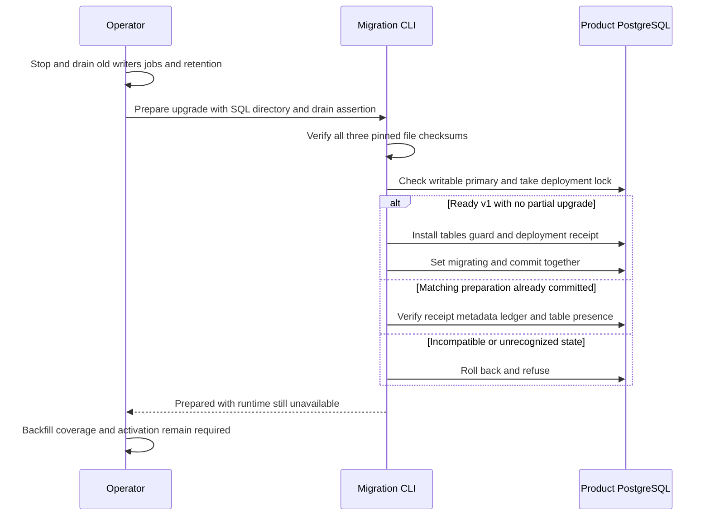

The deployment CLI can now install the prepared audit recovery tables through an
explicit, checksum-pinned transaction. This replaces manual DDL for the preparation
step. It deliberately leaves the database migrating; it is not a complete or
production-ready upgrade workflow.

## Operator boundary and data flow

The invocation is `heimdall-migrate --prepare-audit-upgrade --sql-directory
contracts/persistence/session --writers-drained`, with the existing
HEIMDALL_MIGRATION_DATABASE_URL environment variable. SQL-directory and drain flags
are rejected for unrelated modes. All three file contents are pinned; there is no
arbitrary-SQL execution option. Missing drain assertion fails before connection.

The assertion is not a fence. The operator must actually prevent old processes
and jobs from resuming. Startup/status checks see migrating and refuse, but cannot
stop an already-running v1 writer. Do not run this incomplete flow on a serving
application.

Preparation writes a singleton receipt containing base, decision-table,
backfill-table and preparation-file checksums. Concurrent calls serialize on the
existing deployment lock. Exact retry verifies that receipt and preserves its
original timestamp. It does not rerun DDL, repair objects, mark backfill complete
or claim full schema integrity. Global coverage and physical-schema verification
remain required before activation.

## Executed proof

`tests/integration/audit-upgrade-prepare.py` passed on disposable PostgreSQL 17.11,
pinned to `sha256:3540c0362c809df084ffac0ae69fe794515f9de92692f02178bcdce0ef0302ac`.
Run: `heimdall-upgrade-9079f4a6f7e442d589710b20c957b7f8`.

- Shared checksum files and Go constants agree; altered bytes fail before I/O.
- A read-only connection refuses preparation.
- Injected failure on the final CREATE TABLE leaves no new tables and restores
  ready-v1 metadata through transaction rollback.
- Cancellation behind the deployment lock leaves ready v1 intact and permits retry.
- Concurrent preparation and subsequent retry retain one stable deployment receipt.
- A mismatched receipt or manually installed partial decision table is refused.
- A proxy confirms COMMIT then drops the response: the first call reports
  outcome_unknown; retry verifies the committed preparation.
- The actual CLI requires the explicit drain assertion, supports exact retry,
  reports runtime still unavailable and refuses a ready-v1 status result afterward.

The full workspace gate passed with 1,532 TypeScript tests, Go race tests,
package-consumer checks and 138 Mermaid parses. The existing migration and
managed-storage regression harness also passed after the CLI change, run
`8ab52b5f5b3c4055b7e459463c74bb22`, including initialization/status modes,
transaction rollback, cross-language reads and commit-loss retries.

Version remains 1, the migration ledger still contains only v1, and checkpoint
registration remains empty. The test proves preparation atomicity, not successful
backfill or activation. Railway publishes this evidence, not an upgrade to a
serving product database.

## Remaining work

Register/discover all existing scopes, drive bounded restartable backfill, validate
physical schema and global coverage, publish v2 readiness, and select the new
runtime storage paths. Capacity, retention and broader operational acceptance also
remain open. [[phase-3-readiness-audit]] continues to mark Phase 3 incomplete.
