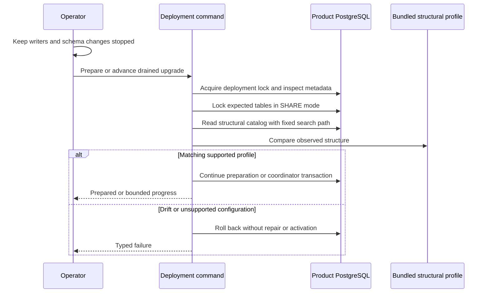

Upgrade preparation and backfill coordination now reject structural schema drift.
The previous receipt/table-presence check could not detect a disabled decision
trigger, weakened constraint or invalid index. The new check compares the catalog
with a bundled profile captured from the four pinned session/audit SQL files on a
pristine PostgreSQL 17.11 database. It leaves runtime readiness unchanged.

## Verification flow

The profile covers nine tables, their indexes and columns, constraints, user and
internal foreign-key triggers, both trigger functions and the revision sequence
configuration. It checks logged persistence, RLS flags, column defaults/types/
nullability/collations, constraint validation, index validity/readiness/liveness,
trigger enablement and function definitions. Unexpected schema relations,
rules, policies or inheritance fail. Even an extra operator-created index requires
an explicitly reviewed profile change; the verifier never learns from a drifting
application database.

Internal trigger names contain generated object IDs and are omitted; their
constraint, function and execution configuration remain compared. A fixed local
search path and name-based definitions make the comparison independent of database
object IDs and connection search paths. PostgreSQL must be major 17 and the
session must use origin replication mode. Only pinned 17.11 has executed evidence;
other catalog output is not silently accepted. Relevant catalog semantics are in
[PostgreSQL trigger documentation](https://www.postgresql.org/docs/17/catalog-pg-trigger.html)
and [index documentation](https://www.postgresql.org/docs/17/catalog-pg-index.html).

## Executed proof

`tests/integration/audit-upgrade-schema.py` passed with Go's race detector on
PostgreSQL 17.11, image digest
`sha256:3540c0362c809df084ffac0ae69fe794515f9de92692f02178bcdce0ef0302ac`.
Run: `heimdall-schema-5a5bbf6b06534621bc700b848be08199`.

- A pristine installation matches the bundled profile across fresh databases and
  different connection search paths.
- Twenty-five independent drift cases fail: disabled/replica-only triggers,
  altered function body/security/search path, removed or changed indexes,
  invalid/not-ready/not-live index flags, missing uniqueness/FK/check constraints,
  unvalidated FK, changed default/nullability, extra column/table/rule, unlogged
  checkpoints, RLS, cycling sequence and replica session mode.
- Index-state corruption uses deliberate catalog fault injection in a disposable
  database. This is a failure test, not an operator repair procedure.
- A concurrent table alteration waits until its deadline while the verification
  transaction holds locks. Cancellation while the verifier waits for a table lock
  retains the deadline error and permits connection reuse.
- Persisted trigger drift blocks both preparation retries and coordinator steps;
  the failed coordinator creates no checkpoints.
- A preexisting base-schema defect causes initial preparation to roll back all
  new tables and the migrating-state change. After the test restores the exact
  base trigger, preparation succeeds.

The existing preparation regression passed as
`heimdall-upgrade-7e777eff203043b39c8066c91134c151`; the coordinator regression
passed as `heimdall-coordinate-bdbd21a9d7b049f693e3a5c222c5c172`. These retain
COMMIT-loss recovery, CLI behavior, concurrent execution, history preservation,
custom-history refusal and unavailable runtime status.

The full workspace gate passed with 1,532 TypeScript tests, Go race tests,
format/lint/type/dependency checks, SDK/package-consumer verification, Quartz
build and 140 Mermaid parses. The pure Go fixture test also pins the embedded
query/profile bytes so changes require an explicit fixture update.

## Boundary

This is structural catalog verification, not a disk/index consistency scan.
Ownership, grants, role membership, current sequence position, historical event
integrity, storage durability and external writer quiescence remain separate
obligations. Table locks last only for the surrounding transaction and do not
fence privileged function/configuration changes or later maintenance steps. The
operator must prevent all competing schema changes throughout the upgrade.

Structural mismatch returns audit_unavailable; missing objects or catalog-query
failures return unavailable. The command never repairs an object or updates the
expected profile from observed state. Runtime v2 activation, factory selection,
capacity, retention and broader operational acceptance remain unfinished.
[[phase-3-readiness-audit]] continues to mark Phase 3 incomplete.
