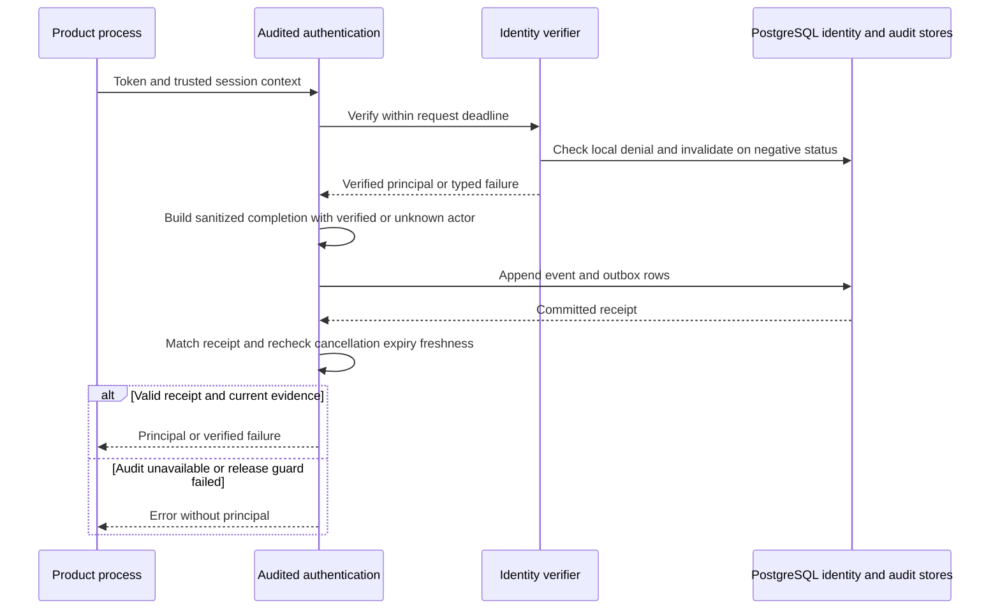

Phase 3 remains open. Both SDKs now compose identity verification with mandatory
durable authentication audit. Returning a verified principal requires a matching
committed receipt; failures and cache hits are also audited.

The product/environment/policy and verifier are captured together. Unverified
claims never become audit actors. Events exclude raw tokens, credential values,
session identifiers and arbitrary exception text. Every invocation gets fresh
event/request IDs. Authentication does not yet select a tenant.

Audit finalization has a separate five-second budget, including for cancelled
calls. A committed success records the observed identity check; cancellation or
expiry/freshness loss during commit still prevents principal release and appends
a correlated refusal with a fresh event ID. Failed refusal persistence returns
audit_unavailable. The event
does not assert product work occurred. Zero-cache mode still checks online per
invocation and retains the five-second operation bound.

## Verification

Shared identity-status cases now run through audited authentication in both
languages, alongside receipt mismatch/failure, withheld receipts, cancellation,
provenance and shared post-commit freshness/expiry cases. The full workspace gate
passed 1,169 TS tests with 25 optional live tests skipped, Go race tests and builds.

The live PostgreSQL harness now composes signed fixture tokens and fixture provider
status with the actual durable identity gate and audit adapter. Each language
verifies six persisted authentication events and six outbox entries, using separate
restricted identity and audit roles. Token-negative session handling, concurrent
replacement preservation and account-negative warm-cache refusal remain covered.
This is live database proof with fixture provider responses, not a live ZITADEL
claim. Earlier Railway provider verification remains recorded separately.

Verified database run: `heimdall-records-24811746fba0410fa8fce00a8525911b`.
The tested source is the commit containing this checkpoint, based on
`c305222936fd852642ac35610aaea7ab77855352`.

Sanitized harness output is tracked at
`tests/integration/evidence/audited-authentication-2026-11-11.json`.
Run `python3 tests/integration/postgres-records.py` through the pinned workspace
toolchain. It creates and removes its own disposable PostgreSQL container.

## Remaining work

These are internal compositions. Public runtime construction, session handlers,
enterprise policy enforcement, audit capacity/recovery workers and full reference
products remain unfinished. Authentication audit cannot undo an already committed
identity denial; audit failure continues to block release. See
`contracts/audited-authentication.md` for exact ordering and final-release guards.
