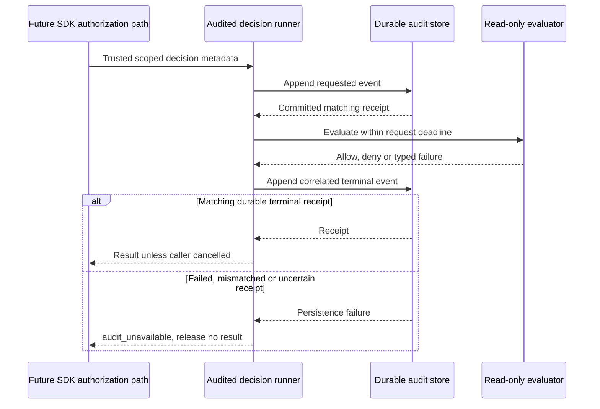

The internal TypeScript and Go decision runners now enforce the audit ordering in [[design/audit-contract]]. They persist a requested event before evaluating a read-only decision, then persist and validate its terminal receipt before returning an allow, deny or evaluation error. This composes the existing audit store into a control-flow gate rather than leaving receipt checks to every consumer.

The runner snapshots trusted metadata and assigns fresh event/decision IDs per invocation. It preserves request/parent correlation, validates built-in semantics and product/environment scope, and checks receipt scope, event ID, timestamp and digest. Unknown exceptions are sanitized to unavailable. Neither error messages nor arbitrary callback values enter the audit record.

## Cancellation and uncertainty

Evaluation has a five-second operation budget, shortened by the caller. Audit persistence uses a separate five-second context so cancellation cannot suppress its required outcome record. The request append consumes the operation budget, and terminal finalization may add up to five seconds. A pre-cancelled invocation can spend up to ten seconds persisting requested/cancelled events, but never runs the evaluator. Callbacks must honor cancellation and must be read-only, since the SDK cannot forcibly stop arbitrary callback work.

If cancellation arrives during terminal persistence, the observed evaluation outcome may commit, but the cancelled caller still receives no allow value. An allow audit is not a claim that business work ran or committed.

Lost request-append acknowledgement prevents evaluation. Lost terminal acknowledgement prevents releasing its result. Both become audit_unavailable, even if the audit transaction actually committed. The durable store can reconcile an exact event retry without rewriting its payload or initial routing. The runner does not automatically rerun an evaluation or retry an ambiguous append.

## Evidence

The shared `contracts/fixtures/audited-decision.json` covers allow, deny, invalid input, unauthenticated, forbidden, unavailable, deadline, cancellation and arbitrary exceptions. Both SDKs also test mismatched receipt fields, failures at either append boundary, scope rejection, non-cooperative evaluation and cancellation while the terminal receipt is withheld.

Pinned PostgreSQL 17.11 run `heimdall-records-a0cb605085af46f0ae9da89429c82a9f` passed the full storage regression harness. Direct database reads proved requested-event visibility before evaluation and terminal/outbox visibility before return. Ordinary decision writes used the restricted audit role. A wire-protocol proxy independently confirmed COMMIT before dropping request and terminal responses in both languages, then exact event replay verified durable receipt recovery. The disposable database was removed by harness cleanup.

Machine-readable evidence: `tests/integration/evidence/audited-decision-2026-11-11.json`. The full workspace gate passed 988 TypeScript tests, Go race tests, formatting/lint/types/Knip and SDK/Quartz builds. Dedicated live cases are separate from the 23 optional tests skipped by the ordinary gate.

## Remaining scope

This is an internal foundation, not a public authorization API. The calling factory still must authenticate actors and bind model, permission and tenant metadata. Public session/authorization integration, crash recovery for unresolved requests, durable lifecycle composition, custom events and SIEM workers remain required. Recovery must distinguish a committed terminal event from a genuinely unresolved request and must not invent a historical decision by reevaluating it. Phase 3 and the audit implementation ticket remain open.
