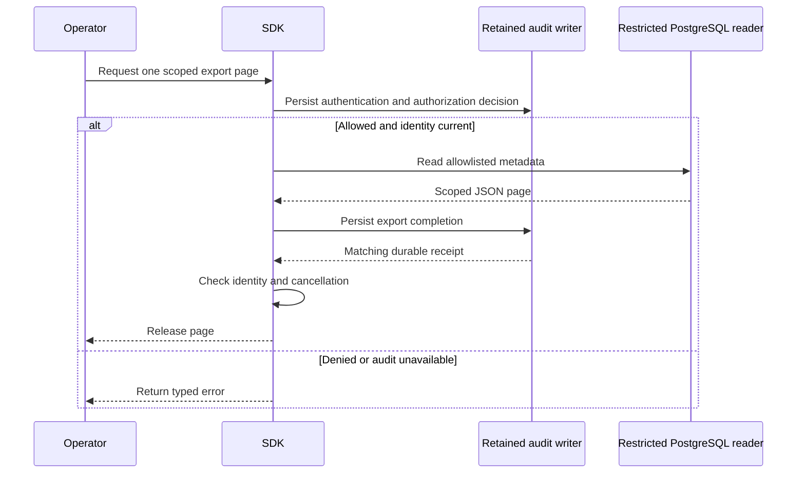

Both SDKs can authorize a whole-product workspace inventory or an export for
one workspace. Operation metadata always requires a named workspace. Policy
uses the verified operator, exact scope and export kind.

The deployment owns the operator policy and the export destination.
[[phase-3-managed-inventory]] assembles a bounded inventory in one snapshot.
[[phase-3-retained-export]] describes the reader's column privileges and scope.

Pinned PostgreSQL run `heimdall-capacity-backfill-850a298dbc394eab87d5972e17a40c1e`
verified both SDKs against retained audit and managed storage. Each SDK used a
column-restricted export reader and a separate audit writer. Both returned the
same allowlisted workspace fields. The database recorded the two authorization
requests, two decisions and two completion events for the exact workspace.

Shared tests also cover whole-product inventory, missing operation scope, policy
denial, decision and completion receipt mismatches, a wrong-product page, and
revocation after the read. The workspace suite passed with 1,744 TypeScript tests,
133 environment-dependent skips, Go race tests and 200 Mermaid diagrams checked
in Markdown and generated HTML.
