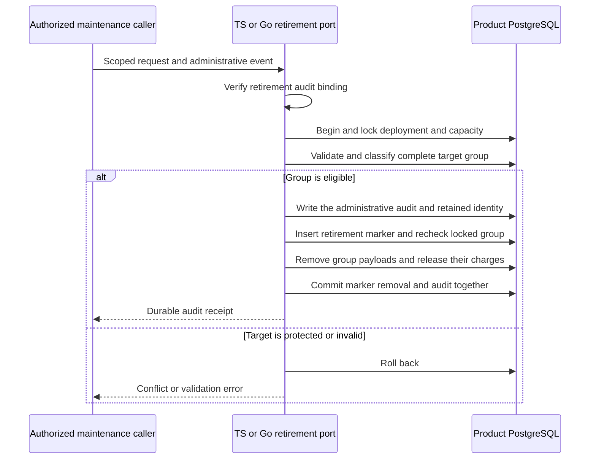

TypeScript and Go now have an internal persistence operation for retiring one
pre-authorized audit group. The operation takes an exact product, environment
and nullable tenant, and binds the policy version, clock and retention duration
to the administrative event. The shared contract is `contracts/audit-retention.md`.

The marker protects exact retries and keeps compact event and decision identities
intact. An exact retry after a lost commit response verifies the marker and
returns the original receipt. Payload-dependent inspection distinguishes retired
history from missing or corrupt history.

The dedicated maintenance role has the existing retained audit privileges, marker
INSERT, column-level UPDATE for delivery row locks, and DELETE on the specific
payload, delivery, charge, decision and decision reservation tables. The marker
checks eligibility again under row locks. The transaction requires room for its
new administrative event and metadata marker before reclaiming payload capacity.

## Verification

The shared retirement fixture binds both SDKs to the same administrative requests
and negative mutations. The live profile in
`tests/integration/audit-capacity-backfill.py` exercises ordinary, completed and
recovered groups, quota accounting, protected and wrong-scope refusal, late
rollback and cross-language retries.

Pinned PostgreSQL run `heimdall-capacity-backfill-9d66d781b16447a8aea61e788f758493`
passed the retirement profile. It retired groups of one, two and three members.
The tests checked held, pending, undelivered, young and wrong-tenant refusal,
ordinary credential refusal, and late payload-delete rollback. Lost commit
responses were injected for an ordinary group in Go and a recovered group in Go.
TypeScript resolved the original receipts. A completed group retired in
TypeScript and Go confirmed its exact retry. Each success added one compact
audit identity and one marker, preserved the group's compact identities, and
reclaimed its payload charges. A separate read of the same database verified
the payload, byte and delivery totals against the remaining charge rows.

The workspace gate passed with 1,707 TypeScript tests, 125 environment-dependent
skips and Go race tests. The documentation check parsed 196 Mermaid diagrams.

Production scheduling and authenticated operator authorization remain open.
See [[phase-3-readiness-audit]] for the remaining phase gates.
