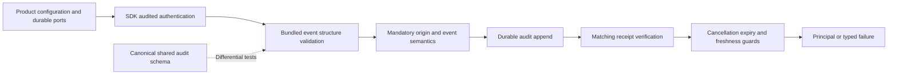

Phase 3 remains open. Audited authentication in both SDKs now owns its built-in
event structure validation. Product code no longer supplies a schema-validation
callback to construct this component. The durable audit store remains required.

The implementation enforces exact required/optional keys, primitive and integer
limits, Unicode code-point lengths, user/system/unknown actor variants, target
shape and enums. Existing semantic checks still reject spoofed event origins,
invalid built-in outcomes and forbidden attributes. A structurally valid actor is
not thereby authenticated; actor construction still uses the captured verifier.

## Evidence

Both languages run the shared audit-event schema fixtures and
`contracts/fixtures/audit-shape-boundaries.json`. Differential tests compare every
top-level property's malformed/boundary values with the canonical JSON schema.
Boundary cases include supplementary Unicode, strict identifier endings, actor
variants, missing/extra fields and 32/33-attribute limits.

The full gate passed 1,223 TypeScript tests with 25 optional tests skipped, Go race
tests and SDK builds. PostgreSQL integration uses the simplified constructors
while retaining the six authentication events/outbox rows per language, negative
identity/session gates and existing failure/uncertain-commit regressions.
Provider responses in this database harness are fixtures; this checkpoint makes
no new live-provider capability claim.

Database run: `heimdall-records-e790f7f8d6ed464abecfe261f77ca654`. Tested source is the commit
containing this checkpoint, based on `b5413ffaf571ce59ffde581c3bb1e70d11fcb4a0`.

Sanitized database proof is tracked in
`tests/integration/evidence/bundled-audit-validation-2026-11-11.json`.

## Scope

No schema downloads, checkout-relative runtime reads, generated schema copies or
new runtime dependencies were added. The canonical schema remains authoritative;
future schema changes must update these validators and their differential tests.
The generic audit persistence port still accepts a validator for its broader
custom-event contract. Public runtime construction, custom event registration and
full adapter assembly remain unfinished. This checkpoint does not advance phases.
