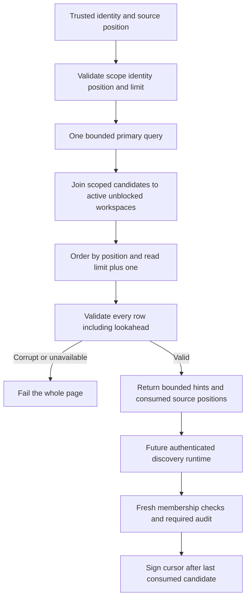

Both SDKs now provide a bounded internal candidate source for workspace discovery.
The source reads the selected principal's candidate index joined to active,
unblocked workspaces. It does not grant access or expose an authenticated public
cursor; those remain responsibilities of the forthcoming discovery runtime.

## Implemented boundary

Positions and revisions remain canonical decimal strings in TS and Go. Large
bigints never pass through a JavaScript number. Input limits are 1 through 100;
queries return at most one extra row to establish continuation. A five-second
budget covers connection acquisition and query execution. The primary status is
checked even when the result is empty.

Every returned record must match the principal, identity hash, product and
environment. Workspace decoding, lifecycle checks, strict position ordering,
unique workspace IDs and timestamp/revision validation run before any page is
returned. A corrupt lookahead fails the page too. Database failure remains distinct
from a legitimate empty result.

The returned continuation points to the final returned candidate. Discovery may
consume only part of the batch and use the individual last consumed position.
This is live traversal: changes behind the cursor may appear only after restarting.
The query bounds returned rows and elapsed time, not all database work needed to
filter inactive workspaces. It exposes no totals or snapshot guarantee.

## Evidence

Local PostgreSQL 17.11 proof run `cff397434b24472eb93d050d611e77e0` passed the managed
integration harness. Focused TS/Go tests also cover shared decoder fixtures,
including exact bigint boundaries, invalid ordering and corrupt lookahead.

Both SDKs verify:

- 101 eligible candidates split into a 100-item page and a final item, despite
  identical display names; pending, suspended, tombstoned and blocked workspaces
  are filtered out.
- Strict product, environment and identity isolation; successful empty results
  only from a primary query.
- Partial-batch resume without skipping unconsumed candidates, current lifecycle
  changes between calls, and stable positions with changed candidate revisions.
- Canonical principal mismatch fails the page. Read-only connections cannot return
  a misleading empty result.
- A table lock interrupted by a 100 ms caller deadline returns deadline_exceeded;
  the pool remains usable after the lock is released.
- Each SDK reads the other language's seeded pages and candidates created by actual
  completed managed operations.

The fixture is `contracts/fixtures/candidate-page.json`; the internal contract is
`contracts/managed-candidates.md`. Run the managed integration harness via
`python3 tests/integration/managed-schema.py` in the configured pnpm environment.
Neither immutable SQL checksum changed. The harness now waits for TCP readiness,
avoiding the image's temporary Unix-socket-only initialization server; a repeat
run exposed that startup race before any SDK test, and the corrected full run
passed.

No public discovery, signed cursor orchestration, membership enforcement or audited
discovery decision is claimed by this storage proof. Candidate rebuild coordination,
membership intent storage and operational foundations remain required. Phase 3
remains active under [[phase-3-readiness-audit]]. Railway publication deploys docs;
the new adapter tests run against disposable local PostgreSQL.
