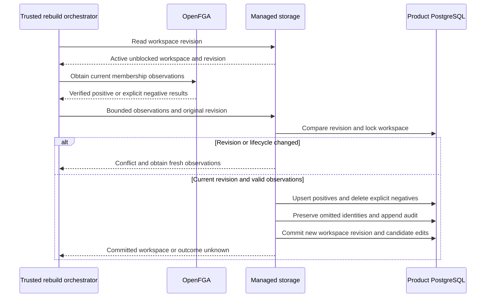

Both SDKs now provide a bounded storage transaction for candidate repair. It
publishes only explicit observations at an expected workspace revision and commits
the candidate edits, new revision and audit together. The remote rebuild workflow
and its durable checkpoints are still to be implemented.

## Coordination rule

The caller must read the revision before observing remote membership. Each batch
contains 1 through 100 distinct identities. Positive observations upsert hints;
negative observations remove only the specified hint. An incomplete remote list
cannot be translated into negative observations, and omitted identities are untouched.

The transaction uses the same workspace-first lock order as managed mutations.
Only an active, unblocked workspace at the expected revision can accept repair.
Observation timestamps cannot predate its prior update or overwrite a newer
candidate observation. Successful repair advances the workspace revision, so
concurrent repair and membership work cannot both commit against one revision.
After a conflict, the caller must reobserve rather than attach a new revision to
old results. Quarantined scopes remain blocked; repair never changes OpenFGA tuples.

Candidate positions survive updates. The whole batch, revision and recovery audit
commit atomically. An audit failure rolls everything back. Lost COMMIT response
returns outcome_unknown, and the consumed revision prevents a stale replay if the
transaction committed. This is not a replacement for remote evidence verification,
operation-key idempotency or a durable full-rebuild checkpoint.

## Evidence

PostgreSQL 17.11 run `44b2c8c55c1c4da6a197cdf26dd43bc6` passed the complete managed
integration harness. Both SDKs verify:

- Bounded distinct input validation, timestamp limits and cancellation before I/O.
- Unicode/NUL identities, positive upserts, explicit negative removal and preservation
  of an omitted member; updates retain position while advancing revision.
- Stale workspace revision, inactive/blocked lifecycle, older existing observations
  and old observations for an absent candidate all conflict.
- A repair racing membership reservation produces one committed winner and one
  audit record. A reservation followed by cancellation invalidates earlier repair observations
  even after the workspace is unblocked again.
- Audit conflict after mixed insert/delete work restores the entire candidate set
  and workspace revision.
- Each language reads the other's repaired Unicode identity through the candidate
  source and refuses stale replay.
- A proxy drops a confirmed COMMIT response: candidate edits and the new revision
  remain durable, the caller receives outcome_unknown, and old-revision replay fails.

Inputs live in `contracts/fixtures/candidate-repair.json`; the detailed contract is
`contracts/managed-candidates.md`. Run
`python3 tests/integration/managed-schema.py` in the configured pnpm environment.
No immutable migration checksum changed.

Tests supply trusted observation results; they do not perform a real OpenFGA rebuild
or establish operator authorization. Remote enumeration, verification of existing
hints, durable checkpoints and restart orchestration remain required. Broader storage
operational foundations remain open. Phase 3 stays active under
[[phase-3-readiness-audit]]. Railway publishes these docs; the new adapter tests run
against disposable local PostgreSQL.
