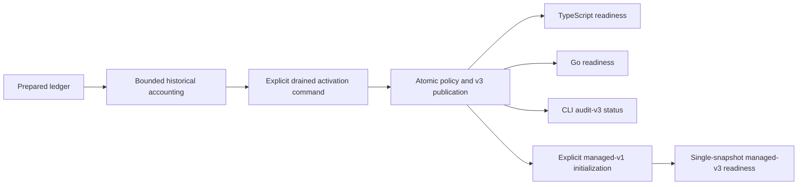

The shared deployment executable now exposes capacity activation and status.
Both SDKs have matching internal v3 readiness checks. Public serving composition
remains the next step; Phase 3 is incomplete.

The operator uses `--activate-capacity-upgrade --writers-drained`, then
`--status audit-v3` or `--status managed-v3`. These are deployment commands, not a
wrapper service. Missing drain assertions, conflicting modes and unrelated
preparation/batch flags fail before database work. The CLI still refuses custom
event history until an explicit matching registry can be supplied.

Readiness requires the exact protocol and migration checksums, ready capacity
policy, matching preparation receipt/limits and a completed checkpoint with no
cursor. TypeScript and Go use the same SQL policy, checked against shared fixtures.
Readiness deliberately ignores historical scanned counts after activation, since
new legitimate writes change live history. Structural catalog validation remains
an activation responsibility.

## Verification

The extended pinned-PostgreSQL integration suite runs the actual CLI through
preparation, accounting and activation over mixed TS/Go history. It checks
activation retries, invalid arguments, unavailable status before activation,
refusal by v2 status, missing managed-schema refusal, explicit managed setup, and
successful combined v3 status. Both SDKs exercise the shared readiness cases:
version windows, migration checksums, policy state, incomplete checkpoint,
preparation receipt and limit mismatch, plus valid post-activation history counts.
All 15 shared cases cover standalone and combined readiness, including a
read-only transaction and independent managed-state/checksum failures.
Cancellation checks require no database. The existing activation suite also covers
lost COMMIT responses and failed publication rollback.

Live run `heimdall-capacity-backfill-f009b7c158d64c3f910d666157036650`
passed on November 12, 2026 and its disposable container was removed.

Public TS/Go factories and per-write admission still require v3 integration and
runtime grants. A successful deployment status is not permission to resume v2
serving processes. Large-history activation, retention and operational
qualification remain open in [[phase-3-readiness-audit]].
