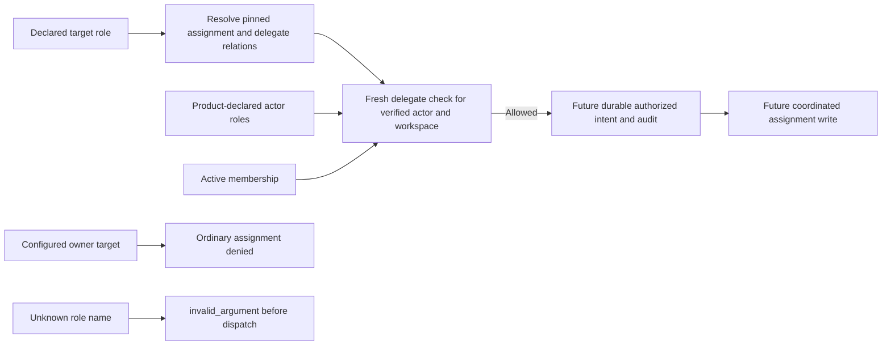

Phase 3 remains in progress. Both internal model compilers now generate delegation relations alongside effective roles and permissions. Each declared role maps to a d_N relation that grants authority only to roles explicitly listed in the product manifest, and only while the actor is a member of the target workspace.

The configured owner role always has a denying ordinary-delegation relation. There is no implicit owner override: owners can delegate only the declared non-owner roles. Bootstrap and ownership transfer remain separate workflows. Missing or empty delegation entries grant no authority. Manifest validation rejects owner delegation before model generation.

Shared vectors cover Ledger, Support, and a Support variant with ownerRole=founder. TS and Go produce identical complete models and hashes, reject undeclared names (including prototype-looking names), and reject attempted owner delegation. The compiler remains internal and requires structural manifest validation first.

The live policy probe checks every actor membership/role combination against each target role, including other-workspace denial, and repeats delegation checks after membership removal with raw role tuples retained. These are real OpenFGA checks using HIGHER_CONSISTENCY. They verify policy evaluation, not an implemented assignRole endpoint or race-safe mutation workflow.

Ordinal mappings and model hashes change when the model changes. These are unreleased, disposable policy models; no product model is silently migrated. Future provisioning must pin manifest, mapping and model ID together. Shared fields added here do not change the serialized user/session contracts.

Remaining work includes runtime actor/tenant binding, lifecycle gates, audited mutation coordination, ownership transfer, model activation/migration, and PostgreSQL persistence. A direct trusted OpenFGA writer can still assign raw owner tuples; SDK authorization is not a credential-isolation boundary.

## Validation

Live run c8dfc2f6-31f6-444c-af40-c1669d54782b passed 1,094 checks: Ledger 590, Support 252, and the custom-owner variant 252. All three owned stores were deleted. Sanitized results are in tests/integration/evidence/tenant-delegation-2026-11-11.json.

Support and its renamed-owner variant have the same model hash but different role-name mappings. This is expected: a model hash alone does not identify a manifest, product or role semantics. Pin and validate the complete manifest/mapping/model binding.

The full workspace gate passed with 869 Vitest tests, Go race tests, formatting/lint/types/Knip/vet, SDK build/declarations and 59 Quartz pages. No dependencies were added. Phase 3 and #33 remain open for integration requirements.
