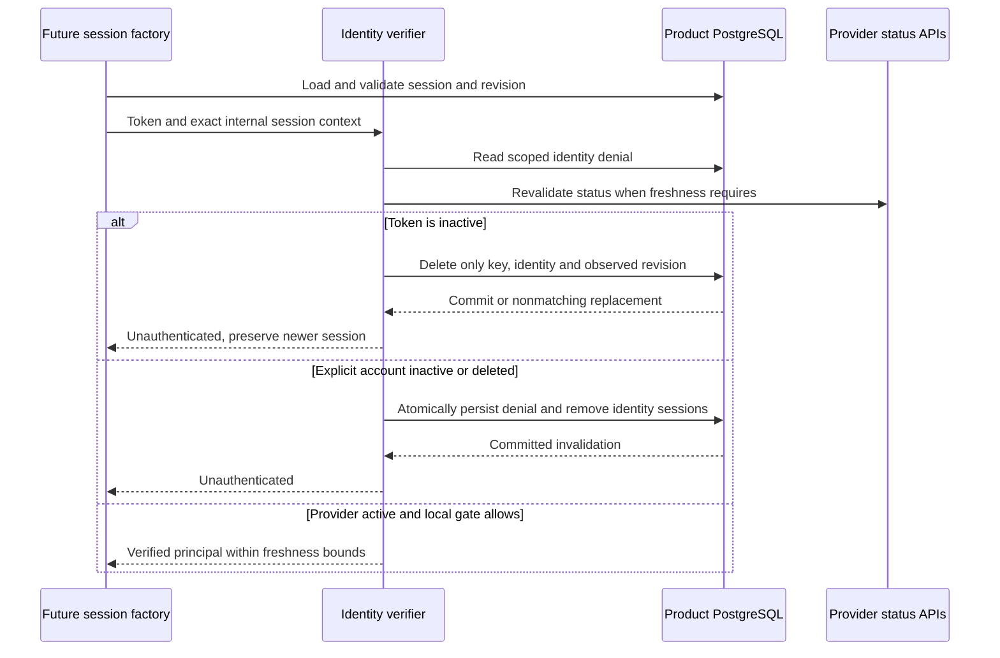
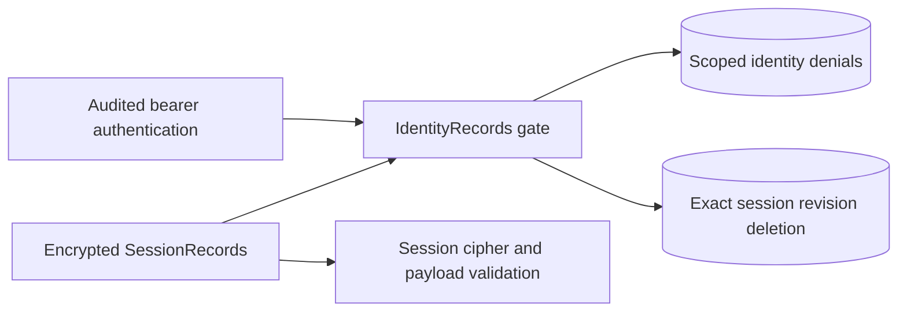

The internal identity verifier now connects to the PostgreSQL session adapter through a product/environment-bound gate in both SDKs. This supplies the durable deny read and precise negative handling required by [[phase-3-identity-freshness]], using the storage semantics proven in [[phase-3-session-version-invalidation]].

Factory session loading in this diagram remains a Phase 4 integration requirement. The new gate supplies the database callbacks, not the complete cookie/session lifecycle.

## Scope and context

Gate construction rejects a product/environment mismatch. Session contexts encode a validated internal storage key and canonical positive revision. They are constructed from a loaded session, never accepted as browser headers or raw cookies. A token negative cannot remove a concurrently refreshed/recreated revision, and a false delete result does not authorize clearing its replacement cookie.

Bearer token negatives do not delete sessions or invent account tombstones. Explicit account negatives persist a scoped denial and remove identity-bound sessions atomically. Later positive provider responses cannot clear that denial. Local deny checks run even when the verifier has a cached positive; the cached-return path also checks cancellation immediately before releasing a principal.

## Evidence

Pinned PostgreSQL 17.11 run `heimdall-records-3cd56cae52c048bb87bec50e399c3fad` passed the full storage regression harness. New tests in both SDKs compose real signed-token verification, fixture provider responses and real PostgreSQL writes using the restricted identity runtime role.

| Case | Verified outcome |
| --- | --- |
| Active signed token | Principal returned after local deny check |
| Inactive bearer token | Unauthenticated, existing sessions preserved |
| Inactive session token | Only observed session revision removed |
| Refresh during status lookup | Replacement revision preserved |
| Explicit inactive identity | Durable denial and session deletion |
| Deleted observation after inactive | Durable reason upgraded to deleted |
| Other subject | Session preserved |
| Warm verifier after persistent denial | Rejected without another provider request |
| Session recreation after denial | Rejected |
| Identity or session-delete COMMIT response lost | outcome_unknown preserved through the gate |
| Cancellation at cached-return boundary | No principal released |

The combined test uses fixture provider responses, not a new end-to-end Railway login. The existing [[phase-3-identity-freshness|Railway status evidence]] remains the provider compatibility proof. Shared `contracts/fixtures/identity-context.json` pins context encoding/rejection in both languages. Machine-readable storage evidence is committed as `tests/integration/evidence/identity-gate-2026-11-11.json`.

The full workspace gate passed 1,004 TypeScript tests, Go race tests, formatting/lint/types/Knip and SDK/Quartz builds. The ordinary gate skips 24 optional live tests; the PostgreSQL harness executes the relevant live cases separately and cleans up its disposable database.

## Remaining work

This is internal persistence/identity composition. Public factories must bind immutable configuration, load/validate sessions per request, supply required durable audit, and implement refresh/logout and enterprise context. Reactivation requires explicit reconciliation; the gate has no clear-denial shortcut. Phase 3 remains in progress.

## Cipher-independent gate checkpoint

The November 11 follow-up separates `IdentityRecords` from encrypted session storage
in both SDKs. A durable identity gate requires the caller-owned PostgreSQL pool,
product and environment, but no session encryption key or payload validator.
`SessionRecords` delegates denial and invalidation to the same implementation.
Identity hashing, advisory locks, SQL predicates, synchronous commits and uncertain
commit outcomes remain shared. There is no schema migration or new public API in
this checkpoint.

Pinned PostgreSQL run `heimdall-records-5ac765d8843c4dcd90d391dee92b12f1`
passed the full storage and fault-injection harness. The combined authentication
tests instantiate the gate independently of the session cipher, while creating
real sessions through the encrypted adapter to verify invalidation and replacement
preservation. Both languages still produce six committed authentication events and
six outbox rows per scope. The tests use fixture provider responses, not a new live
ZITADEL login. Machine-readable evidence is
`tests/integration/evidence/standalone-identity-gate-2026-11-11.json`.

Shared invalid-revision fixtures additionally reject trailing LF, CR and CRLF for
conditional invalidation and session compare-and-swap. This fixes TypeScript's
end-anchor acceptance of a trailing newline and preserves Go parity. No database
access occurs for these invalid arguments. Unit tests also exercise scope mismatch,
cancellation and bearer token-negative no-op without opening a database connection.

The full workspace check passed 1,251 TypeScript tests (26 optional live tests
skipped), Go race tests, package-consumer checks and SDK/Quartz builds. The
documentation build validates 115 Mermaid diagrams.

The public PostgreSQL runtime factory is still pending. This extraction removes
its dependency on session encryption without fabricating a cipher or weakening
session validation. Phase 3 remains open.
