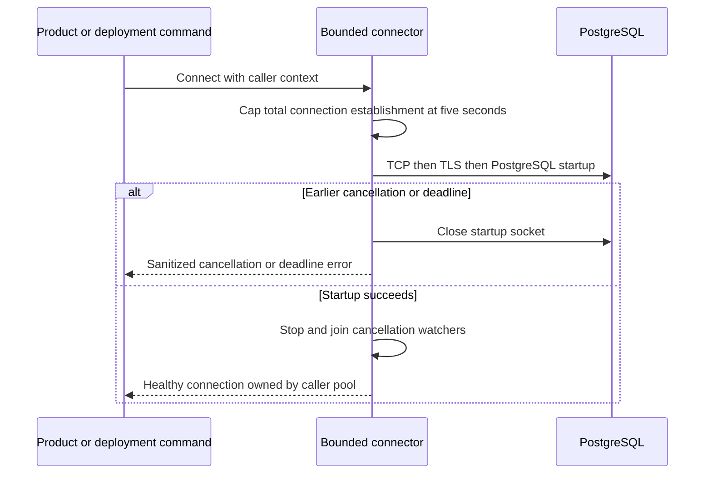

Go now exposes `postgres.NewConnector(dsn)` for application-owned `sql.OpenDB`
pools. The migration and key-management commands use the same connector. It fixes
the observed lib/pq startup gap: cancellation now closes the connection during
TLS or PostgreSQL startup, instead of waiting indefinitely for a server response.



Configuration is captured without opening a database connection. Standard lib/pq
environment and service-file configuration still apply. Each Connect uses its own driver connector
and cancellation state; credentials and TLS choices are preserved. A shorter DSN
connection timeout is retained. The overall five-second limit also bounds host
fallback attempts. The wrapper sanitizes parse and provider failures. It does not
migrate schemas, own the application pool or change query semantics.

```go
connector, err := postgres.NewConnector(databaseDSN)
if err != nil { return err }
db := sql.OpenDB(connector)
defer db.Close() // once at application shutdown
storage, err := postgres.NewStorage(db, postgres.StorageOptions{
    ProductID: "ledger", Environment: "production", AuditSinks: []string{"siem"},
})
```

## Executed evidence

Race-enabled loopback regressions accept TCP and deliberately withhold startup
responses. They cover earlier deadlines and explicit cancellation for plain
PostgreSQL startup and for TLS after accepting SSLRequest and receiving ClientHello.
They verify socket closure. A separate case supplies no caller deadline and
proves the connector's five-second cap. Invalid DSNs, already-cancelled/nil
contexts and timeout configuration limits are checked without database access.

Pinned PostgreSQL 17.11 run
`heimdall-capacity-backfill-0c966d52a0e54300abad7db7b5a5b21d` passed and its
disposable container was removed. Deployment migration/activation commands now
run through the connector. The live pool test confirms that cancelling the context
used to open a successful connection does not close it: its backend PID remains
unchanged on reuse, and v3 readiness passes. Existing recovery and COMMIT-loss
regressions remain green.

## Boundaries

NewStorage still accepts caller-owned pools and cannot retrofit their drivers.
Custom pools must independently satisfy bounded startup and cancellation; bare
lib/pq `sql.Open` without a timeout does not. The fix closes the observed startup
gap for pools constructed with this connector and both SDK deployment commands.
It is not proof of arbitrary custom drivers, TLS certificate deployment, every
network fault or full Phase 3 acceptance. Retention, maintenance process-kill and
operational qualification remain in [[phase-3-readiness-audit]].
