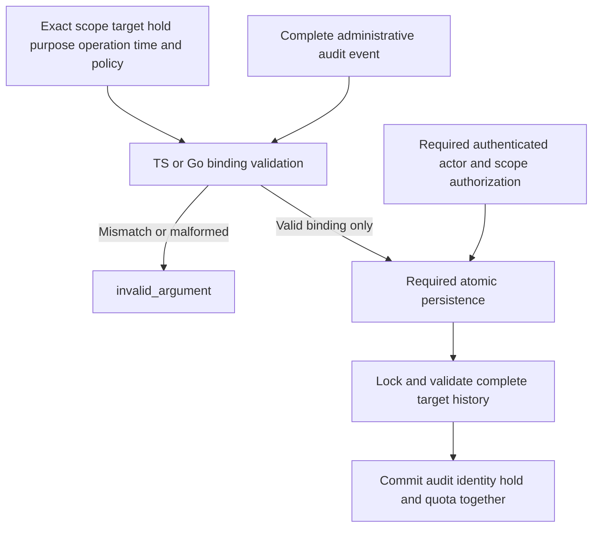

Hold persistence must not accept an arbitrary audit reference as proof of an
administrative action. TypeScript `validateAuditHold` and Go `ValidateAuditHold`
now check the full reserved event against the intended hold operation. The shared
contract is `contracts/audit-retention.md`; vectors are in
`contracts/fixtures/audit-hold-binding.json`.

The administrative event uses `heimdall.policy.completed`, an explicit
`audit.hold.administrative.acquire`, `audit.hold.administrative.release`,
`audit.hold.retry.acquire` or `audit.hold.retry.release` action, and the protected
audit-event target. The hold ID is the operation ID. Tenant, policy version and
timestamps must match exactly; unknown actors and self-targets are refused.
Full shape and existing security-event semantics remain mandatory.

A deterministic, domain-separated audit ID binds product/environment, hold ID and
acquire/release. A retry must reuse the original event. Changed purpose, target,
actor, policy, time or tenant under that ID must conflict at the persistence layer,
not create another action. A null tenant means product-level records only.

## Verification and limits

The shared vectors cover both purposes and operations, tenant and product-level
scope, system and user actors, malformed events, wrong scope/target/policy/action,
unknown actors, timestamps, secret attributes and self-target refusal. Tests also
assert that validation does not mutate input. TypeScript checks nonfinite and
fractional request times separately.

The workspace gate passed with 1,706 TypeScript tests (123 environment-dependent
skips), Go race tests, lint, types, package builds and the Quartz build. Both SDKs
pass 41 shared binding vectors; TypeScript adds the nonfinite/fractional-time test.
The initial gate parsed 193 diagrams before this evidence page was added; the
publication gate validates the additional diagram too. These are pure contract tests, not live
PostgreSQL hold-operation proof. Actor authorization, trusted clock/policy
selection, full target-history validation, atomic persistence, immutable retries
and COMMIT-loss recovery remain required. No public hold endpoint or retirement
worker is enabled. Phase 3 remains incomplete.

## CI fixture correction

The first PR check exposed a timing-dependent failure in the existing public
bearer test. Its mock introspection endpoint recalculated token expiry for every
response, which could exceed the signed token's fixed expiry after a second
boundary. The verifier correctly returned unavailable. The mock now reuses the
same expiry in the signed token and introspection response. Runtime verification
rules are unchanged; 30 consecutive runs of `go test -race -count=30 -run '^TestPublicTokens$' .`
passed with the corrected fixture.
