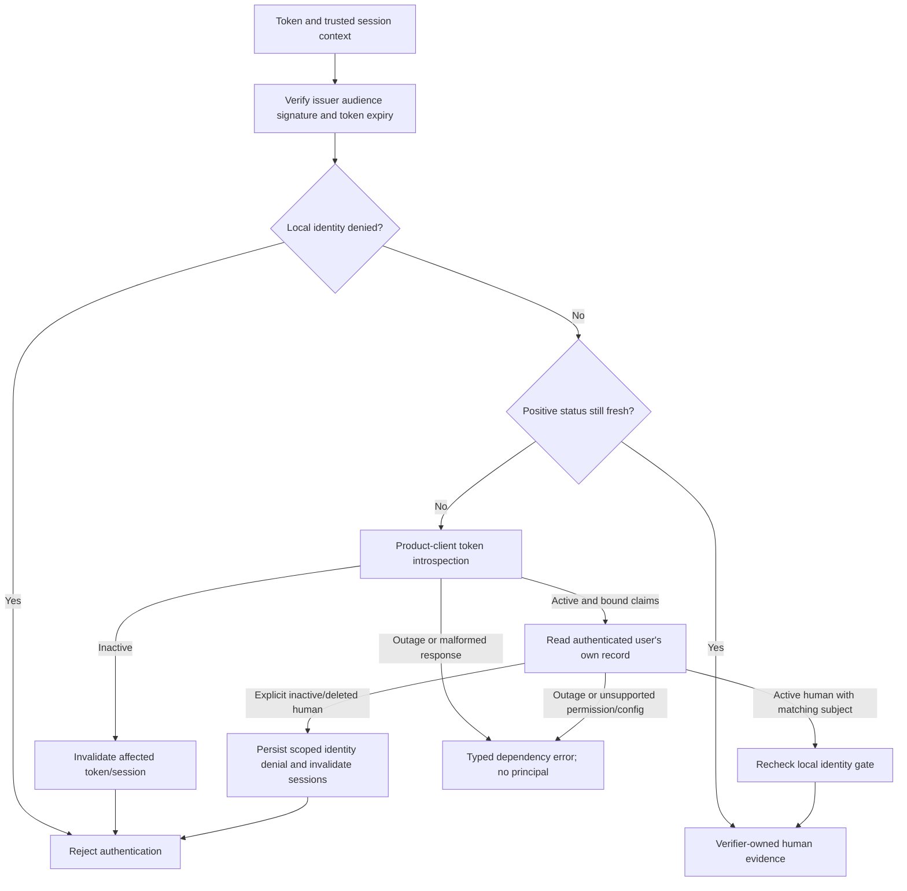
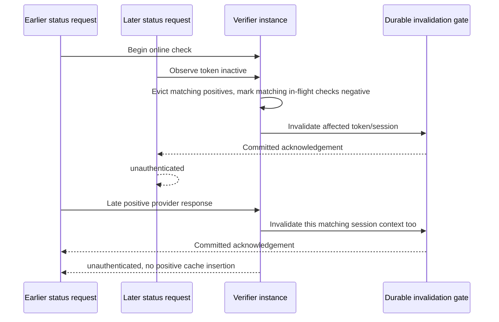

Both internal SDKs now combine [[phase-3-token-verification|signature verification]] with product-client introspection, an authenticated self-user lookup and a mandatory local deny/invalidation gate. This advances #34 while Phase 3 remains open. The new gate is an internal dependency for the eventual built-in factory, not extra recommended application wiring.

Default positive freshness is 60 seconds, capped by token expiry. Zero performs an online check every time. Cache hits still verify signatures and consult the local gate. Keys bind product, environment, policy version, issuer/subject, exact token fingerprint and trusted session context; the cache holds at most 1,024 positive entries. A stale result is never reused during an outage. The overall check honors a five-second or earlier caller deadline.

The self-user request uses the user's own access token. Login/setup must request the product audience **and** `urn:zitadel:iam:org:project:id:zitadel:aud`; no administrator credential is used by this runtime path. Introspection uses the product client's secret through a cancellation-aware loader. Both status responses are bounded to 64 KiB and redirects are refused. The [pinned user schema](https://github.com/zitadel/zitadel/blob/v4.19.4/proto/zitadel/user/v2/user.proto) supplies the human/machine and state distinctions.

## Revocation is not always account deactivation

An inactive token may be individually revoked. It invalidates the relevant token/session without creating an account-wide tombstone. Self-user 401/404 and unsupported machine identities also deny that token; 404 alone does not prove account deletion. Explicit inactive/locked/deleted human state produces an identity-level negative. Unknown state, malformed binding, introspection credential failure, rate limiting or user-lookup 403 returns unavailable.

A matching negative wins over older in-flight positive responses. A negative for one token does not evict another independently valid token for the same person. No positive provider response clears the durable identity gate. `owns` checks provenance only; it is not a license for authorization code to retain a principal indefinitely.

## Evidence

Live run `3952bfca-603d-40ac-b3c3-2106447b841e` passed all six product/state cases against the pinned Railway ZITADEL instance: Ledger and Support active humans were accepted, then disabled and deleted users were denied in **both TS and Go**, with invalidation callbacks recorded. The wider OIDC/PKCE, refresh/revocation and cleanup regressions also passed. Sanitized evidence is in `tests/integration/evidence/identity-freshness-2026-11-11.json`.

The full workspace gate passed with 951 TS tests, Go race tests, lint/types/Knip, SDK builds and 70 Quartz pages. Provider JSON decoding rejects malformed Unicode rather than repairing identity strings.

Shared `contracts/fixtures/identity-status.json` exercises active humans, inactive tokens, explicit inactive/locked/deleted users, machine rejection, mismatched subjects/audiences, malformed claims and HTTP failure distinctions in TS and Go. Additional tests cover the exact freshness deadline, zero freshness, token expiry cap, context isolation, cache capacity, outage without stale fallback, cancellation/redaction, uncertain invalidation completion, independent tokens and late-positive races. Go runs with the race detector.

PostgreSQL run `heimdall-records-938c89a2996744618b48c5c5abe7a561` passed the complete live storage regression. Both adapters now expose a scoped primary-store identity-denial read, tested before/after invalidation and against another identity. This supplies the local read primitive; it does not yet wire the full session factory.

The earlier live attempt `1e8a67c1-cc44-4c47-8d9b-82adeacbc56a` failed closed with deadline_exceeded in a Go deleted-user check. Cleanup ran. The five-second limit was preserved; subsequent successful samples are not an availability or revocation SLA.

## Remaining integration

Live provider tests record invalidation calls with a fixture gate; they do not prove end-to-end durable session deletion and audit integration. The PostgreSQL gate primitives are tested separately. Public factories must join them, bind invalidation to the verified loaded session/revision, apply idle/absolute and refresh policy, and await required audit persistence. No production authentication facade is exported yet.

Provider lifecycle collection across products, authoritative reactivation with cleanup/current grants, strict SSO evidence and final fault/restore tests remain required. There are no implicit workers or migrations. See `contracts/identity-status.md` for the internal behavioral contract and callback cancellation limits.
