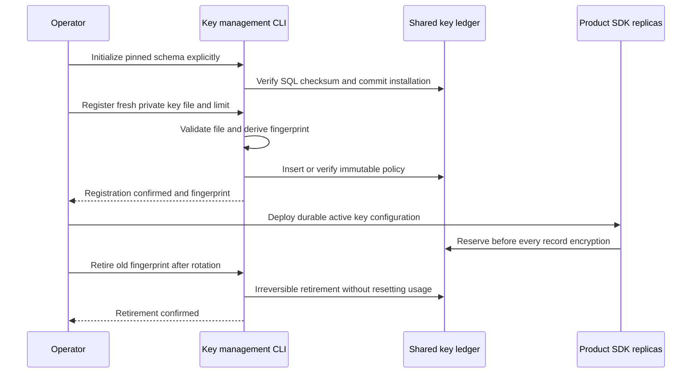

`heimdall-keys` manages the shared encryption-usage ledger used by both SDKs.
It is a deployment executable, not a service, runtime constructor or background
worker. It complements [[phase-3-key-usage-ledger]] and
[[phase-3-metered-records]]. Phase 3 remains incomplete.

## Operator commands

Build from `sdk/go`:

```sh
go build -o /tmp/heimdall-keys ./cmd/heimdall-keys
```

Provide `HEIMDALL_KEY_DATABASE_URL` through the deployment secret environment.
It must select the one shared primary ledger used by all consumers of these keys.
Initialization requires a deployment role able to create the schema; registration
and retirement need appropriate policy-write privileges. Product runtime roles
remain limited to reads and `UPDATE(used)`.

```sh
/tmp/heimdall-keys --initialize --sql ../../contracts/persistence/keys/0001.sql
/tmp/heimdall-keys --status
/tmp/heimdall-keys --register --fresh-key --key-file /run/secrets/record-key --limit 100000000
/tmp/heimdall-keys --retire --fingerprint LOWERCASE_LEDGER_FINGERPRINT
```

The example allowance is an explicit operator choice, not a measured universal
capacity default. Allowed limits are 1 through 4294967295. The registration file
must be a private regular file containing exactly 32 raw bytes, not hex/base64.
Group/other permissions, directories, symlinks and wrong lengths are rejected.
The command computes the same key-material fingerprint as both SDKs and prints
only that fingerprint. It does not print the key, file path or connection string.
The temporary key buffer is cleared after fingerprinting; this is not a claim
that the process or operating system can guarantee memory erasure.

`--fresh-key` asserts that material not already registered has never encrypted
records. The program cannot establish historical usage in another deployment.
Registration retries preserve the existing allowance and consumption; changed
limits and retired keys conflict. There is no reset, deletion or reactivation
command. `--status` checks schema/primary compatibility, not per-key remaining
capacity or readiness of every product.



## Rotation and uncertain outcomes

Register the new material first, then deploy it as the active key while retaining
previous decryption keys. Verify product writes and reads before retiring the old
fingerprint. Retirement blocks new reservations, including lagging replicas; it
does not revoke allowances already confirmed. Retain old decryption keys until
all affected records have expired or been safely rewritten. Automated rewriting
and complete fleet rotation orchestration are not supplied by this CLI.

A lost COMMIT response returns `outcome_unknown` with exit status 1. Rerun the
identical operation against the same ledger. Registration verifies the existing
policy without resetting usage; retirement is idempotent. Do not switch databases,
change limits or generate new material merely to retry an ambiguous command.
Invalid invocation returns 2; successful operations return 0. `--help` documents
the flags without connecting to PostgreSQL.

After ledger restore or cloning, old counts cannot authorize continued encryption
with old key material. Quiesce all writers and establish fresh encryption keys
before resuming. This is an operating constraint, not automated restore recovery.

## Verification and remaining work

Run `heimdall-key-usage-975dc283e4df45739f057b0e994a2c29` passed on
November 11, 2026. The integration harness builds and runs the actual CLI against
disposable pinned PostgreSQL 17.11. It verifies initial installation and retry, readiness, registration,
usage preservation, changed-policy conflict, read-only refusal, and both
registration and retirement COMMIT-response loss followed by an identical retry.
The same run includes TS/Go accounting, metered writers, rotation reads and
reservation-response-loss regressions. Unit tests cover invalid invocation,
secret-free diagnostics, private-file validation and help behavior.

Full backup/restore drills, fleet rotation, key-usage monitoring, audit capacity and
retention remain open in [[phase-3-readiness-audit]]. These commands do not move the
project to Phase 4 or establish first-release operational qualification.
