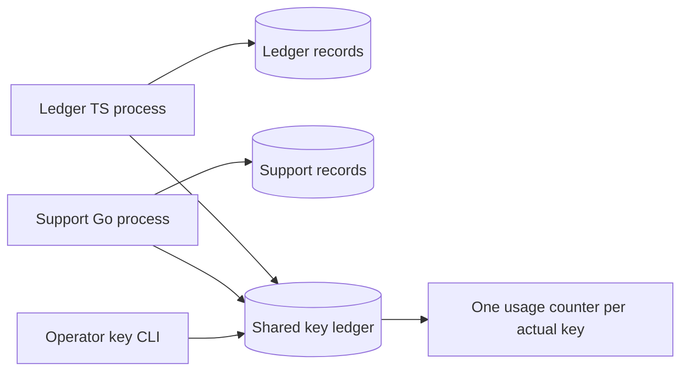
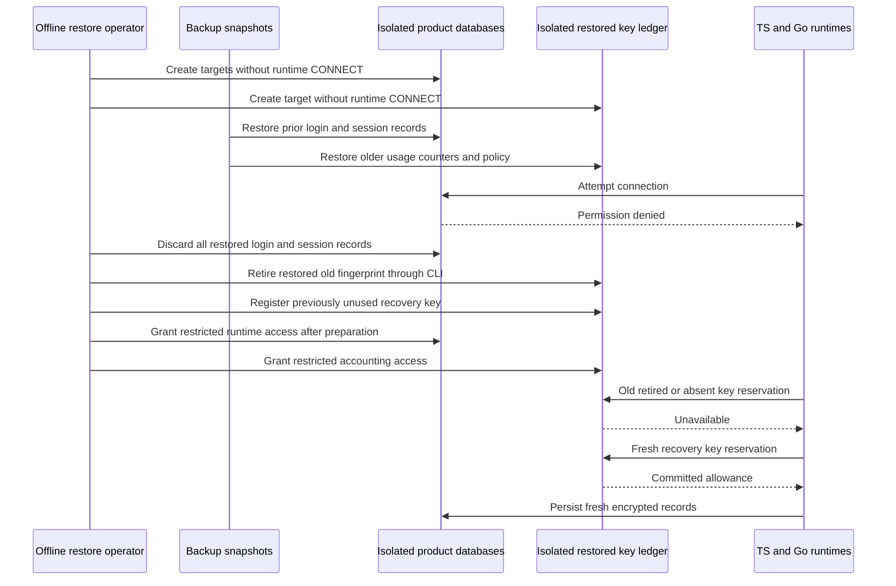

This checkpoint verifies the record-encryption portion of rotation and restore
across separate product databases. It does **not** certify a full Heimdall restore:
managed workflows, remote authorization, identity-provider state, audit continuity
and SIEM replay still require coordinated qualification. Phase 3 remains active.

## Topology and rolling configuration

The executable drill uses a pinned PostgreSQL 17.11 container with three databases:
Ledger product records, Support product records and the shared key ledger. Separate
TypeScript and Go processes run each phase concurrently. Product and accounting
pools have one connection each. A restricted login role receives record privileges
in product databases and only reads plus `UPDATE(used)` in the key database.

Both products first write with the same old material. A new key is then registered
through the real `heimdall-keys` binary. During rolling configuration, each product
reads old envelopes and writes using both old and new configurations. After the
old fingerprint is retired, newly started lagging processes using that old active
key cannot encrypt. Updated processes can still read old envelopes using retained
decryption keys and continue writing with the new key.

At this boundary the shared ledger records four uses of the old key and four uses
of the new key. These are combined counts across both product databases. Retirement
does not cancel reservations already confirmed before retirement; the drill does
not claim otherwise.

## Why restore must stay offline

The drill takes real custom-format `pg_dump` backups after the initial writes.
Subsequent phases delete a session record and consume more key allowance. Restoring
those earlier snapshots demonstrably brings back the deleted record and changes
the old key's state from retired with four uses to active with two uses.

Schema compatibility and valid ciphertext cannot detect this rollback. Resuming
runtime access immediately would make an old session record readable again and
would reuse an older key budget. The procedure therefore restores into fresh,
isolated target databases with runtime `CONNECT` revoked before data restoration.
Actual login attempts verify that runtime access is denied in all three targets.

In the drill, dropping restored login/session records is an explicit offline
invalidation step using deployment credentials. It does not delete audit events,
managed operations or business data. It forces fresh record creation instead of
replaying credentials from the snapshot. It is not routine expiry cleanup.

Both products reconnect only after the old restored fingerprint is retired, the
fresh recovery material is registered, and the restored login/session rows have
been removed. Both SDKs refuse the retired old key and the intermediate key absent
from the older ledger. Fresh writes consume exactly two allowances on the new
shared recovery key. The original databases remain unchanged by the isolated
restore exercise.

## Recorded proof

Run `heimdall-key-rotation-25f4c4c4d2ae48b1a758a302a635795c` passed on November
11, 2026 using the pinned image in `tests/integration/key-rotation.py`.
`contracts/fixtures/key-rotation.json` supplies the phase names, public synthetic
key material, expiry, allowance and Unicode payload. The harness builds the real
key CLI and runs both SDK test processes, including the Go race detector.

The test creates only disposable databases and keeps snapshot files in a temporary
directory outside the repository. It removes the container and files on completion.
No production data or Railway service state is restored by this test.

## Remaining operational boundaries

This is a fresh-target, offline record-layer drill, not an in-place restoration
procedure. Revoking `CONNECT` alone does not terminate existing connections. A real
restore must first stop and drain every writer, worker and credential holder that
could reach restored state, and prevent their return until all recovery gates pass.
A lease expiry or process restart is not that proof.

The SDK does not infer an unnoticed ledger rollback from the database's contents.
Do not register material with unknown prior usage at zero, even if its row is absent
from the restored ledger. Keep recovery keys fresh and shared across the intended
replicas. Audit events lost since backup cannot be recreated from this key ledger;
audit recovery/RPO, provider state and managed-operation reconciliation remain
separate required work in [[phase-3-readiness-audit]].
