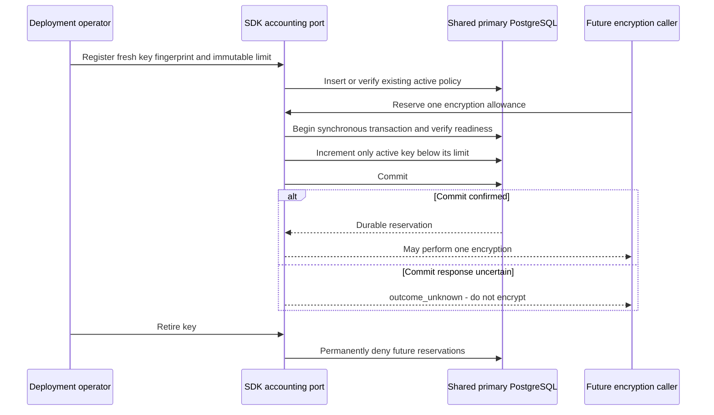

Phase 3 remains incomplete. This checkpoint implements internal PostgreSQL
accounting ports in TypeScript and Go. Record encryption does not yet call these
ports, so this is not a claim of deployment-wide encryption enforcement.

## Accounting boundary

All consumers of the same AES key material must share one ledger. The fingerprint
is SHA-256 over `heimdall.record-key-usage.v1`, a NUL byte and the raw 32-byte key.
Key aliases, products and environments do not create independent allowances.
Shared synthetic vectors verify this encoding in both languages.

The separate `heimdall_keys` schema contains an immutable per-key limit, monotonic
usage and irreversible retirement. The maximum configured allowance is 4294967295,
consistent with the fewer-than-2^32 encryption bound documented by
[Go's random-nonce GCM API](https://pkg.go.dev/crypto/cipher#NewGCMWithRandomNonce).
This accounting does not replace random secret keys or correct nonce generation.

A reservation survives subsequent encryption or record-write failure. Retrying
consumes another allowance; it never refunds or reuses an uncertain receipt.
Registration retries preserve usage and reject changed limits or retired keys.
Registration requires an explicit operator assertion that previously unseen key
material is fresh; the SDK cannot infer a key's historical use elsewhere.

Runtime credentials receive schema usage, table reads and `UPDATE(used)` only.
Registration and retirement need deployment credentials. Readiness checks the
pinned schema ledger on the primary inside the same transaction, with the shared
deployment advisory lock, synchronous commit and bounded statement/lock waits.

## Verification

`tests/integration/key-usage.py` launches an isolated pinned PostgreSQL 17.11
container and removes it after the run. Run
`heimdall-key-usage-85ed37ca675b4458b59808a39bd3c2ff` passed on November 11,
2026. It executes the actual TS and Go ports:

- Explicit Go initialization and readiness, then idempotent migration retry.
- Twenty concurrent reservations per language with a seven-use cap: exactly
  seven successes, including Go race-detector execution.
- Go and TS consuming the same two-use key, with the next reservation refused.
- Registration retries preserve counts; changed policy conflicts.
- Retirement is idempotent and irreversible; retired keys cannot be registered
  again or reserved.
- Runtime roles cannot register or retire keys; read-only connections refuse writes.
- Both languages lose the COMMIT response through the PostgreSQL protocol proxy:
  each returns `outcome_unknown`, while the two committed increments remain stored.
- SQL guards reject decreasing usage, changing limits, reactivating retired keys
  and deleting history.

Source-level checks also cover fingerprint vectors, bounds, malformed inputs,
pre-cancelled operations and checksum-pinned SQL bytes.

## Remaining work and operational constraints

The encryption and session/login writers still use their existing unmetered
primitive. Wiring every record write through confirmed reservations, rotation
configuration, deployment CLI support and full operational fault qualification
remain required. The public SDK does not yet expose these accounting ports.

Retirement cannot cancel already-confirmed reservations. It leaves decryption
available for retained keys. Ledger restore or cloning must never resume writes
with old material and rolled-back counts: use fresh encryption keys. Separate
ledgers, direct SQL, privileged counter manipulation and unrelated encryption
code cannot be made globally safe by this database's local counter.

See [[phase-3-readiness-audit]] for the remaining Phase 3 acceptance requirements.
