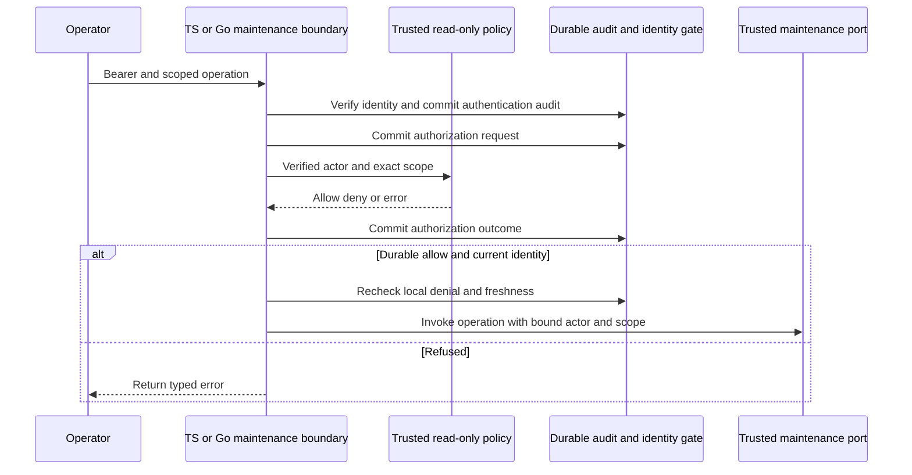
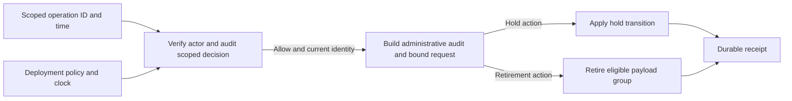

The internal TypeScript and Go maintenance boundary verifies a bearer token with
the deployment's identity verifier. It derives the actor from the verified
principal and fixes the product, environment and policy version to that
deployment. The policy callback receives the exact tenant, action, target and
operation ID. A null tenant selects product-level records only.

The configured policy is a trusted, read-only deployment integration. The
deployment supplies the pinned model and manifest metadata. The caller cannot
supply the actor or widen the scope through mutation of the callback input.
A mismatched or missing audit receipt prevents the storage callback from running.
The last identity check catches a durable deny arriving during the decision, as
well as expired or stale identity evidence.

Product-level allow and deny events use the existing authorization request and
completion protocol. The schema exception applies only to recognized audit
maintenance actions with matching permission, a known SDK user, an audit event
target, an operation ID and a policy version. Application decisions keep their
tenant requirement.

A new maintenance authorization needs room for its own durable decision.
The v5 release reservation covers the release event after authorization.
Authentication and policy failures keep the maintenance operation closed.
Operator policy configuration and production scheduling remain open. The bound
command below connects the authorization result to storage.

## Verification

Shared fixtures exercise allowed and denied exact scopes, invalid credentials,
audit receipt failure, policy outage, revocation and stale identity. The live
profile uses the real retained v5 append port with signed-token verification
against a controlled provider fixture.

Pinned PostgreSQL run `heimdall-capacity-backfill-7d479bc7291a46258a9b75dadf345fd7`
passed the live authorization profile in both languages. It verified ten completed
product-level decisions in the durable v5 ledger. The shared tests confirm
that missing or mismatched receipts, denial, revocation and stale identity keep
the callback from running. Workspace checks passed with 1,729 TypeScript tests,
125 environment-dependent skips and Go race tests. The documentation check
parsed 197 Mermaid diagrams.

## Bound maintenance command

Both SDKs compose the authorization boundary with the privileged retirement and
hold ports. The command takes a stable operation proposal and uses the
deployment's model, policy version, retention duration and trusted clock. It
builds the storage request and administrative event from the authorized scope
and verified actor. Callers can retry the same proposal and receive the same
administrative receipt. Each retry is independently authorized and audited.

The shared command profile exercises both hold purposes, cross-tenant denial,
future-time refusal and idempotent retirement. It can use the real v5 port
with a dedicated PostgreSQL role. Production policy setup and scheduling remain
deployment integrations.

Pinned PostgreSQL run `heimdall-capacity-backfill-5c9c0425023e43f18a40c566cc78091b`
passed the bound command profile in both languages using a dedicated maintenance
role. The two product-level targets each received two released holds and one
retirement marker. Their payloads were removed. Both SDKs verified the stored
retirement actor and policy, and the original receipt survived an authorized
retry. Cross-tenant release and future-time proposals were refused. Workspace
verification passed with 1,730 TypeScript tests, 125 environment-dependent skips,
Go race tests and 198 Mermaid diagrams.
