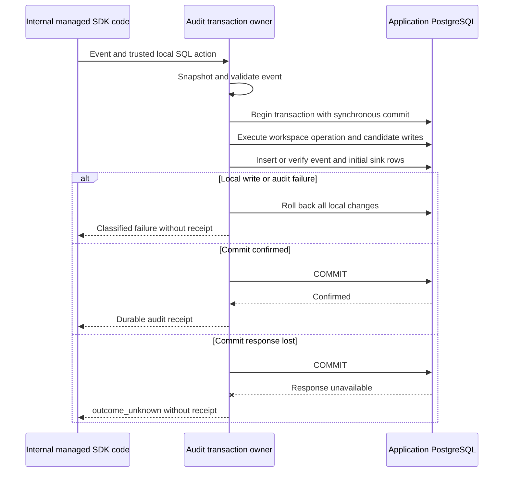

The internal audit store in both SDKs now supports local SDK writes in the same
transaction as an audit event and its initial outbox rows. Standalone append uses
the same implementation. This establishes the transaction boundary for forthcoming
managed mutations; it does not implement onboarding or remote recovery.

## Boundary and retry semantics

TypeScript's internal `PostgresAudit.appendWith` and Go's package-private
`Audit.appendWith` run local SQL and existing audit logic on one connection.
Validation and event snapshotting happen before the callback or database I/O.
The snapshot prevents a caller mutation during the callback from changing the
stored event. Callback conflicts, database errors, audit-ID conflicts, outbox
failures and cancellation before commit roll back uncommitted state. A successful
receipt is released only after COMMIT, with the original sink routing preserved.

The callback is for trusted SDK implementation, not product extension code. It must
not commit independently, perform remote I/O, ignore its cancellation context or
publish a success result. Public runtime storage still exposes standalone audit
append only. Higher-level methods must validate authenticated provenance, scope,
intent binding, lifecycle transitions and generation CAS.

Audit event idempotency is not mutation idempotency. A matching existing event does
not stop the callback from running: managed operations must check their durable
operation key and generation inside the transaction. Receipt recovery after a lost
response verifies the event; it is not permission to blindly replay a mutation.
No timer or lease can clear remote-write uncertainty through this primitive.

## Executed evidence

Local pinned PostgreSQL 17.11 run `e804264b4e7c45978de03cb86f0245ad` passed the
shared six-case transaction matrix in both languages using a restricted runtime
role:

- Successful workspace, operation, candidate, audit-event and two-sink commit.
- A typed callback conflict and a database uniqueness conflict both roll back
  all newly written managed state without an audit receipt.
- Existing audit ID with a different payload preserves the original event and
  rolls back the attempted managed writes.
- Failure inserting the second sink rolls back managed rows, event and first sink.
- Cancellation after local writes and before commit preserves the cancellation
  error and leaves none of the newly attempted rows committed.

Both implementations also pass validation-before-callback and event-snapshot tests.
Separate wire-proxy runs observe the server's confirmed COMMIT, withhold its
response and disconnect the client. Each SDK returns `outcome_unknown` and no
successful receipt. Independent reads find all five record families committed.
Standalone receipt recovery succeeds without changing the original two sinks or
replaying managed writes.

The broader session/audit regression run
`heimdall-records-cae5be7e74db4e308162c703132ff2c9` passed after standalone append
was routed through the shared boundary. It includes public durable bearer runtimes,
identity gates, cross-language receipts, audit/outbox transitions and their
committed-response-loss tests. These are native SDK tests against disposable local
PostgreSQL; they are not a live managed-product rollout.

Reproduce with `python3 tests/integration/managed-schema.py` and
`python3 tests/integration/postgres-records.py` using the repository toolchain.
Machine-readable evidence is in
`tests/integration/evidence/managed-audit-transaction-2026-11-11.json`.
The shared fixture's operation bytes are synthetic physical rows, not a complete
validated onboarding command. The audit envelope uses bundled structural and
semantic validation; authenticated event provenance remains the SDK caller's duty.

Managed create/update methods, complete intent/operation validation, candidate
coordination and safe recovery still require implementation. The other Phase 3
foundations remain tracked in [[phase-3-readiness-audit]]. This checkpoint does not
complete Phase 3 or advance to Phase 4.
