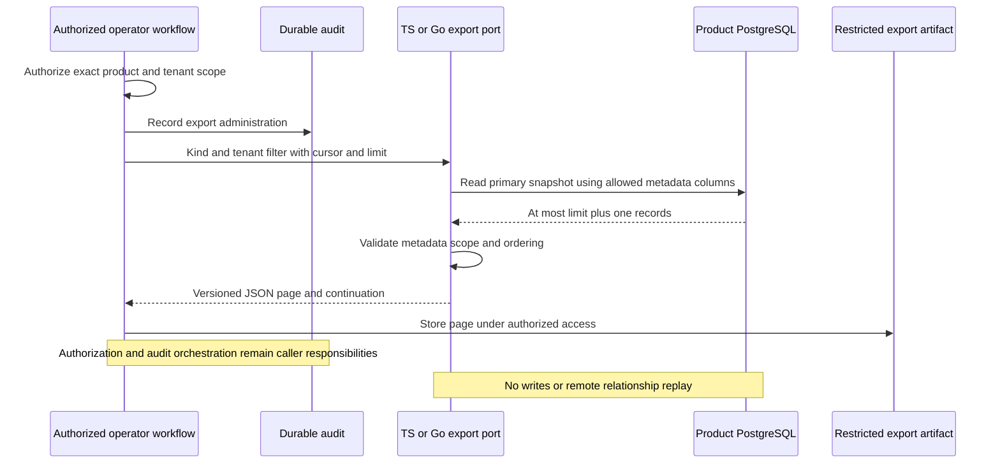

TypeScript and Go now implement bounded, read-only export pages for managed
workspace and operation metadata. This completes the internal export storage port;
[[phase-3-readiness-audit]] still has unfinished foundations, and public authorized
export administration remains later integration work.

## Format and data flow

Both SDKs emit a version-1 JSON page containing fixed scope, export kind, tenant
filter, items and a nullable last-emitted-ID continuation. Workspace pages carry
IDs, lifecycle, block state, revision and timestamps. Per-workspace operation pages
carry IDs, kind/state, dispatch/generation counters, timing and model/manifest pins.
All states remain visible, including tombstones and uncertain operations.

The SQL projection excludes names, principals, identity hashes, intent payloads,
fingerprints, idempotency digests, role assignments and session secrets. The reader
needs only SELECT on the allowed metadata columns and schema USAGE. IDs may still
contain operator-selected identifying information: the artifact is not anonymous
or intended for public disclosure.

`contracts/managed-export.md` defines exact fields, limits and the exit mapping.
The stored model IDs/hash and manifest version identify the separate model and
compiler mappings to retain. `member`, assignment `r_N`, effective `e_N`, delegation
`d_N` and permission `p_N` relations must be interpreted using that exact manifest;
ordinals cannot be inferred from another version.

## Verification

Shared `contracts/fixtures/managed-export.json` provides 39 metadata vectors for
valid states, exact bigint revisions, safe numeric bounds, malformed rows and
unexpected sensitive fields. Both SDKs reject a malformed row rather than return
partial data.

The disposable pinned PostgreSQL harness verifies:

- 103 workspaces and 102 operations over bounded pages, correct continuation and
  terminal-page behavior, with uncertain operations preserved.
- Product/environment and explicit workspace filtering; no authorization inferred
  from a cursor or a matching company name.
- A column-restricted role can execute both exports but cannot SELECT workspace
  names or operation intent payloads. Seeded private values never appear in output.
- TS reads Go-seeded metadata and Go reads TS-seeded metadata through the export
  ports, without credentials or encryption keys in the artifacts.
- Read-only connections are refused, blocked reads respect caller deadlines,
  pre-cancellation avoids I/O, and the pool remains usable after cancellation.
- Existing managed migration, journal, membership, candidate, concurrency and
  committed-response-loss regression tests still pass.

Run `aa13157b4430426387c5bec4a6588826` passed against pinned PostgreSQL 17.11. This
is local database evidence, not proof of a production operator UI, SIEM export or
complete restore. The immutable session and managed SQL checksums are unchanged.
Workspace checks passed 1,484 TypeScript tests (58 live-only tests skipped outside
the configured harness), Go race tests and package builds. All 130 Mermaid
source diagrams pass parsing. A related scope-validation regression rejects a
trailing newline before cleanup I/O in TypeScript, matching Go's strict grammar.

## Consistency and exit limits

Each page is one primary snapshot. Multiple pages do not share a snapshot. Stop
and drain writers before a consistent exit inventory; a live traversal can miss
inserts behind its cursor or observe later updates. The export port does not
establish or certify the freeze, quiescence or resolved-operation prerequisites.

Export metadata cannot restore the operation journal, audit, identities, sessions
or OpenFGA tuples. Preserve access-controlled backups and obtain relationships
through separately authorized OpenFGA APIs. Resolve dispatched/uncertain writes
using the selected recovery procedure and explicitly transfer lifecycle ownership
before exit. A successful export never unblocks a workspace or permits replay.
