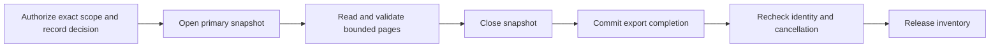

Both SDKs can assemble an authorized inventory from multiple PostgreSQL pages
in one repeatable-read transaction. The reader uses the existing column
allowlist. The SDK closes the snapshot before recording the export and checking
identity again. The product receives one complete JSON document.

The inventory is bounded to 100 pages, 4 MiB of page input and five seconds of
snapshot time. Failed or unfinished inventories return an error without
releasing partial data. This covers local workspace or operation metadata.
The product coordinates remote relationship export and the managed exit
procedure separately.

Pinned PostgreSQL run `heimdall-capacity-backfill-1190ebeed26a4abbba2ee1d00b64da00`
verified both SDKs with a separate column-restricted reader and audit writer.
A concurrent write changed a later workspace after the first page. Each
inventory returned its original state and persisted one successful completion.
Shared cases also verify cursor progression and refusal after the page limit.
