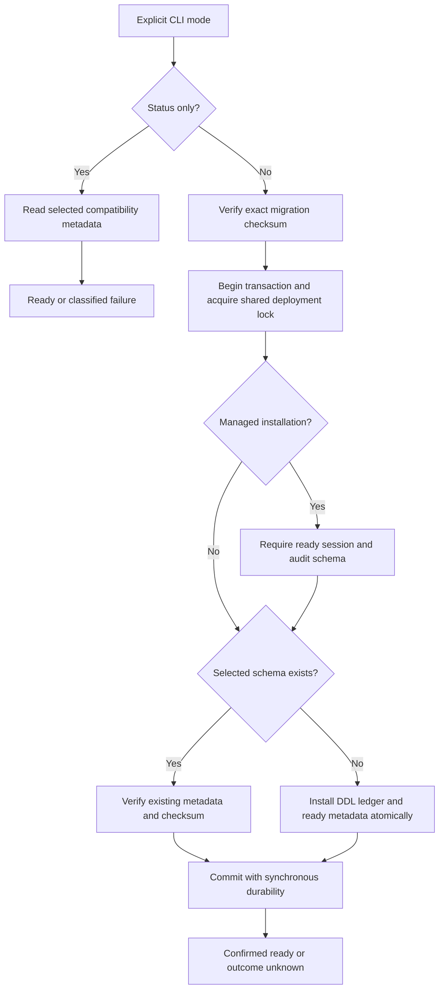

The existing deployment-only CLI now installs the separately pinned managed schema
after checking session/audit readiness. TypeScript and Go check both schema families
in one statement snapshot. This advances #52; Phase 3 remains incomplete.



## Operator interface

From `sdk/go`, supply the application database connection through
`HEIMDALL_MIGRATION_DATABASE_URL` and choose exactly one command:

```sh
go run ./cmd/heimdall-migrate -initialize-session-schema -sql ../../contracts/persistence/session/0001.sql
go run ./cmd/heimdall-migrate -initialize-managed-schema -sql ../../contracts/persistence/managed/0001.sql
go run ./cmd/heimdall-migrate -status session
go run ./cmd/heimdall-migrate -status managed
```

Initialization is explicit. A missing prerequisite fails without implicitly
installing it. Existing incompatible or partial schemas are rejected without
adoption or repair. Exact SQL checksums are checked before database I/O. Runtime
constructors never migrate. Both installers use the same database advisory lock,
READ COMMITTED isolation and synchronous commit. They retain the 30-second overall,
five-second lock and 20-second statement limits. A failed COMMIT response returns
`outcome_unknown`; an exact rerun verifies the ledger under the lock.

Status accepts no SQL path or initialization flags and performs no writes. It
checks writer compatibility on a primary, so a read-only transaction or replica is
unavailable even though a SELECT-only role on the primary can run it. Combined
managed readiness requires both independent ledgers and metadata; session-only
readiness does not depend on the managed family. Both SDKs use a five-second bound
and preserve cancellation. Readiness is a snapshot, not a migration fence or a
complete physical-schema/privilege audit.

## Executed evidence

Local pinned PostgreSQL 17.11 run `f6ff3a42712a4ce9b0ddd305d62731a8` passed:

- The shared 22-case compatibility matrix in both SDKs, including invalid metadata,
  protocol ranges and ledger/checksum mismatches in either family.
- Committed versus uncommitted migration-state visibility; failed managed readiness
  does not prevent session-only readiness.
- Missing managed schema rejection without creation; read-only connection rejection
  and successful status with a SELECT-only role.
- Invalid command combinations, missing prerequisite refusal, mid-DDL permission
  failure with full rollback, concurrent installers and idempotent reruns.
- Cancellation while waiting for the deployment lock and successful retry afterward.
- A wire proxy observed a confirmed managed COMMIT but withheld its response. The
  command returned `outcome_unknown`; a direct read found ready metadata before an
  exact rerun succeeded.
- Existing physical constraints and bidirectional TS/Go record reads.

Session-storage regression run
`heimdall-records-53082407397e4bbbbcbf5de3f0845d15` also passed, including session
migration faults, encrypted CAS, durable audit/outbox, identity invalidation and
both public PostgreSQL-backed bearer runtimes.

Railway verification run `149ffc2e201c4e68aacfb9bf52aaf681` uploaded the actual
Linux CLI binary, verified its checksum and executed both installers/status modes
against a disposable application database. Concurrent managed installs serialized;
either incompatible family blocked installation/status without repair. Status
worked with the restricted SELECT-only role. Database, role and uploaded artifacts
were removed and cleanup verified. This used the existing private verification
PostgreSQL service, not the identity services' databases. It did not deploy a new
companion service or open a public database port.

Machine-readable results and checksums are recorded in
`tests/integration/evidence/managed-migrations-2026-11-11.json`. Reproduce with
`python3 tests/integration/managed-schema.py`,
`python3 tests/integration/postgres-records.py` and the explicitly scoped
`python3 tests/integration/migration-runner-railway.py --execute-verification-migration`.
The workspace gate passed 1,260 TS tests with 32 optional live-test skips, Go race
tests, package-consumer checks and both SDK builds. The local integration commands
above separately execute their database-dependent cases.

## Remaining boundary

Managed workspace/operation/candidate adapters and their atomic audit composition
are still required. There is no public managed constructor, automatic recovery,
force-unblock or lease-fencing claim. This initial installer cannot upgrade beyond
v1, drain running versions, or prove backup/restore safety. Operational foundations,
audit capacity/recovery and key-usage enforcement remain in
[[phase-3-readiness-audit]].
