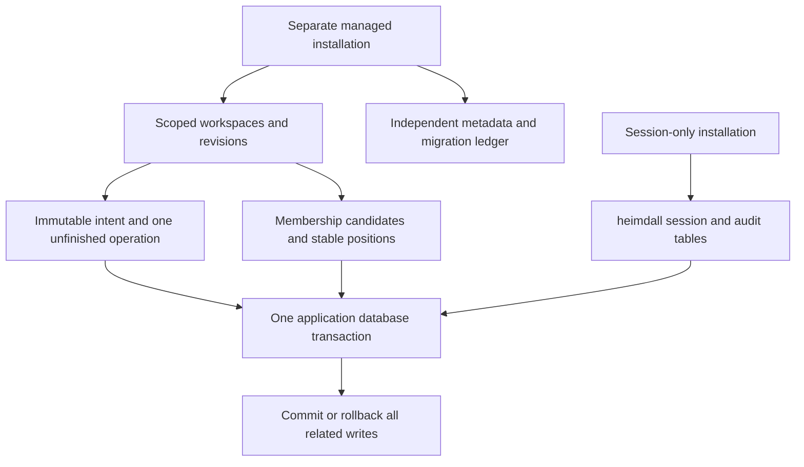

The shared migration catalog now includes a separately installed managed schema.
`contracts/persistence/managed/0001.sql` is pinned by SHA-256
`3df4dc62f6271691c56ac605c51012a97301b98c70454af62984cf253c066c55`.
The published session migration bytes and checksum are unchanged. This addresses
the missing physical-schema portion of [[phase-3-readiness-audit]], not the complete
managed adapter or lifecycle work.

## Storage boundaries

| Family | Physical constraints | Responsibility still above SQL |
| --- | --- | --- |
| Managed metadata | Independent version/range/checksum tables | Migration runner, readiness and upgrade policy |
| Workspaces | Scoped primary key, immutable identity, noncycling revision, lifecycle and timestamp bounds | Validated names, lifecycle CAS and authorization gate |
| Operations | Scoped FK, immutable intent/indexed bindings, unique idempotency digest, one unfinished operation per workspace | Complete payload/digest validation, generation CAS, legal transitions and recovery evidence |
| Candidates | Scoped identity/workspace key, stable database-issued position and changing revision | Canonical principal/hash validation, fresh membership checks and coordinated rebuilding |
| Audit/outbox | Existing immutable session-v1 tables in the same application database | Required event semantics and atomic orchestration |

Operation intent is stored as UTF-8 JSON bytes, preserving escaped U+0000 identities
without JSONB conversion. SHA-256 identity/digest columns avoid oversized identity
indexes. Store/model/hash and manifest version are immutable operation bindings.
Completed/cancelled records retain their idempotency keys. An uncertain operation
retains the unique unfinished-operation slot indefinitely; its timestamp cannot
expire that slot. Due-work indexing includes only pending/retryable states.

Runtime roles can read/write the selected records but cannot delete workspace or
operation history, reset sequences, alter migration metadata or run DDL. Candidate
rows may be deleted for explicit reconciliation. Scoped foreign keys use RESTRICT.
The schema does not isolate mutually hostile product backends sharing credentials.

No trigger authorizes a user, dispatches remote writes or replays uncertain work.
SQL bounds alone do not implement the operation state machine. Future SDK adapters
must reject illegal transitions, preserve the lifecycle gate and establish verified
quiescence before recovery. The tests complete a separately confirmed operation to
check retained idempotency; they do not clear an uncertain operation.

## Executed proofs

Local PostgreSQL 17.11 run `f6e49fdb945f491d99fefc62d0c14504` passed native TypeScript
and Go SQL tests, including bidirectional reads of escaped-NUL/Unicode intent bytes.
Railway run `241c4eafb1354d298c2531903a4b973e` executed the same shared SQL constraint
vectors in a disposable application database on the existing verification cluster.
It did not modify either service's internal database or deploy a product backend.

Both runs proved:

- Session-only installation creates no managed schema.
- A failure after managed DDL/metadata insertion rolls back the entire installation.
- Scoped foreign keys, immutable fields and privilege boundaries reject 18 shared
  negative cases with their expected PostgreSQL error codes.
- Two concurrent unfinished-operation inserts for one workspace have one winner.
- Workspace, operation, candidate, audit event and delivery rows roll back together.
- Runtime credentials cannot delete history, reset sequences or create tables.

The native language tests also check stable candidate positions with new revisions,
retained terminal idempotency, and reuse of the unfinished-operation slot only for
a different key after confirmed completion. Schema fixtures use synthetic payload
and audit shapes to isolate physical constraints; they are not complete validated
SDK event/operation examples. Railway ran SQL through the verification connection,
not the native SDK processes inside the database service.

The full workspace gate passed 1,259 TypeScript tests (30 optional live skips), Go
race tests, package consumer checks and SDK builds. Both languages verify the exact
session and managed SQL bytes through their storage compatibility policy tests.
Updated documentation contains 118 parsed Mermaid diagrams across 82 pages.

Reproduce locally with `python3 tests/integration/managed-schema.py` under the
repository toolchain. The explicit `--execute-verification-managed` option targets
the fixed Railway verification project with the existing CLI/SSH configuration.
Both modes drop their owned database and test role before reporting success.
Machine-readable evidence is in
`tests/integration/evidence/managed-schema-2026-11-11.json`.

## Next implementation

The subsequent [[phase-3-managed-migrations]] checkpoint adds managed installation
and combined readiness. Next, build TS/Go managed record adapters with shared
transaction, CAS and corruption tests.
No public managed constructor or placeholder operation API is introduced here.
Cleanup, restore, audit capacity/recovery and key-usage foundations remain open in
[[phase-3-readiness-audit]]. Phase 3 remains in progress.
