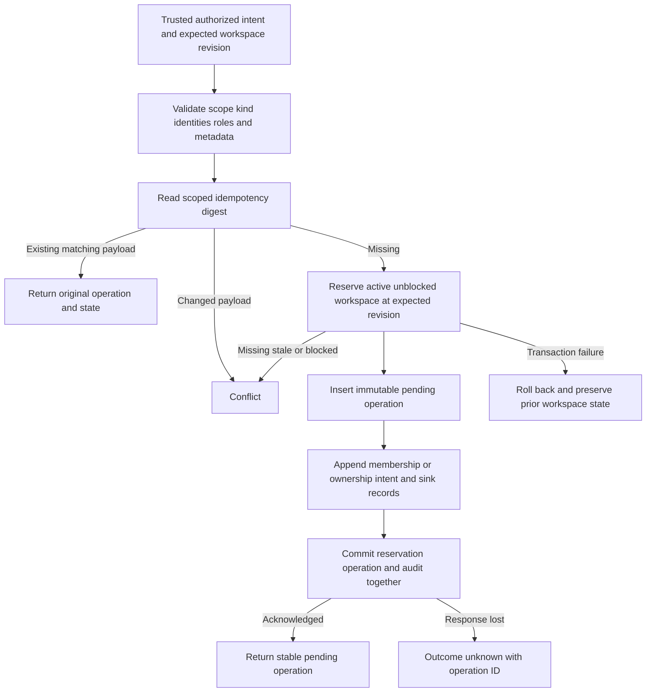

Both SDKs now record durable membership and ownership intents for existing
workspaces. The local transaction reserves the workspace, stores the immutable
operation and commits its required audit/outbox records. This is the persistence
boundary for future administration, not a public role-management API.

## Behavior implemented

Add, remove, role assignment and ownership transfer use the same scoped digest and
fingerprint rules as creation. A new intent requires an active, unblocked workspace
at the supplied revision. The revision is checked as an exact bigint string.
The workspace is reserved first, preserving the established lock order. Candidates
remain unchanged until confirmed completion.

Retries return the original record even when the original revision has changed.
They preserve terminal and uncertain states. Changed payloads conflict. Concurrent
identical requests converge on one operation and one intent audit; competing keys
cannot reserve the same revision. Existing uncertain work keeps the scope blocked.

Audit failure rolls back the reservation and operation. Lost COMMIT acknowledgement
returns outcome_unknown with an operation ID; retry can recover a committed pending
record. Ownership uses its reserved audit event family. Cancellation before any
dispatch preserves the active workspace and permits a later independently keyed
request at the new revision. No local transaction spans a remote network call.

## Evidence

Local PostgreSQL 17.11 run `3ffafc3ca0464ead9885c7ba63fe4f99` passed the full managed
integration harness. Both SDKs verify:

- All four membership kinds through durable intent, dispatch marker, supplied
  confirmation and atomic completion; terminal retry returns the original result.
- Workspace/intent mismatch and malformed revisions rejected before database access.
- Pending, suspended, tombstoned, blocked and stale-revision workspaces refused.
- Eight identical concurrent requests converge; two competing keys have one winner.
- Changed targets conflict; an uncertain operation cannot admit a successor, and
  same-key retry preserves uncertainty.
- Audit-ID conflict rolls back the workspace revision/block and leaves no operation.
- Pre-dispatch cancellation preserves active lifecycle and permits a new intent.
- Each language reads and retries the other's completed membership operations.
- A proxy drops a confirmed COMMIT response: the reservation and pending operation
  remain durable, the caller receives outcome_unknown, and retry returns original IDs.
- Existing creation, transition, candidate, migration and audit regression tests.

The shared fixture is `contracts/fixtures/membership-intents.json`; the contract is
`contracts/managed-operations.md`. Run
`python3 tests/integration/managed-schema.py` in the configured pnpm environment.
Neither immutable migration checksum changed.

Tests seed existing workspaces and supply confirmation as a trusted test input.
They do not establish actor authorization, product role validity, last-owner policy,
remote mutation success or operator recovery. Those remain mandatory orchestration
requirements. Workspace revision checks do not fence external OpenFGA requests.
Rebuild coordination, recovery scanning and operational foundations remain open;
Phase 3 remains active under [[phase-3-readiness-audit]]. Railway deploys this
checkpoint's documentation; the new SDK storage tests use disposable local PostgreSQL.
