Both SDKs now require a durable key-usage reservation before PostgreSQL record
encryption. This completes the adapter composition missing from
[[phase-3-key-usage-ledger]]. Phase 3 remains incomplete: deployment tooling,
rotation/restore procedures, audit capacity/retention and operational qualification
remain required.

## Write boundary

The record and identity-bound session constructors now receive an explicit key
accounting pool in addition to the product database pool. They can be the same
pool, or different pools connecting to a shared ledger. Every consumer of shared
key material must select the same ledger. Runtime constructors do not migrate
schemas or register keys.

```mermaid
sequenceDiagram
  participant A as Product SDK
  participant R as Record adapter
  participant K as Shared key ledger
  participant C as AES GCM cipher
  participant D as Product database
  A->>R: Create or compare and swap
  R->>R: Validate and snapshot scoped plaintext
  R->>K: Reserve active key fingerprint
  alt Confirmed durable reservation
    K-->>R: One allowance consumed
    R->>R: Check caller cancellation
    R->>C: Encrypt snapshot exactly once
    C-->>R: Authenticated envelope
    R->>D: Persist record or attempt CAS
    D-->>R: Result or write failure
    R-->>A: Return result without refunding allowance
  else Missing retired exhausted or uncertain
    K-->>R: Error
    R-->>A: No encryption or record write
  end
```

The shared sealing method covers generic login/session creation and CAS as well
as identity-bound session creation and CAS. Reservations commit before acquiring
the subsequent record transaction's connection or identity lock. A single-slot
pool therefore does not require two simultaneous connections for one write.

Counts measure encryption attempts, not successful rows: a lost CAS, duplicate
creation, denied identity or failed database write still consumes allowance.
Reads and deletions need no encryption allowance. Retirement preserves decryption
with retained keys. A renamed key ID has the same fingerprint and cannot reset
usage. A new active key must be registered, and its own allowance governs writes.

## Evidence

The pinned PostgreSQL 17.11 run
`heimdall-key-usage-83dc075d6e7d48aaaacd4632cecb8acc` passed the extended
`tests/integration/key-usage.py` checks in both languages, using shared limits, expiry and Unicode payload from
`contracts/fixtures/metered-records.json`:

- All four create/CAS entry points fail when the key is exhausted.
- Six confirmed encryptions include successful writes, stale CAS, duplicate
  creation and a denied identity. Rejected writes do not refund these counts.
- Key aliases and another product do not bypass the shared allowance.
- Retiring the old key preserves reads. Rotation accepts old envelopes and writes
  with the newly registered key until its separate allowance is exhausted.
- Accounting uses a restricted runtime pool with no product-record privileges;
  product writes use their separately supplied connection.
- Lost accounting COMMIT responses produce `outcome_unknown` and no record in
  either SDK. A TypeScript spy additionally verifies no call to encryption.

The existing storage, session, identity, CAS-race, cross-language read, audit,
migration and response-loss suite passed in run
`heimdall-records-b43cd731bf9241bdbbe2e0f4c66a4d2b`. Its fixture setup explicitly
installs the accounting schema and registers the public synthetic test key.
Pre-cancelled writes also have focused tests requiring no database connection;
the TypeScript test additionally requires no encryption invocation.

## Limits

These are internal adapters. Public browser sessions and HTTP handlers are later
work. Pure envelope helpers remain available internally for cryptographic fixtures;
they are not persistence adapters and do not independently meter encryption.

This checkpoint proves same-ledger adapter accounting, not global control of
unrelated encryption code or independently restored/cloned ledgers. Registration
must represent fresh material. Every deployment sharing keys must share accounting,
and restoring an older ledger requires fresh encryption keys before writes resume.
Retirement cannot revoke an already-confirmed in-memory allowance. Full deployment
CLI support and operational rotation/restore qualification remain open.
