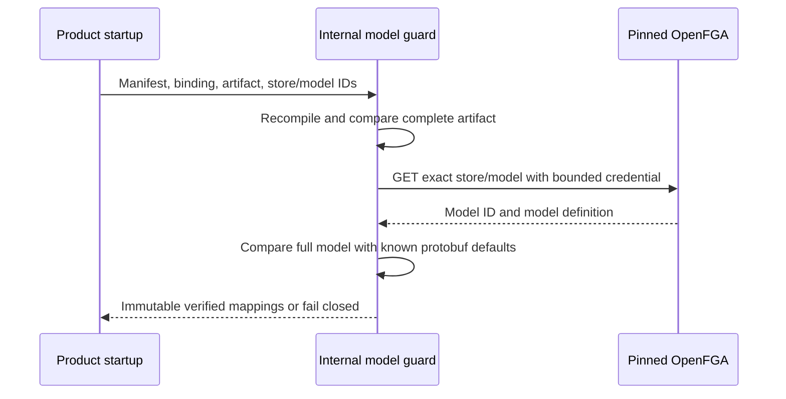

The internal TypeScript and Go guards now bind a compiled product policy to an exact OpenFGA store/model pair before its mappings can be used. They recompute the model, hash, role mapping and permission mapping from the structurally validated manifest and binding, rejecting altered artifacts locally.

The read has a five-second deadline including credential loading, honors earlier cancellation, rejects redirects and limits the response to one MiB. Missing models, changed definitions, unexpected fields and credential/provider failures return unavailable without provider details. Local artifact mismatches return invalid_argument. Credential callbacks must honor cancellation; arbitrary callback work cannot be forcibly stopped by the SDK.

The pinned provider returns protobuf defaults absent from the compiler artifact: empty conditions, empty user relations/null metadata, empty computed-userset objects, metadata module/source_info and reference conditions. Only these known defaults are normalized. The complete resulting structure is compared; unknown fields are not dropped. No latest-model lookup, model write or fallback occurs.

## Evidence

Railway OpenFGA 1.22.0 run `d6312d32-6596-4693-a509-7d178fc6928e` passed direct SDK verification in both languages for Ledger, Support and the custom-owner fixture. The existing role-combination, membership, delegation, cross-tenant and cross-product checks also passed. All owned stores were deleted in the probe's cleanup path.

Machine-readable output is recorded in `tests/integration/evidence/model-binding-2026-11-11.json`. The shared `contracts/fixtures/model-binding.json` captures the provider response and negative cases for model ID, schema, unknown fields, conditions, null relations and changed membership semantics. Tests additionally cover altered local hashes/mappings, HTTP failures, caller cancellation and a credential loader that does not settle before the caller's deadline.

The full workspace gate passed: 968 TypeScript tests, Go tests with the race detector, formatting/lint/types/Knip, SDK builds and 72 Quartz pages. The 21 optional live tests are skipped by the ordinary gate; the model probe invoked both SDK live tests with Railway credentials.

## Remaining boundary

These are internal readiness primitives. They do not expose a public runtime, authorize tuple mutations, activate models or migrate tuples. Future checks must use the returned exact model ID and scoped mapping; a verified model alone says nothing about current membership. Phase 3 and the model implementation ticket remain open.
