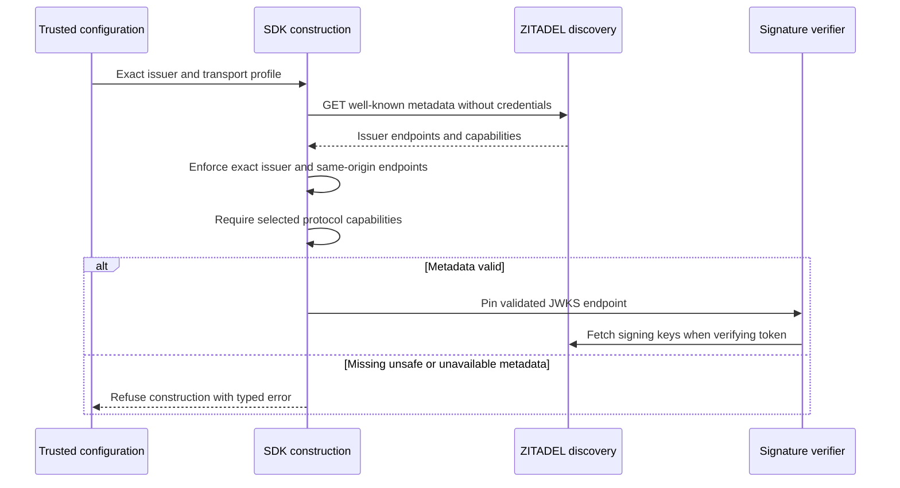

Phase 3 remains in progress. Both SDKs now discover and validate the provider
metadata required to construct the selected backend runtime. This closes the gap
between a configured issuer and the signature verifier's trusted JWKS URL.

## Implemented boundary

Discovery reads only the configured issuer's well-known URL. The returned issuer
must match exactly, and all five selected endpoints must pass endpoint validation
and share that issuer's origin. Separate hosted Login UI remains supported because
the provider authorization endpoint retains its own origin.

Require code response, authorization-code and refresh grants, S256 PKCE, RS256,
and Basic client authentication at token/introspection/revocation endpoints.
Additional advertised algorithms do not broaden signature verification. Unknown
metadata extensions are ignored; selected endpoints are returned as an immutable
TS object or copied Go value.

Each read has a five-second total deadline, earlier caller cancellation, a 64 KiB
response limit, strict UTF-8/Unicode JSON, and no redirects or retries. Invalid
operator endpoint configuration fails before network dispatch. Provider failures
are unavailable, not unauthenticated; cancellation and deadlines stay distinct.
No bearer token, client secret or administrative credential is sent by discovery.

## Verification

Shared `contracts/fixtures/oidc-discovery.json` covers supported metadata, ignored
extensions, unchanged algorithm policy, issuer mismatch, missing fields, malformed
capabilities, cross-origin URLs, traversal, query strings and transport downgrade.
Transport tests cover redirects without following them, oversized/malformed
responses, pre-cancellation, earlier deadlines and invalid configuration without
network dispatch. Existing live token tests now use discovery output before
signature verification in both languages.

The full workspace gate passed with 1,127 TypeScript tests, 25 optional live tests
skipped, Go race tests, SDK builds and Quartz validation. Separate live discovery
tests passed against the pinned Railway provider in both languages. The Ledger
and Support OIDC probe also passed with both SDKs using validated discovery,
checking valid tokens, cross-product audience rejection, unknown keys and forged
signatures. The probe removes its disposable organization after verification.

Live run `f5c3a246-d2aa-450d-ad66-c165ea8c5e14` completed at `2026-11-11T11:43:12.508Z`.
The tested implementation is the commit containing this checkpoint, based on
`075854eb9cdfbdcf0f38cd204d08287ed6c6d1e6`. The provider is the Phase 2 pinned
ZITADEL deployment `7ef5c76d-4911-4326-97dc-50d5614f2a55`.

Sanitized live output is tracked in
`tests/integration/evidence/oidc-discovery-2026-11-11.json`. Run the existing
`probe:oidc` with `HEIMDALL_PROBE_SDK_IDENTITY=1` and the documented private
verification credentials. Direct metadata-only checks use
`HEIMDALL_TEST_DISCOVERY_ISSUER` with the discovery tests, without credentials.

## Remaining gate

Discovery proves endpoint and advertised-capability compatibility, not client
registration, product ownership, credential validity, human identity or storage
readiness. Public factory composition, audited identity entry points and full
browser session orchestration remain open. No phase advancement or public
runtime-authentication claim follows from this checkpoint.

The internal contract is `contracts/oidc-discovery.md`; the provider's
[endpoint documentation](https://zitadel.com/docs/apis/openidoauth/endpoints)
explains discovery and JWKS. The implementation deliberately accepts the selected
same-origin ZITADEL profile rather than arbitrary cross-origin OIDC topologies.
