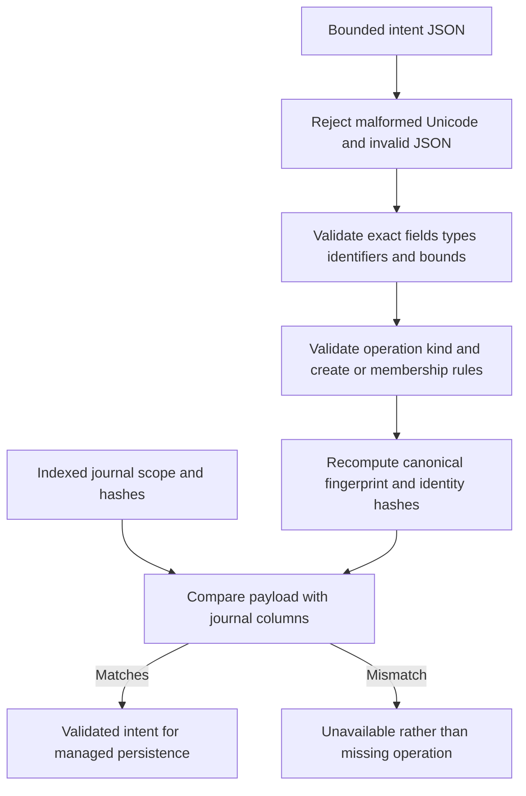

Both SDKs now validate complete operation intents before hashing and expose
internal bounded JSON parsers for persisted payloads. A second validator binds a
payload to its indexed journal scope, identity hashes and fingerprint. This removes
the former assumption that every digest caller had already run schema validation.
It does not implement durable operation lookup or idempotent creation yet.

## Implemented boundary

The parser accepts at most 1 MiB of JSON and validates exact camel-case fields,
required nested identity fields, supported operation kinds, product/environment and
workspace identifiers, name limits, unique role identifiers, manifest version and
all existing intent semantics. Both languages reject malformed native Unicode and
escaped unpaired surrogates instead of repairing them. Escaped NUL in a subject is
preserved under the established identity encoding; display-name controls remain
invalid. The typed Go representation now serializes the shared camel-case keys.

JSON numeric representations such as `1`, `1.0` and `1e0` represent the same integer
version. Repeated object members follow last-value semantics in both SDKs. Go
normalizes the decoded object before typed conversion, preventing its usual struct
merging from retaining an earlier issuer when a later repeated actor object omits
that required field. Unknown and missing resulting fields still fail validation.

Digest functions validate directly, even when bypassing the JSON parser. Valid
existing fingerprints and idempotency digests remain byte-for-byte unchanged.
Names, identities and role order are not normalized; only the fingerprint's copied
role array is sorted.

The journal-binding helper compares product, environment, operation kind, manifest
version, canonical actor/target hashes and recomputed fingerprint. Non-create
workspace IDs must match the journal workspace ID. Creation intentionally keeps its
allocated workspace ID outside the request fingerprint; the journal ID must still
be a valid nonempty identifier. The future journal transaction must allocate it
once and return the same ID on retries.

Malformed raw inputs return `invalid_argument`. A stored payload/index mismatch
returns `unavailable`, preserving the distinction from a missing operation. Hashes
and valid syntax do not authenticate actors or authorize roles. Product policy,
current membership/delegation, model pins, operation state/generation and durable
idempotency lookup remain separate requirements. The raw idempotency key is absent
from the payload, so this helper cannot reconstruct its stored key digest.

## Evidence

The focused TS suite passed 184 tests, including the existing intent/state corpus,
71 new parsing cases, 15 binding cases, established digest-vector checks and native
Unicode/size boundaries. The matching Go contract suite passed with the race
detector. Shared cases cover:

- All five operation kinds and valid Unicode names/identities.
- Missing/null/extra fields, unknown kinds, malformed identifiers, duplicate and
  over-limit roles, invalid manifest versions and creation actor/target mismatch.
- Exact 1 MiB acceptance, oversized input rejection and malformed Unicode rejection.
- Integer representations, repeated member handling and prevention of partial
  repeated identity-object merging.
- Product/environment, kind, version, actor/target hash, fingerprint and non-create
  workspace mismatches, plus explicit creation-ID exclusion from the fingerprint.
- Every existing valid digest vector, unchanged through parsing and validation.

Fixtures are `contracts/fixtures/operation-intent-runtime.json` and
`contracts/fixtures/operation-intent-binding.json`. Run the TS
`operation-contract.test.ts` / `operation-intent-runtime.test.ts` tests and
`go test -race ./internal/contract -run TestIntent` from `sdk/go`.
These are executable parser/binding tests, not PostgreSQL or remote mutation proofs.
Publishing this evidence to Railway deploys documentation only.

Durable idempotent creation, complete journal reads/transitions, candidate
coordination and managed mutation authorization are still required. Phase 3 remains
active under [[phase-3-readiness-audit]].
