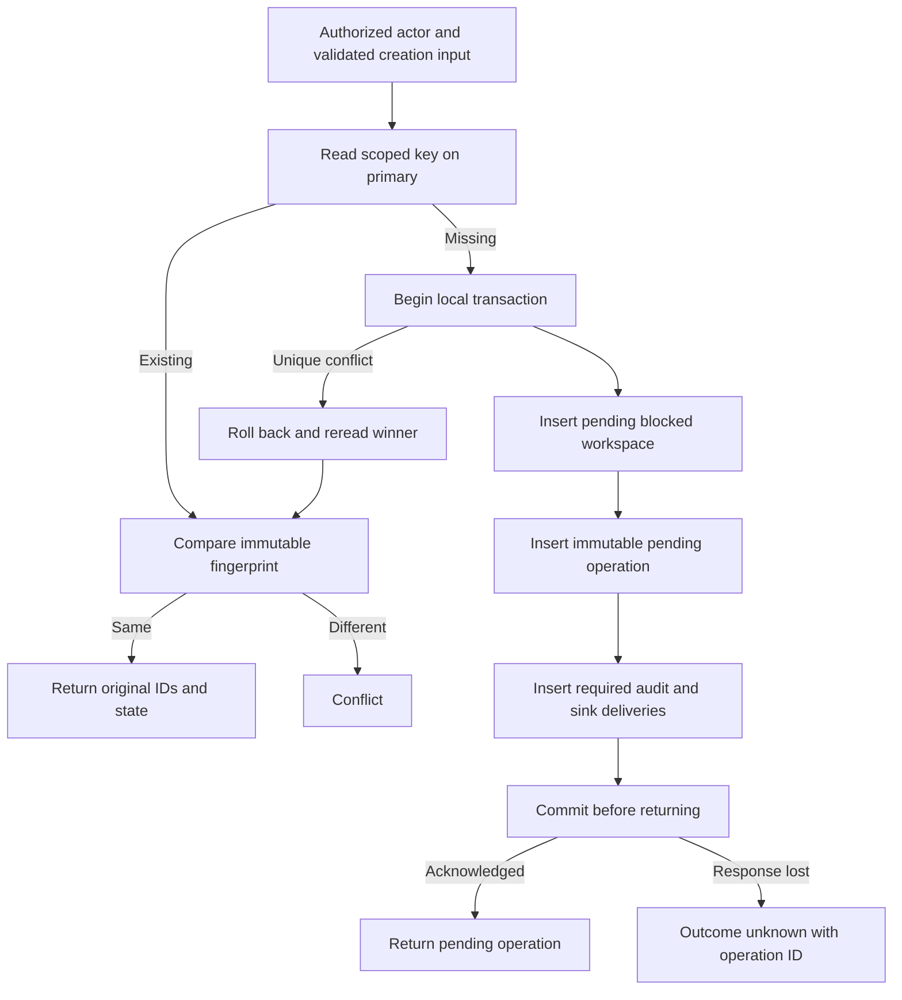

Both SDKs now implement internal primary operation lookup and idempotent local
workspace creation. The pending workspace, immutable intent, audit event and sink
deliveries commit together. This is persistence infrastructure, not a public
onboarding API or remote mutation implementation.

## Implemented behavior

Lookup is scoped to product, environment and initiating identity. It checks primary
availability even when the row is absent. Payload/index corruption, incompatible
model pins or invalid counters are unavailable, not a missing result. The same
bounded intent parser and canonical identity/fingerprint rules run in both SDKs.

Creation retains the first workspace/operation IDs and routing across retries.
Changed input conflicts. Concurrent losers roll back their attempted local writes
before reading the winner. Audit failure leaves no orphan workspace or operation.
The raw idempotency key is not stored. New workspaces remain pending and blocked;
no discovery candidate or OpenFGA relationship is created by this method.

Terminal and uncertain records remain unchanged on retry. Tests seed these states
administratively to prove preservation; transition methods are not implemented.
Lost local COMMIT acknowledgement returns outcome_unknown with an operation ID.
A retry can discover the committed record without replaying a remote mutation.
This does not establish safe recovery of an uncertain OpenFGA write.

## Evidence

Local PostgreSQL 17.11 proof run `9fee6d1244a1496ea675c36c5f5d4857` passed:

- Shared journal decoder vectors for all states, malformed bindings/counters and
  Unicode payloads, including escaped NUL identities.
- Initial pending/blocked creation with one operation, one audit event, two sink
  deliveries and no candidate; identical retry preserves all counts and IDs.
- Changed payload conflicts, actor/product isolation and model-pin refusal.
- Eight concurrent same-key requests and two competing changed-payload requests
  per SDK; concurrent TS/Go invocations converge on one committed creation.
- Audit-ID collision and outbox failure roll back all attempted managed writes.
- Both SDKs read and retry records written by the other language.
- A proxy drops a confirmed COMMIT response in each SDK: outcome_unknown is returned,
  committed rows exist, and a retry returns the original IDs without extra routing.
- Existing physical schema, migration, workspace-read and audit transaction tests.

Run `python3 tests/integration/managed-schema.py` in the configured pnpm environment.
The fixture is `contracts/fixtures/operation-journal.json`; the persistence contract
is `contracts/managed-operations.md`. Neither immutable SQL checksum changed.
Railway publication for this checkpoint deploys documentation only; these new SDK
creation tests run against disposable local PostgreSQL.

Managed transitions, candidate coordination, public authorization/onboarding and
operational foundations remain required. Phase 3 stays active under
[[phase-3-readiness-audit]].
