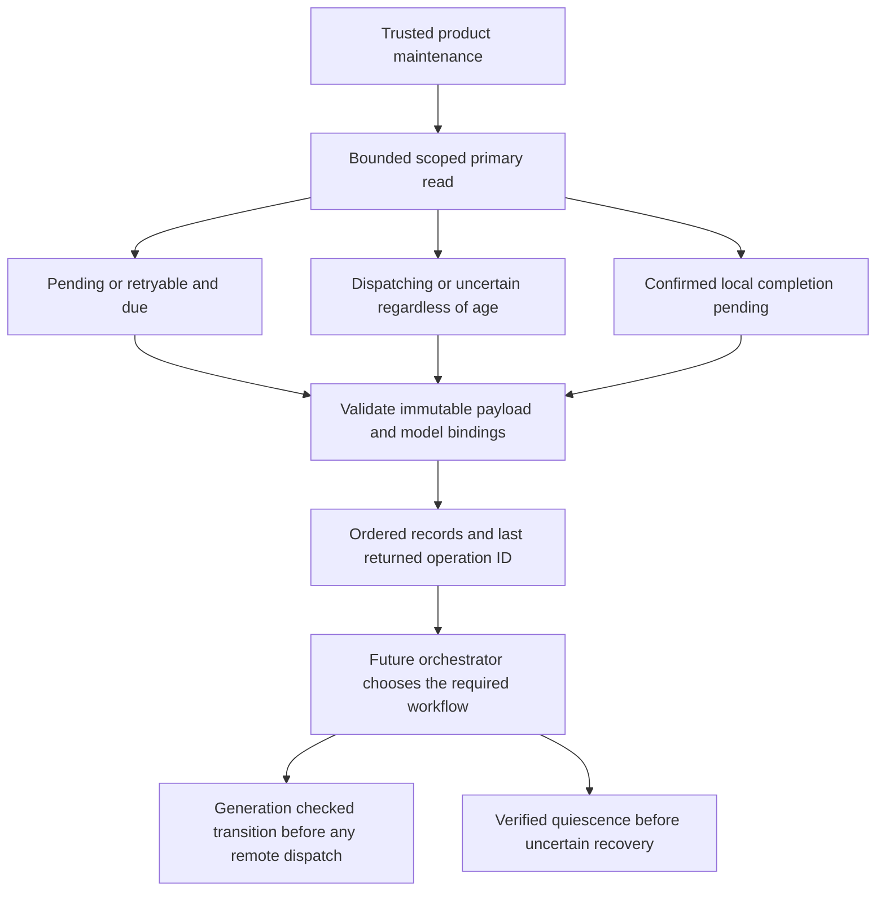

Both SDKs now expose internal primary scans for maintenance. Runnable operations,
possible in-flight or uncertain operations, and confirmed work awaiting local
completion are separate queues. Scanning does not claim, dispatch, retry, cancel
or unblock anything.

## Implemented behavior

Each query is fixed to its configured product/environment and one of three queue
classifications. It reads across initiating identities for trusted maintenance;
this is not an end-user operation-list endpoint. Every returned intent is validated
against canonical identity hashes, fingerprint, scope, model and manifest pins.

Requests accept limits 1 through 100, a safe integer time and a nullable last-ID
position. Ordering uses immutable operation IDs with C collation. The query selects
at most limit plus one rows and returns at most 4 MiB of encoded record data, plus
bounded JSON framing. A byte-limited page retains continuation after its last
returned record. Primary status is checked on empty results too. The common
five-second I/O budget and cancellation/error distinctions apply.

No record changes during selection. A worker must win the generation-checked
transition before acting. Recovery includes dispatching and uncertain records even
when their timestamps are in the future; neither time nor visibility proves safety.
Confirmed work is separate from remote dispatch. Completed and cancelled records
remain stored but never enter these queues.

This is live keyset traversal. Workers must start a new sweep to find work that
became eligible behind the cursor. It is not a scheduler checkpoint, lease, snapshot,
proof of authorization, or recovery action. Output and time limits do not bound all
database work needed to find records.

## Evidence

PostgreSQL 17.11 proof run `8ccb884ab7b449d89403f1b6244a1d34` passed the full managed
integration harness. New shared cases in `contracts/fixtures/operation-scan.json`
verify both languages against journals produced by the other SDK's transition tests:

- Due filtering, all three queue classifications and exclusion of terminal states.
- One-item keyset traversal returns exactly the same IDs as the complete short page.
- Product/environment isolation and refusal of incompatible model bindings.
- Read-only primary checks on an empty scope, caller cancellation while a table lock
  blocks the query, and successful pool reuse after releasing that lock.
- Identical state, generation and attempt snapshots before and after scans.
- Five valid one-MiB intent payloads: the byte bound returns three records with a
  continuation, then the remaining two without skipping IDs. Both SDKs read the
  same persisted large-record fixture.

Run `python3 tests/integration/managed-schema.py` in the configured pnpm environment.
The detailed contract is `contracts/managed-operations.md`. No migration checksum
changed. Railway deploys this evidence page; these new scanner tests use disposable
local PostgreSQL.

Candidate rebuild coordination, broader storage operational foundations and
orchestrated recovery remain open. Phase 3 stays active under
[[phase-3-readiness-audit]]. Nothing in this checkpoint permits replaying an uncertain
OpenFGA write or clearing a workspace block.
